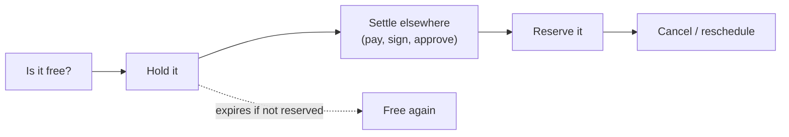
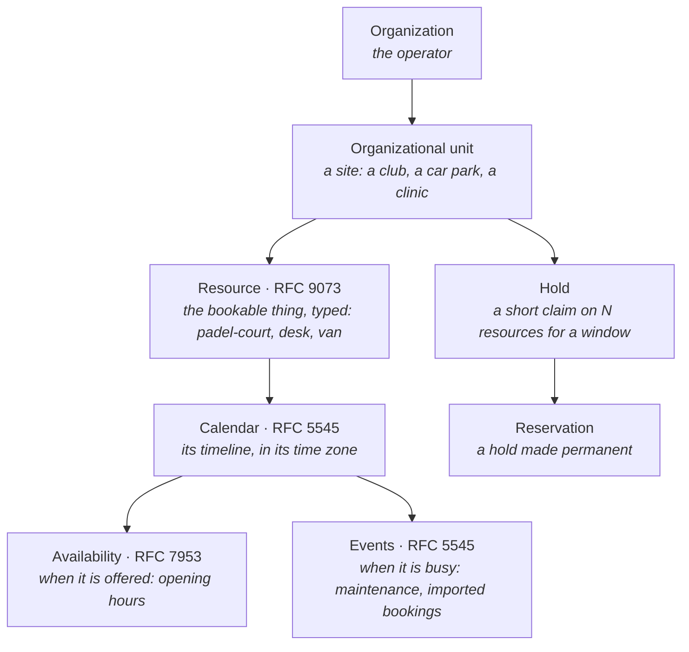
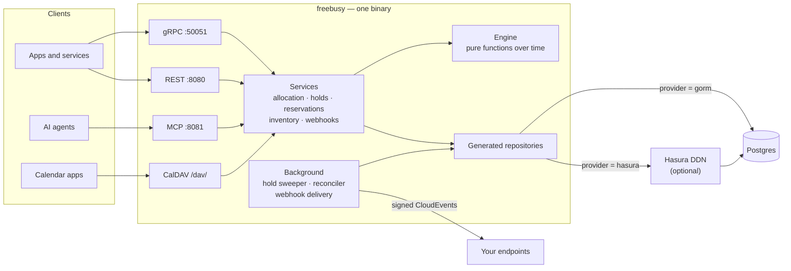
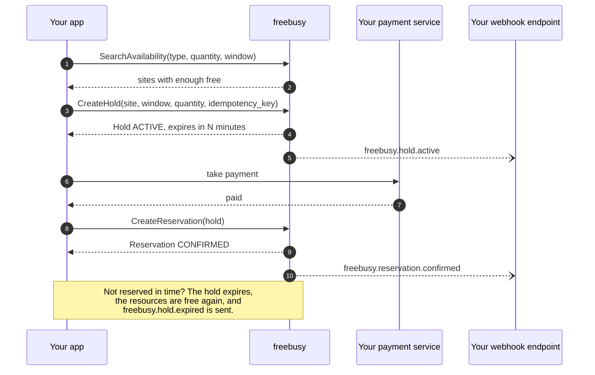
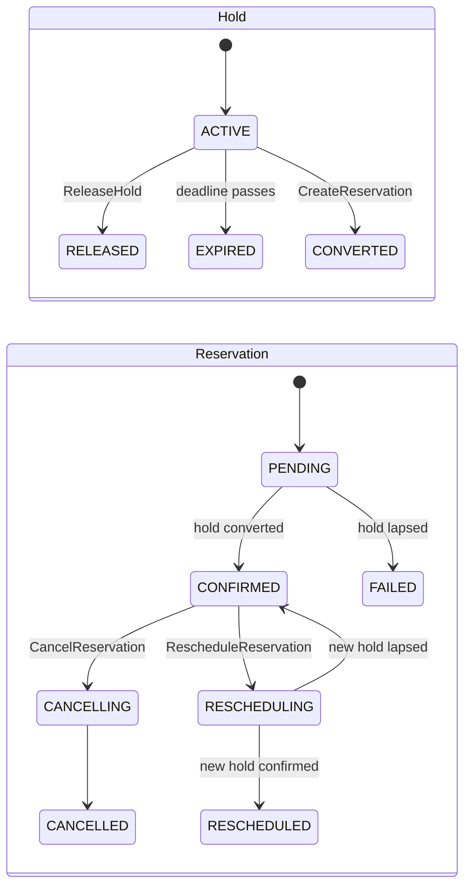
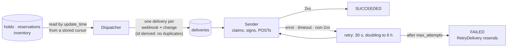
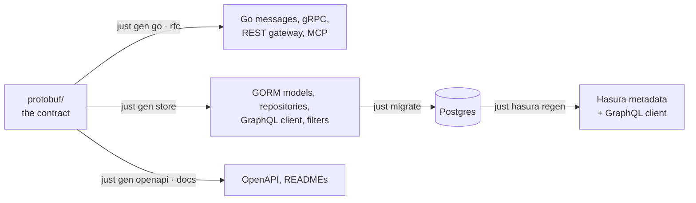

<!-- Copyright 2026 Srikanth K. -->
<!-- SPDX-License-Identifier: AGPL-3.0-or-later -->

# freebusy

**A generalized availability and booking engine.** freebusy knows what can be
booked, when it is free, and who is holding it — and nothing about why. A padel
club, a meeting-room system, a parking operator, a clinic's appointment book
and an equipment-rental desk are the same problem to it: things with
calendars, open at some times, busy at others, taken for a while and then
either kept or let go.

It is built on calendar standards rather than on any one industry's model:
bookable things are RFC 9073 resources, their timelines RFC 5545 calendars,
their opening hours RFC 7953 availability. It speaks gRPC, REST, MCP (for AI
agents) and CalDAV, stores everything in Postgres — directly or through Hasura
DDN — and makes double booking impossible at the database.



## Contents

- [What it is for](#what-it-is-for)
- [How it works](#how-it-works)
- [Running in production](#running-in-production)
- [Configuration](#configuration)
- [Using the API](#using-the-api)
- [Webhooks](#webhooks)
- [CalDAV](#caldav)
- [Developing freebusy](#developing-freebusy)
- [Testing and CI](#testing-and-ci)
- [Repository layout](#repository-layout)
- [Troubleshooting](#troubleshooting)
- [Runbooks](#runbooks)
- [Status](#status)
- [Licence](#licence)

## What it is for

Anything booked by time, in any quantity, from any number of sites:

| Use case | Resources | Booked by |
|---|---|---|
| Sports facilities | courts, pitches, lanes | slots |
| Workspaces | meeting rooms, desks, studios | slots |
| Parking | bays, chargers | slots or days |
| Rentals | vehicles, tools, equipment | days |
| Accommodation | rooms, cabins, pitches | nights |
| Appointments | practitioners, chairs, treatment rooms | slots |
| Education | classrooms, labs, instruments | slots or terms |

freebusy deliberately stops at time. Everything that makes a booking belong to
one industry lives elsewhere and refers to freebusy by name:

| Concern | Where it lives |
|---|---|
| Prices, discounts, deposits, refunds | a payment service — it refers to a reservation by name |
| Customers, guests, staff identities | a user service — a reservation names a `users/{user}` |
| Products, rate plans, channel rules | the vertical built on top |
| Anything else a booking must remember | the reservation's free-form `attributes` |

## How it works

### The model



- **Resources are booked by type and quantity, not by name.** A caller asks for
  "two padel courts at this site, 18:00–19:00"; the engine picks which two,
  preferring the ones that leave the fewest unusable gaps.
- **Free time** is what a resource's availability offers, less its calendar's
  events and less what live holds and reservations claim. Recurring events
  expand with their RRULE, EXDATE and RDATE; an edited single occurrence
  (RECURRENCE-ID) replaces the instance it names; every time is read in its own
  zone, so a weekly 10:00 stays at 10:00 across daylight-saving changes.
  Rules may use FREQ DAILY to YEARLY with INTERVAL, COUNT, UNTIL, BYDAY
  (numbered, "the second Tuesday", under MONTHLY and YEARLY), BYMONTHDAY,
  BYMONTH, BYHOUR, BYMINUTE, BYSETPOS ("the last weekday of the month") and
  WKST. A rule using anything else — BYSECOND, BYYEARDAY, BYWEEKNO, RSCALE, or
  a frequency finer than daily — is refused with UNSUPPORTED_RECURRENCE, and a
  stored event with one counts as busy from its start rather than free.
- **Booking rules** — minimum and maximum length, how far ahead, how late —
  come from each resource's RFC 9073 `STRUCTURED-DATA`. freebusy never needs to
  know what a "night" or a "session" means to you.
- **Nothing is served outside a live organization.** Every site names its
  organization, every resource its site, and a call naming a site or an
  organization that does not exist — or is soft-deleted — is answered
  `NOT_FOUND` on every surface (gRPC, REST, MCP). Deleting an organization
  that still has sites, or a site that still has resources, is refused.
- **Deletes are soft, then final.** A deleted organization, site, resource,
  calendar, event or availability stays restorable with `Undelete` for
  `[retention] deleted_days` (30 by default), and its `expire_time` says until
  when; after that it is purged for good, children before parents.
- **No double booking, ever.** A Postgres exclusion constraint refuses two
  overlapping claims on one resource, however many servers race for it.

### The pieces



- **One process, four surfaces.** The same service code answers gRPC, the REST
  gateway, MCP tool calls and CalDAV, with the same validation everywhere.
- **The engine is pure.** Availability is computed by functions over plain
  values — no database, no clock of its own — so what `CheckAvailability`
  answers is exactly what `CreateHold` enforces.
- **Every database call is generated** from the protobuf contract (GORM models,
  GraphQL client, repositories, filters). Hand-written code is business logic.
- **Two interchangeable backends.** Postgres directly (GORM) or through Hasura
  DDN; every test runs on both.

### A booking, end to end



### Lifecycles



`PENDING`, `CANCELLING` and `RESCHEDULING` are written *before* the work they
describe, so a crash never leaves the books wrong: a background reconciler
finds any reservation stuck in one and finishes it.

## Running in production

The production artifact is a container image holding **one file**: a
statically linked `/freebusy` binary, built for `linux/amd64` and
`linux/arm64`. No base image, no shell, no libc, no configuration files — the
binary carries its configuration, the time-zone database and root
certificates, and is configured by environment variables. It runs as an
unprivileged user on a read-only filesystem.

### 1. Build the image

```sh
bazel build //image                         # the two-platform image index
bazel run //image:push -- --tag 1.0.0       # to ghcr.io/shokki-engineering/freebusy
bazel run //image:load                      # or into the local Docker as freebusy:latest
bazel run //image:push_migrations -- --tag 1.0.0   # the migrations image beside it
```

A version tag does all of this in CI (`.github/workflows/release.yml`); see
`CHANGELOG.md` for how to cut one.

### 2. Prepare Postgres

Postgres 18 with a database for freebusy. Its schema comes from the versioned
migrations in `migrations/`, applied with [atlas](https://atlasgo.io) (the
community build is enough) from a checkout of this repository, pointed at your
database with the same environment variables the server uses:

```sh
FREEBUSY_PROFILE=release \
FREEBUSY_DATABASE__POSTGRES__HOST=db.internal \
FREEBUSY_DATABASE__POSTGRES__USER=freebusy \
FREEBUSY_DATABASE__POSTGRES__PASSWORD=… \
FREEBUSY_DATABASE__POSTGRES__DBNAME=freebusydb \
just db apply
```

`FREEBUSY_PROFILE=release` keeps a checkout's development profile out of it,
so only the release defaults and your variables apply. Run it before each
upgrade; it applies only what the database has not seen. The migrations need
the `btree_gist` and `pg_trgm` extensions, so the user needs the right to
create them, or create them once beforehand.

**A database built before migrations existed** (by `go run
./tools/db/gorm/migrate`) has to be reconciled once. AutoMigrate never drops
anything, so it may hold indexes and columns the models have since let go of.
Compare it with what the migrations build, review the SQL, and apply it:

```sh
atlas schema diff --from "$DATABASE_URL" --to "file://migrations" \
  --dev-url "postgres://…/scratch?sslmode=disable" > reconcile.sql
psql "$DATABASE_URL" -f reconcile.sql
just db apply --baseline <latest version in migrations/>
```

### 3. Run the server

```sh
docker run -d --name freebusy --read-only \
  -p 50051:50051 -p 8080:8080 -p 8081:8081 \
  -e FREEBUSY_DATABASE__POSTGRES__HOST=db.internal \
  -e FREEBUSY_DATABASE__POSTGRES__USER=freebusy \
  -e FREEBUSY_DATABASE__POSTGRES__PASSWORD=… \
  -e FREEBUSY_DATABASE__POSTGRES__DBNAME=freebusydb \
  ghcr.io/shokki-engineering/freebusy:1.0.0
```

### Or: the Compose stack

`deploy/compose` runs freebusy on one host: the server, Postgres, the
migrations (applied before the server starts, on every `up`), and a
`pg_dump` every day into `./backups`. Profiles add the rest:

```sh
cd deploy/compose
cp .env.example .env                      # set every CHANGE_ME
docker compose up -d                      # Postgres backend
docker compose --profile observability up -d   # + Grafana, Prometheus, alerts on :6009
docker compose --profile cache up -d      # + Redis, with FREEBUSY_CACHE_ENABLED=true
docker compose --profile hasura up -d     # + the Hasura engine and connector
```

Postgres is the production backend. Hasura is optional: the `hasura` profile
with `FREEBUSY_DATABASE_PROVIDER=hasura`. Ports are published on `127.0.0.1`
only; put a TLS-terminating proxy in front.

### Or: Kubernetes

`deploy/helm/freebusy` is the chart; Postgres (and Redis) are yours. Each pod
applies pending migrations in an init container before it starts, and atlas's
lock makes replicas apply them once.

```sh
helm install freebusy oci://ghcr.io/shokki-engineering/charts/freebusy --version 1.0.0 \
  --set database.postgres.host=db.internal \
  --set secrets.existingSecret=freebusy      # postgres-password, webhook-secret-key, ...
```

`values.yaml` documents every setting. For `database.provider: hasura` with
`hasura.enabled`, build an engine image for the release first: the engine's
metadata names its connector's URL, and the committed build names
`local.hasura.dev`, which suits only Compose.

### 4. Check it

```sh
curl http://localhost:8080/health
grpc_health_probe -addr=localhost:50051     # the standard gRPC health service
```

### Production checklist

- **Ports**: 50051 gRPC, 8080 HTTP (REST and `/health`), 8081 MCP. Several
  replicas may run at once; everything they share is in Postgres.
- **TLS**: the release defaults serve plain gRPC and HTTP — terminate TLS at
  your load balancer, or mount a certificate and set
  `FREEBUSY_SERVER__TLS__CERT_FILE` and `FREEBUSY_SERVER__TLS__KEY_FILE`.
- **Database TLS**: `sslmode` defaults to `require`.
- **Telemetry**: set `FREEBUSY_OTLP_ENDPOINT` (`host:port`, OTLP gRPC) to
  export traces, metrics and logs, and `FREEBUSY_OTLP_SECURE=true` when the
  collector serves TLS; `FREEBUSY_SITE` and `FREEBUSY_SITE_NAME` label them.
  `deploy/observability` holds the alert rules and Prometheus configuration;
  the dashboard is `.grafana/dashboard_service.json`.
- **Backups**: the Compose stack writes one a day; elsewhere, schedule
  `pg_dump --format=custom` and keep copies off the host. Restoring is in the
  [runbooks](#runbooks).
- **Shutdown**: on SIGTERM freebusy stops accepting calls and finishes the ones
  in flight; give it 30 seconds. Background work (webhook sends, the
  reconciler) stops at once and resumes on another replica or the next start.
- **Webhooks** send only to `https` endpoints on public addresses unless you
  allow otherwise.
- **Authentication is not built yet.** Keep freebusy on a private network,
  reachable only by your own services, until it is (see [Status](#status)).
- **CalDAV** is off by default in production for the same reason.

## Configuration

Every configuration file is compiled into the binary. Settings are layered,
later layers winning:


Any key can be set from the environment as `FREEBUSY_<SECTION>__<KEY>`, with
**double underscores** between levels:

```sh
FREEBUSY_DATABASE__PROVIDER=hasura
FREEBUSY_DATABASE__POSTGRES__HOST=db.internal
FREEBUSY_SERVER__HTTP__PORT=8443
FREEBUSY_WEBHOOKS__MAX_ATTEMPTS=12
```

(Always the double-underscore form: a variable without one reads every
underscore as a level, so `FREEBUSY_SERVER_ENABLE_HTTP` would mean
`server.enable.http`.)

| Section | Settings |
|---|---|
| `[server]` | `environment`, `enable_http`, `enable_mcp`, `enable_health` |
| `[server.grpc]`, `[server.http]`, `[server.mcp]` | `host`, `port`; MCP's `transport` |
| `[server.tls]` | `cert_file`, `key_file` — when set, gRPC and HTTP both serve TLS |
| `[database]` | `provider`: `gorm` or `hasura` |
| `[database.postgres]` | `host`, `port`, `user`, `password`, `dbname`, `sslmode`, pool sizes |
| `[database.hasura]` | `url` of the engine's GraphQL endpoint |
| `[caldav]` | `enabled` |
| `[webhooks]` | `enabled`, `allow_insecure_endpoints`, `allow_private_networks`, `interval_seconds`, `max_attempts`, `retention_days`, `secret_key`, `previous_secret_keys` |
| `[retention]` | `purge`, `deleted_days` — how long soft-deleted records stay restorable |

Release defaults versus the development profile:

| Setting | Release | Development |
|---|---|---|
| `server.environment` | production (no gRPC reflection) | debug |
| `server.enable_http` | true | false |
| `server.tls` | none | a local mkcert pair in `.certs/` |
| `database.postgres` | `127.0.0.1`, `sslmode=require`, no password | the local Docker Postgres |
| `caldav.enabled` | false | true |
| `webhooks.allow_insecure_endpoints` | false | true |
| `webhooks.allow_private_networks` | false | true |

## Using the API

New to it? [docs/getting-started.md](docs/getting-started.md) goes from an
empty server to a confirmed booking with `curl`, step by step.

| Service | What it does |
|---|---|
| `AllocationService` | `ComputeAvailability`, `CheckAvailability`, `BatchComputeAvailability`, `SearchAvailability` |
| `HoldService` | `CreateHold`, `GetHold`, `ListHolds`, `ExtendHold`, `ReleaseHold`, `DeleteHold` |
| `ReservationService` | `CreateReservation`, `GetReservation`, `ListReservations`, `CancelReservation`, `RescheduleReservation` |
| `Organizations`, `OrganizationalUnits` | the tenants and their sites (RFC 4519): create, get, list, update, and soft delete with `Undelete` (AIP-164) |
| `WebhookService` | webhooks (create, update, pause, resume, rotate secret, delete) and their deliveries (list, get, retry) |
| `Resources`, `Calendars`, `Availabilities`, `Events` | the inventory, plus `QueryFreeBusy` and `ExpandEvent` |

The contract is in `protobuf/` (and published to the Buf Schema Registry as
`buf.build/shokki-engineering/freebusy`); REST paths and JSON follow it by
gRPC transcoding, documented in `protobuf/generated/openapi/openapiv3-spec.yaml` (one OpenAPI 3
file, every REST path, `just gen openapi`). MCP serves each
service at its own path on one port, e.g.
`/freebusy/allocation/v1/allocationservice/mcp`.

**Setting up.** Create an organization, then a site (an organizational unit)
naming it. Nothing can be published or booked before both exist.

**Publishing inventory.** Create a calendar (with its time zone), a resource
on it (`resource_types`, `organizational_unit`, and its booking rules in
`structured_data`), availability for its opening hours, and events for
closures. All of it can also be written by any calendar app over CalDAV.

**Booking.**

1. **Ask** — `SearchAvailability` across sites, `ComputeAvailability` for one
   site's slots or days, `CheckAvailability` for one exact window (with the
   reasons when the answer is no).
2. **Hold** — `CreateHold` with a window, a quantity and an
   `idempotency_key`. `ExtendHold` and `ReleaseHold` change it.
3. **Settle** — payment, forms, approvals: in your services.
4. **Reserve** — `CreateReservation` from the hold. Safe to retry: a hold
   backs at most one reservation.
5. **Change** — `CancelReservation` frees the resources;
   `RescheduleReservation` moves the booking onto a new hold you took first,
   so the new time is secured before the old one is let go.

Errors follow AIP-193: `INVALID_ARGUMENT` for a bad request,
`FAILED_PRECONDITION` for a state that forbids the call, `ABORTED` for a stale
`etag`, and every one carries a stable `reason` to branch on.
[docs/errors.md](docs/errors.md) lists them all, with what to do about each.

## Webhooks

A webhook subscribes an HTTPS endpoint to changes in holds, reservations and
inventory; each change arrives as a signed [CloudEvent](https://cloudevents.io).

| Record | Event types `freebusy.<record>.<…>` |
|---|---|
| hold | `active`, `released`, `expired`, `converted` |
| reservation | `pending`, `confirmed`, `cancelling`, `cancelled`, `failed`, `rescheduling`, `rescheduled` |
| resource, calendar, event, availability | `created`, `updated`, `deleted` |

A webhook may limit itself to some types and to one site.



- **Nothing is lost.** Changes are read from the records themselves, so a
  crash between a write and its announcement cannot drop one. Two quick
  changes to one record may arrive as one event with the later state; every
  event carries the whole record.
- **Signed** per [Standard Webhooks](https://www.standardwebhooks.com):
  `webhook-id`, `webhook-timestamp`, and `webhook-signature: v1,<base64
  HMAC-SHA256 of "id.timestamp.body">` with the `whsec_…` secret
  `CreateWebhook` returns. Any Standard Webhooks library verifies it. After
  `RotateWebhookSecret` the old secret signs too, for 24 hours. Secrets are
  stored sealed (AES-256-GCM) under `[webhooks] secret_key`; set it with
  `FREEBUSY_WEBHOOKS__SECRET_KEY=$(openssl rand -base64 32)`, and when you
  replace it, move the old key to `previous_secret_keys` until every webhook
  has rotated.
- **Safe by default**: `https` only, no redirects followed, and no
  connections to loopback, private, link-local or CGNAT addresses — checked
  on the address DNS returned — unless `allow_private_networks` is set.
- Finished deliveries are pruned after `retention_days`.

## CalDAV

With `[caldav] enabled = true`, a CalDAV server (RFC 4791) is mounted on the
HTTP port under `/dav/`, with discovery at `/.well-known/caldav`. Apple
Calendar, Thunderbird and DAVx⁵ can add it as an account; calendars, events —
edited single occurrences included — and availability read and write through
the same code as the API, and `free-busy-query` is answered by the engine.
It has no authentication yet, so it is a development surface.

## Developing freebusy

### Tools

| Tool | Version | For |
|---|---|---|
| Go | 1.26.5 (`go.mod`) | building and testing |
| Docker | recent | Postgres, the Hasura engine |
| [just](https://just.systems) | 1.40+ | every task below |
| [buf](https://buf.build) | 1.74+ | code generation, `buf lint` |
| Bazelisk | reads `.bazelversion` (Bazel 9) | the Bazel build and the image |
| mkcert | any | the development TLS certificate |
| Hasura DDN CLI (`ddn`) | v3.9.4 | the Hasura backend (needs `ddn auth login`) |
| api-linter | 2.3.1 | AIP lint |

Code generation also needs The Protobuf Project's plugins, ahead of anything
older on `PATH`:

```sh
brew tap the-protobuf-project/homebrew-tap
brew install --cask protoc-gen-store protoc-gen-mcp protoc-gen-cache protoc-gen-openapi-solo gnostic
```

### First run

```sh
docker compose -f docker/postgres/docker-compose.yaml up -d   # Postgres 18 with freebusydb
just migrate                                                   # the schema
mkcert -install && mkdir -p .certs \
  && (cd .certs && mkcert freebusy-dev localhost 127.0.0.1)    # the dev certificate
just run                                                       # the server, dev profile
```

The dev profile serves gRPC with TLS (`grpcurl -insecure localhost:50051 list`,
reflection on). Set `enable_http = true` in `config/freebusy.dev.toml` for
REST on `https://localhost:8080`; edits there apply on the next `just run`.

### The Hasura backend

```sh
cd hasura
cp .env.example .env
docker compose -f compose.yaml --env-file .env up -d --build   # engine on :3280, connector on :9794
```

No Hasura account is needed to run it: the engine serves the committed build
in `hasura/engine/build`, and `hasura/.env.example` holds the connector
settings that build was made with (its token is a local-only value, not a
secret). Then `FREEBUSY_DATABASE__PROVIDER=hasura just run`.

Changing the schema is the one step that needs a DDN login (`ddn auth login`):
`just hasura regen` rebuilds the metadata and `engine/build` through Hasura's
build service. Commit both.

### Code generation



After a contract change: `just gen go`, `just gen rfc`, `just gen store`,
`just migrate`, `just db diff <name>` (the production migration, generated),
`just hasura regen`. Rules (also in `CLAUDE.md`):

- Never edit generated code or Hasura metadata (`hasura/**/*.hml`) by hand.
  When the generated layer cannot express something, extend the generator.
- No Go import aliases; when two packages share a name, split the file.
- api-linter must pass; only `core::0215::foreign-type-reference` may be
  disabled.

### Bazel

`go build` and Bazel build the same thing; Bazel adds reproducible
cross-compilation and the image. Gazelle writes every `BUILD.bazel` from the Go
sources — run `just gazelle` after adding or moving packages or imports (and
`bazel mod tidy` first after a `go.mod` change).

```sh
just bazel-check         # bazel build //... && bazel test //...
just image               # the image for this machine, into Docker
just image-run           # and run it against the local Postgres
```

## Testing and CI

```sh
just test         # unit tests, race detector; the live suites skip
just test-live    # everything, on both backends — needs Postgres, Hasura and Redis running
just lint         # gofmt, go mod verify, vet, staticcheck, buf lint
just check        # build + lint + test
just bazel-check  # the same through Bazel
```

The live suites read `FREEBUSY_TEST_POSTGRES_DSN`, `FREEBUSY_TEST_DATABASE_URL`,
`FREEBUSY_TEST_GRAPHQL_URL` and `FREEBUSY_TEST_REDIS_ADDR`; `just test-live` sets them, adds
`FREEBUSY_TEST_REQUIRE_LIVE=1` (an unset one fails instead of skipping) and runs
one package at a time, since the suites share the database. One suite builds
the real binary, starts it, and drives it as a client would — REST, MCP, and
webhooks delivered by its own background loop.

CI (`.github/workflows`) runs independent jobs — lint, protobuf build and
breaking changes, build, unit tests, Bazel (BUILD files current, build, test,
image), and the live suites against Postgres and the Hasura engine — plus
strict AIP lint. Dependabot's weekly updates merge themselves when every
check passes. The repository needs:

- branch protection on `main` requiring every job — without it, auto-merge
  merges at once, and Dependabot has already merged two red pull requests
  that way.

The Hasura job needs no secret: it serves the committed engine build.

## Repository layout

```
config/                 configuration: release defaults + dev profile, both embedded
docs/                   getting started, the error contract
deploy/
  compose/              the single-host stack
  helm/freebusy/        the Helm chart
  observability/        alert rules, Prometheus and Alertmanager configuration
docker/                 local Postgres; the grpc-web Envoy proxy
hasura/                 Hasura DDN project: metadata, connector, engine
image/                  the container image (Bazel, rules_oci)
internal/
  caldav/               the CalDAV server
  database/             the connection, and the generated GORM / GraphQL / repository layers
  e2e/                  end-to-end suites, the binary suite among them
  livetest/             the live-suite gate
  service/
    allocation/         availability and holds; engine/ is the pure arithmetic
    reservation/        reservations and the reconciler
    rfcsvc/             the inventory services, ExpandEvent, QueryFreeBusy
    webhooksvc/         webhooks: API, dispatcher, sender
protobuf/
  freebusy/             the contract: allocation, reservation, shared, webhook
  generated/            generated code — never edited
tools/                  just recipes, buf templates, generator helpers
```

## Troubleshooting

| Symptom | Cause |
|---|---|
| `curl http://localhost:8080` answers 400 in development | the dev profile serves HTTPS: use `https://` |
| An MCP client finds no service on port 8082+ | every MCP service shares one port; each has its own path |
| Live tests fail intermittently — deliveries already sent, reservations already reconciled | another freebusy server is running against the same database; its background loops act on the tests' rows |
| `ddn supergraph build local`: "Not logged in" | `ddn auth login`; only `just hasura regen` needs it — running the committed build does not |
| `go build` fails on a clean machine fetching a module | a dependency is private or missing from the public Go proxy; every dependency must be fetchable by anyone |
| `bazel run //:gazelle`: "unknown repo" | run `bazel mod tidy` first |
| A dependency's own BUILD files break Bazel | add it to the `gazelle_override(build_file_generation = "clean")` list in `MODULE.bazel` |
| The server prints "failed to start server" and exits 1 | a port is taken, or the configuration is invalid |

## Runbooks

Each alert in `deploy/observability/alerts.yaml` names its section here.

**Server errors** (`FreebusyServerErrors`). More than 5% of calls end Internal,
Unknown, Unavailable or DeadlineExceeded. Open the service dashboard's *Error
Rate by Service*, then *Error & Warning Logs* and *Recent Traces*: a failed
call's trace shows which statement or call failed, and the error a caller
received ends with its trace ID. The usual causes are the database (below)
or, on Hasura, the engine (below).

**Slow calls** (`FreebusySlowCalls`, `FreebusySlowHolds`). Check *Pool Wait
Events* first: waits mean the pool is the bottleneck (next section). Otherwise
*Slow Traces* shows where the time goes. Holds racing for one resource wait on
each other; a long CreateHold tail under contention is a known limit until
generated inserts take an advisory lock.

**Pool saturated** (`FreebusyPoolSaturated`). Callers are queueing for a
Postgres connection. Raise `max_open_conns` (`FREEBUSY_DATABASE__POSTGRES__MAX_OPEN_CONNS`)
if Postgres has headroom, or add replicas; if Postgres itself is busy, find the
slow statements in *GORM Query Duration*.

**Webhook endpoint stuck** (`FreebusyWebhooksFailing`). Deliveries gave up after
`max_attempts`. `ListDeliveries` with `filter: state = FAILED` shows each one's
`response_code` and `error_message`. Once the receiver is fixed,
`RetryDelivery` sends each failed one again. A webhook whose receiver will be
down for long can be paused (`PauseWebhook`): its deliveries wait instead of
using up their attempts, and `ResumeWebhook` lets them go.

**Hold sweeper backlog** (`FreebusyHoldsUnswept`). Every sweep in 10 minutes
failed, so lapsed holds still read ACTIVE in list views. Availability is not
affected: reads treat a lapsed hold as expired whatever its stored state. The
error is in the logs as "allocation hold sweeper failed"; it is almost always
the database.

**No replica reporting** (`FreebusyAbsent`). No telemetry for 5 minutes: every
replica is down, or none can reach the collector. `docker compose ps` or
`kubectl get pods`; then the server's own output, which goes to stdout too.

**Redis down.** The list cache falls through to the database: calls succeed,
only list latency rises. The dashboard's *List Cache Hit Rate* drops to zero
while gets keep flowing. Nothing to do but bring Redis back; pages written
before the outage expire on their own within a minute.

**Hasura engine down** (provider `hasura`). Every call fails Unavailable or
Internal. Restart the engine and connector (`docker compose --profile hasura
restart engine connector`); if the database is fine, switching
`FREEBUSY_DATABASE__PROVIDER` to `gorm` serves the same data directly.

**Restore a backup.** Stop the server, restore over the database, start it:

```sh
docker compose stop freebusy
docker compose exec -T postgres pg_restore -U postgres -d freebusydb \
  --clean --if-exists --no-owner < backups/freebusydb-<time>.dump
docker compose start freebusy
```

The dump carries atlas's revision table, so the next `migrate` applies only
what came after the backup. Test a restore now and then: restore into a
scratch database (`createdb`, then `pg_restore -d` it) and compare row counts.

## Status

Ready to build on. Not built yet:

- **Authentication and authorization** on every surface (planned: OIDC,
  e.g. Keycloak). Until then, private networks only.
- **Hasura event windowing**: on Hasura, event reads fetch a calendar's whole
  history and filter in code; Postgres narrows them in SQL.
- **"This and future" edits** to a recurring series (RANGE=THISANDFUTURE) are
  refused; calendar apps split the series instead.
- **Atomic CalDAV writes** of a series together with its edited occurrences.

## Licence

Copyright © 2026 Srikanth K. All rights reserved, except as granted by the
licences below.

Dual-licensed.

- **[AGPL-3.0-or-later](./LICENSE)** — free for open-source work, forever.
- **[Commercial](./LICENSE-COMMERCIAL.md)** — for proprietary or closed-source
  products, and for offering freebusy as a network service without publishing
  your source.

The `.proto` contract and the code generated from it (everything under
[`protobuf/`](./protobuf), and the module on the Buf Schema Registry) are
**[Apache-2.0](./protobuf/LICENSE)**, so a proprietary application that merely
*talks to* a freebusy server needs no commercial licence. The line is drawn at
building on, or modifying, the server itself.

Contributions are accepted under the [Contributor Licence Agreement](./CLA.md):
sign off every commit (`git commit -s`).

---

© 2026 Srikanth K. All rights reserved.
