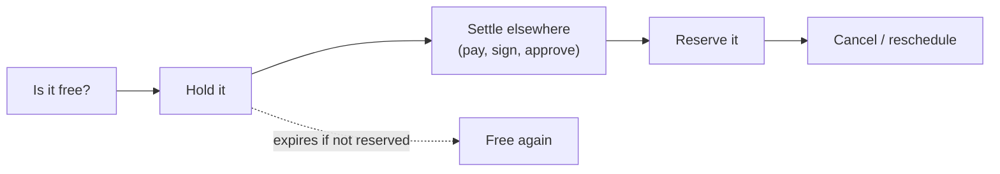
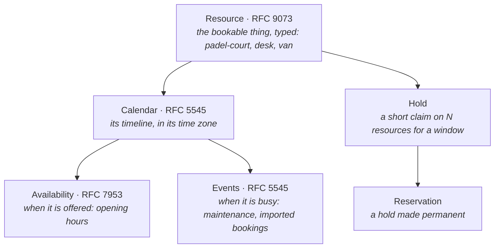
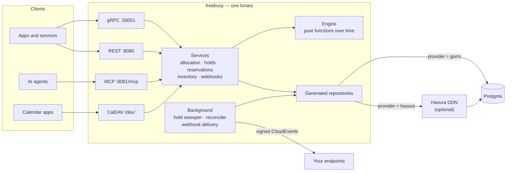
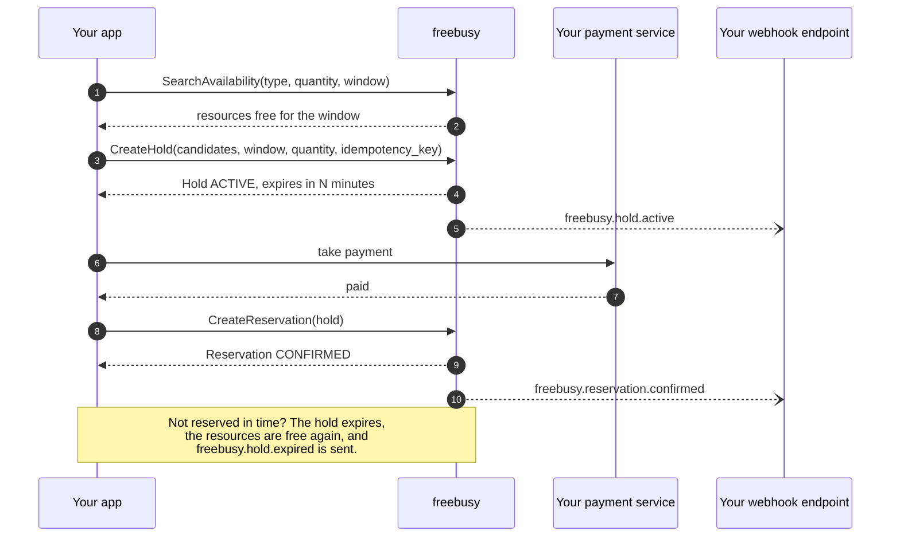
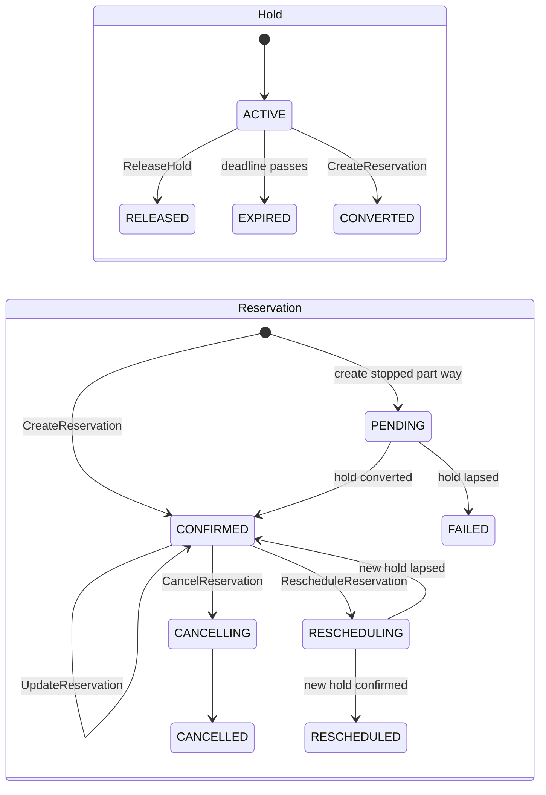
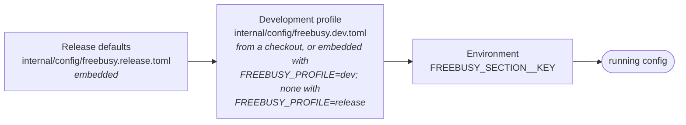
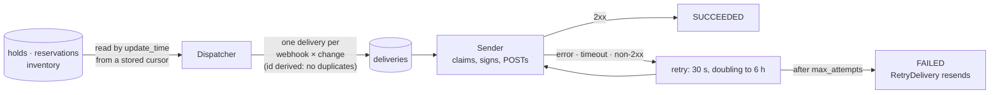
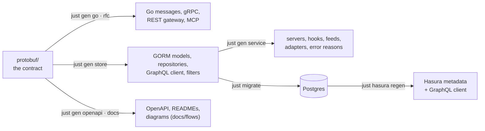

<!-- Copyright 2026 Srikanth K. -->
<!-- SPDX-License-Identifier: AGPL-3.0-or-later -->

# freebusy

**A generalized availability and booking engine.** freebusy knows what can be
booked, when it is free, and who is holding it — and nothing about why. A padel
club, a meeting-room system, a parking operator, a clinic's appointment book
and an equipment-rental desk are the same problem to it: things with
calendars, open at some times, busy at others, taken for a while and then
either kept or let go.

It is built on calendar standards rather than on any one industry's model:
bookable things are RFC 9073 resources, their timelines RFC 5545 calendars,
their opening hours RFC 7953 availability. It speaks gRPC, REST, MCP (for AI
agents) and CalDAV, stores everything in Postgres — directly or through Hasura
DDN — and makes double booking impossible at the database.



## Contents

- [What it is for](#what-it-is-for)
- [How it works](#how-it-works)
- [Running in production](#running-in-production)
- [Configuration](#configuration)
- [Using the API](#using-the-api)
- [Calling freebusy from a browser](#calling-freebusy-from-a-browser)
- [Search](#search)
- [Performance](#performance)
- [Webhooks](#webhooks)
- [CalDAV](#caldav)
- [Developing freebusy](#developing-freebusy)
- [Testing and CI](#testing-and-ci)
- [Repository layout](#repository-layout)
- [Troubleshooting](#troubleshooting)
- [Runbooks](#runbooks)
- [Status](#status)
- [Licence](#licence)

## What it is for

Anything booked by time, in any quantity:

| Use case | Resources | Booked by |
|---|---|---|
| Sports facilities | courts, pitches, lanes | slots |
| Workspaces | meeting rooms, desks, studios | slots |
| Parking | bays, chargers | slots or days |
| Rentals | vehicles, tools, equipment | days |
| Accommodation | rooms, cabins, pitches | nights |
| Appointments | practitioners, chairs, treatment rooms | slots |
| Education | classrooms, labs, instruments | slots or terms |

freebusy deliberately stops at time. Everything that makes a booking belong to
one industry lives elsewhere and refers to freebusy by name:

| Concern | Where it lives |
|---|---|
| Prices, discounts, deposits, refunds | a payment service — it refers to a reservation by name |
| Customers, guests, staff identities | a user service — a reservation names a `users/{user}` |
| Products, rate plans, channel rules | the vertical built on top |
| Anything else a booking must remember | the reservation's free-form `attributes` |

## How it works

### The model



- **One pool, no tenants.** Every resource is in one pool; a request names the
  resources it means -- by name, by type, or with a filter over their
  attributes. Grouping them into venues, properties or tenants belongs to
  whatever is built on top.
- **Resources are booked by type and quantity, not by name.** A caller asks for
  "two of these padel courts, 18:00–19:00"; the engine picks which two,
  preferring the ones that leave the fewest unusable gaps.
- **Free time** is what a resource's availability offers, less its calendar's
  events and less what live holds and reservations claim. Recurring events
  expand with their RRULE, EXDATE and RDATE; an edited single occurrence
  (RECURRENCE-ID) replaces the instance it names, and a "this and future"
  edit (RANGE=THISANDFUTURE over CalDAV, `original_start_range` over the API)
  splits the series there: the original ends before that instance and the
  rest, shifted as the edit is, becomes a series of its own (UID
  `<uid>_R<instance in UTC>`); every time is read in its own
  zone, so a weekly 10:00 stays at 10:00 across daylight-saving changes.
  Rules may use FREQ DAILY to YEARLY with INTERVAL, COUNT, UNTIL, BYDAY
  (numbered, "the second Tuesday", under MONTHLY and YEARLY), BYMONTHDAY,
  BYMONTH, BYHOUR, BYMINUTE, BYSETPOS ("the last weekday of the month") and
  WKST. A rule using anything else — BYSECOND, BYYEARDAY, BYWEEKNO, RSCALE, or
  a frequency finer than daily — is refused with UNSUPPORTED_RECURRENCE, and a
  stored event with one counts as busy from its start rather than free.
- **Booking rules** — minimum and maximum length, how far ahead, how late —
  come from each resource's RFC 9073 `STRUCTURED-DATA`. freebusy never needs to
  know what a "night" or a "session" means to you.
- **Deletes are soft, then final.** A deleted resource, calendar, event or
  availability stays restorable with `Undelete` for
  `[retention] deleted_days` (30 by default), and its `expire_time` says until
  when; after that it is purged for good, children before parents.
- **No double booking, ever.** A Postgres exclusion constraint refuses two
  overlapping claims on one resource, however many servers race for it.

### The pieces



- **One process, four surfaces.** The same service code answers gRPC, the REST
  gateway, MCP tool calls and CalDAV, with the same validation everywhere.
- **The engine is pure.** Availability is computed by functions over plain
  values — no database, no clock of its own — so what `CheckAvailability`
  answers is exactly what `CreateHold` enforces.
- **Every database call is generated** from the protobuf contract (GORM models,
  GraphQL client, repositories, filters). Hand-written code is business logic.
- **Two interchangeable backends.** Postgres directly (GORM) or through Hasura
  DDN; every test runs on both.

### A booking, end to end



### Lifecycles



`CreateReservation` answers `CONFIRMED`: it converts the hold and confirms in
one call, with no separate confirm step. `PENDING`, `CANCELLING` and
`RESCHEDULING` are written *before* the work they describe, so a crash never
leaves the books wrong: a background reconciler finds any reservation stuck in
one and finishes it. A caller sees `PENDING` only when a create stopped part
way.

## Running in production

The production artifact is a container image holding **one file**: a
statically linked `/freebusy` binary, built for `linux/amd64` and
`linux/arm64`. No base image, no shell, no libc, no configuration files — the
binary carries its configuration, the time-zone database and root
certificates, and is configured by environment variables. It runs as an
unprivileged user on a read-only filesystem.

### 1. Build the image

```sh
bazel build //deploy/image                         # the two-platform image index
bazel run //deploy/image:push -- --tag 1.0.0       # to ghcr.io/shokki-engineering/freebusy
bazel run //deploy/image:load                      # or into the local Docker as ghcr.io/shokki-engineering/freebusy:latest
bazel run //deploy/image:push_migrations -- --tag 1.0.0   # the migrations image beside it
```

A version tag does all of this in CI (`.github/workflows/release.yaml`); see
`CHANGELOG.md` for how to cut one. Release builds stamp the binary with the tag
and commit (`--config=release`, which runs `tools/bazel/status.sh`;
`RELEASE_TAG` overrides `git describe`): `docker run --rm <image> --version`
prints them, and the startup line names the commit. Unstamped builds say
`dev`.

Every release artifact is signed keylessly with [cosign](https://docs.sigstore.dev/)
by the release workflow: the four images (and each platform in them), the Helm
chart in the registry, and the files on the GitHub release (each with a
`.sigstore.json` bundle). Verify before you deploy:

```sh
id='^https://github.com/shokki-engineering/freebusy/.github/workflows/release.yaml@refs/tags/v'
iss=https://token.actions.githubusercontent.com
cosign verify ghcr.io/shokki-engineering/freebusy:1.0.0-rc.2 \
  --certificate-identity-regexp "$id" --certificate-oidc-issuer "$iss"
cosign verify ghcr.io/shokki-engineering/charts/freebusy:1.0.0-rc.2 \
  --certificate-identity-regexp "$id" --certificate-oidc-issuer "$iss"
cosign verify-blob freebusy-1.0.0-rc.2.tgz --bundle freebusy-1.0.0-rc.2.tgz.sigstore.json \
  --certificate-identity-regexp "$id" --certificate-oidc-issuer "$iss"
```

### 2. Prepare Postgres

Postgres 18 with a database for freebusy. Its schema comes from the versioned
migrations in `deploy/migrations/`, applied with [atlas](https://atlasgo.io) (the
community build is enough) from a checkout of this repository, pointed at your
database with the same environment variables the server uses:

```sh
FREEBUSY_PROFILE=release \
FREEBUSY_DATABASE__POSTGRES__HOST=db.internal \
FREEBUSY_DATABASE__POSTGRES__USER=freebusy \
FREEBUSY_DATABASE__POSTGRES__PASSWORD=… \
FREEBUSY_DATABASE__POSTGRES__DBNAME=freebusydb \
just db apply
```

`FREEBUSY_PROFILE=release` keeps a checkout's development profile out of it,
so only the release defaults and your variables apply. Run it before each
upgrade; it applies only what the database has not seen. The migrations need
the `btree_gist` and `pg_trgm` extensions, so the user needs the right to
create them, or create them once beforehand.

**A database built before migrations existed** (by `go run
./tools/db/gorm/migrate`) has to be reconciled once. AutoMigrate never drops
anything, so it may hold indexes and columns the models have since let go of.
Compare it with what the migrations build, review the SQL, and apply it:

```sh
atlas schema diff --from "$DATABASE_URL" --to "file://deploy/migrations" \
  --dev-url "postgres://…/scratch?sslmode=disable" > reconcile.sql
psql "$DATABASE_URL" -f reconcile.sql
just db apply --baseline <latest version in deploy/migrations/>
```

### 3. Run the server

```sh
docker run -d --name freebusy --read-only \
  -p 50051:50051 -p 8080:8080 -p 8081:8081 \
  -e FREEBUSY_DATABASE__POSTGRES__HOST=db.internal \
  -e FREEBUSY_DATABASE__POSTGRES__USER=freebusy \
  -e FREEBUSY_DATABASE__POSTGRES__PASSWORD=… \
  -e FREEBUSY_DATABASE__POSTGRES__DBNAME=freebusydb \
  ghcr.io/shokki-engineering/freebusy:1.0.0
```

### Or: the Compose stack

`deploy/compose` runs freebusy on one host: the server, Postgres, the
migrations (applied before the server starts, on every `up`), and a
`pg_dump` every day into `./backups`. Profiles add the rest:

```sh
cd deploy/compose
cp .env.example .env                      # set every CHANGE_ME
docker compose up -d                      # Postgres backend
docker compose --profile observability up -d   # + Grafana, Prometheus, alerts on :6009
docker compose --profile cache up -d      # + Redis, with FREEBUSY_CACHE_ENABLED=true
docker compose --profile hasura up -d     # + the Hasura engine and connector
```

Postgres is the production backend. Hasura is optional: the `hasura` profile
with `FREEBUSY_DATABASE_PROVIDER=hasura`. Ports are published on `127.0.0.1`
only; put a TLS-terminating proxy in front.

### Or: Kubernetes

`deploy/helm/freebusy` is the chart; Postgres (and Redis) are yours. Each pod
applies pending migrations in an init container before it starts, and atlas's
lock makes replicas apply them once.

```sh
helm install freebusy oci://ghcr.io/shokki-engineering/charts/freebusy --version 1.0.0 \
  --set database.postgres.host=db.internal \
  --set secrets.existingSecret=freebusy      # postgres-password, webhook-secret-key, ...
```

`values.yaml` documents every setting. For `database.provider: hasura` with
`hasura.enabled`, build an engine image for the release first: the engine's
metadata names its connector's URL, and the committed build names
`local.hasura.dev`, which suits only Compose.

The chart needs **Kubernetes 1.30 or later** while `preStopSleepSeconds` is on
(the default, 5): a terminating pod keeps serving for that long, through the
pod lifecycle `sleep` action, so the Service drops it before it stops
accepting calls and a rolling restart refuses none. The image has no shell to
run `sleep` in, so on an older cluster set `preStopSleepSeconds: 0`. Each pod
reports its own name as `service.instance.id` (and `k8s.pod.name`,
`k8s.namespace.name`, `k8s.node.name`) on its telemetry, so replicas' metrics
stay apart.

After an install or upgrade, `helm test freebusy` runs a Pod that calls
`/health` and a read API through the Service.

**On kind**, as CI's `kind` job does: `deploy/kind/` holds throwaway Postgres
and Redis and the values for images loaded from the local Docker.

```sh
kind create cluster --name freebusy
bazel run //deploy/image:load && bazel run //deploy/image:load_migrations
kind load docker-image --name freebusy ghcr.io/shokki-engineering/freebusy:latest
kind load docker-image --name freebusy ghcr.io/shokki-engineering/freebusy-migrations:latest
kubectl apply -f deploy/kind/datastores.yaml
helm install freebusy deploy/helm/freebusy -n freebusy -f deploy/kind/values.yaml --wait
helm test freebusy -n freebusy --logs
deploy/kind/rollout-check.sh     # a rolling restart under traffic, no failed call
```

### 4. Check it

```sh
curl http://localhost:8080/health
grpc_health_probe -addr=localhost:50051     # the standard gRPC health service
```

### Production checklist

- **Ports**: 50051 gRPC, 8080 HTTP (REST and `/health`), 8081 MCP (one
  endpoint, `/mcp`). Several
  replicas may run at once; everything they share is in Postgres.
- **TLS**: the release defaults serve plain gRPC and HTTP — terminate TLS at
  your load balancer, or mount a certificate and set
  `FREEBUSY_SERVER__TLS__CERT_FILE` and `FREEBUSY_SERVER__TLS__KEY_FILE`.
- **Database TLS**: `sslmode` defaults to `require`.
- **Telemetry**: set `FREEBUSY_OTLP_ENDPOINT` (`host:port`, OTLP gRPC) to
  export traces, metrics and logs, and `FREEBUSY_OTLP_SECURE=true` when the
  collector serves TLS; `FREEBUSY_SITE` and `FREEBUSY_SITE_NAME` label them.
  Each process reports `service.instance.id` (`FREEBUSY_TELEMETRY_INSTANCE_ID`,
  else the host name) and `host.name`; `OTEL_RESOURCE_ATTRIBUTES` adds more.
  `deploy/observability` holds the alert rules and Prometheus configuration;
  the dashboard is `deploy/grafana/dashboard_service.json`.
- **Backups**: the Compose stack writes one a day; elsewhere, schedule
  `pg_dump --format=custom` and keep copies off the host. Restoring is in the
  [runbooks](#runbooks).
- **Shutdown**: on SIGTERM freebusy stops accepting calls and finishes the ones
  in flight; give it 30 seconds. Background work (webhook sends, the
  reconciler) stops at once and resumes on another replica or the next start.
- **Webhooks** send only to `https` endpoints on public addresses unless you
  allow otherwise.
- **Authentication is not built yet.** Keep freebusy on a private network,
  reachable only by your own services, until it is (see [Status](#status)).
- **CalDAV** is off by default in production for the same reason.
- **MCP is stateless** (`[server.mcp] stateless = true`, the default): no
  `Mcp-Session-Id` is issued, so any replica behind a load balancer answers
  any MCP request, with no sticky routing. That gives up what needs a session
  -- server-to-client requests (elicitation, sampling, roots) and the
  standalone GET stream and DELETE, which answer 405 -- none of which
  freebusy's tools use; tool calls, progress notifications included, work as
  before. Set it to `false` for sessions, on a single replica or with sticky
  routing.

## Configuration

Every configuration file is compiled into the binary. Settings are layered,
later layers winning:



Any key can be set from the environment as `FREEBUSY_<SECTION>__<KEY>`, with
**double underscores** between levels:

```sh
FREEBUSY_DATABASE__PROVIDER=hasura
FREEBUSY_DATABASE__POSTGRES__HOST=db.internal
FREEBUSY_SERVER__HTTP__PORT=8443
FREEBUSY_WEBHOOKS__MAX_ATTEMPTS=12
```

(Always the double-underscore form: a variable without one reads every
underscore as a level, so `FREEBUSY_SERVER_ENABLE_HTTP` would mean
`server.enable.http`.)

| Section | Settings |
|---|---|
| `[server]` | `environment`, `enable_http`, `enable_mcp`, `enable_health` |
| `[server.grpc]`, `[server.http]`, `[server.mcp]` | `host`, `port`; MCP's `transport`, `path` (default `/mcp`) and `stateless` (default `true`: streamable HTTP without sessions, at `path` and each service's own path) |
| `[server.tls]` | `cert_file`, `key_file` — when set, gRPC and HTTP both serve TLS |
| `[server.cors]` | `enabled` (false), `allowed_origins`, `allowed_methods`, `allowed_headers`, `exposed_headers`, `allow_credentials` (false), `max_age_seconds` (600) — browser access to the HTTP port; see [Calling freebusy from a browser](#calling-freebusy-from-a-browser) |
| `[database]` | `provider`: `gorm` or `hasura` |
| `[database.postgres]` | `host`, `port`, `user`, `password`, `dbname`, `sslmode`, pool sizes |
| `[database.hasura]` | `url` of the engine's GraphQL endpoint |
| `[caldav]` | `enabled` |
| `[webhooks]` | `enabled`, `allow_insecure_endpoints`, `allow_private_networks`, `interval_seconds`, `max_attempts`, `retention_days`, `secret_key`, `previous_secret_keys` |
| `[retention]` | `purge`, `deleted_days` — how long soft-deleted records stay restorable |
| `[engine]` | `max_evaluations` (0: the number of CPUs), `admission_wait_ms` (250) — admission control: how many availability evaluations (search, compute, check, CreateHold's choice) run at once, and how long one waits before `RESOURCE_EXHAUSTED` / `ENGINE_BUSY`; e.g. `FREEBUSY_ENGINE__MAX_EVALUATIONS=8` |
| `[search]` | `horizon_days` (365), `provider` (`postgres` or `opensearch`) — the availability read model; see [Search](#search). `FREEBUSY_SEARCH__HORIZON_DAYS`, `FREEBUSY_SEARCH__PROVIDER` |
| `[search.opensearch]` | `url`, `username`, `password`, `index_queue` (1024), `timeout_ms` (500) — the cluster `provider = "opensearch"` uses; `FREEBUSY_SEARCH__OPENSEARCH__URL`, `__USERNAME`, `__PASSWORD` |

Release defaults versus the development profile:

| Setting | Release | Development |
|---|---|---|
| `server.environment` | production (no gRPC reflection) | debug |
| `server.enable_http` | true | false |
| `server.tls` | none | a local mkcert pair in `.certs/` |
| `database.postgres` | `127.0.0.1`, `sslmode=require`, no password | the local Docker Postgres |
| `caldav.enabled` | false | true |
| `webhooks.allow_insecure_endpoints` | false | true |
| `webhooks.allow_private_networks` | false | true |

## Using the API

New to it? [docs/getting-started.md](docs/getting-started.md) goes from an
empty server to a confirmed booking with `curl`, step by step.

| Service | What it does |
|---|---|
| `AllocationService` | `ComputeAvailability`, `CheckAvailability`, `BatchComputeAvailability`, `SearchAvailability` |
| `HoldService` | `CreateHold`, `GetHold`, `ListHolds`, `ExtendHold`, `ReleaseHold`, `DeleteHold` |
| `ReservationService` | `CreateReservation`, `GetReservation`, `ListReservations`, `UpdateReservation`, `CancelReservation`, `RescheduleReservation` |
| `WebhookService` | webhooks (create, update, pause, resume, rotate secret, delete) and their deliveries (list, get, retry) |
| `Resources`, `Calendars`, `Availabilities`, `Events` | the inventory, plus `QueryFreeBusy` and `ExpandEvent` |

The contract is in `protobuf/` (and published to the Buf Schema Registry as
`buf.build/shokki-engineering/freebusy`); REST paths and JSON follow it by
gRPC transcoding, documented in `protobuf/generated/openapi/openapiv3-spec.yaml` (one OpenAPI 3
file, every REST path, `just gen openapi`). MCP is one endpoint,
`http://localhost:8081/mcp` (`[server.mcp] path`), carrying every service's
tools; point an agent there once. Each service also still answers at its own
path on the same port (e.g. `/freebusy/allocation/v1/allocationservice/mcp`),
which a later release retires. Both are stateless by default: every request
stands alone, with no session to keep.

**API docs.** The reference for each package is generated beside its protos:
[protobuf/README.md](protobuf/README.md) indexes
[allocation](protobuf/freebusy/allocation/README.md),
[reservation](protobuf/freebusy/reservation/README.md),
[webhook](protobuf/freebusy/webhook/README.md) and
[shared](protobuf/freebusy/shared/README.md) -- services, messages, enums, and
Mermaid diagrams of the resources, the flows (book, reschedule, cancel, hold
expiry, webhook delivery) and the hold, reservation, webhook and delivery
lifecycles. The flows and lifecycles are written in
[docs/flows](docs/flows) (`just gen flows` refreshes them from the protos;
`just gen docs` renders them); the same diagrams ride in the OpenAPI spec's
descriptions and under `x-mermaid`.

**Publishing inventory.** Create a calendar (with its time zone), a resource
on it (`resource_types`, any attributes in `structured_data` -- its booking
rules among them), availability for its opening hours, and events for
closures. All of it can also be written by any calendar app over CalDAV.

**Booking.**

1. **Ask** — `SearchAvailability` across every resource, `ComputeAvailability`
   for chosen resources' slots or days, `CheckAvailability` for one exact
   window (with the reasons when the answer is no). Each takes a list of
   resources and a `filter` to narrow what it considers. `SearchAvailability`'s `resource_types`
   matches a resource carrying *any* of the types listed.
2. **Hold** — `CreateHold` with a window, a quantity, the
   `candidate_resources` or `candidate_filter` it may take from, and an
   `idempotency_key`. `ExtendHold` and `ReleaseHold` change it.
3. **Settle** — payment, forms, approvals: in your services.
4. **Reserve** — `CreateReservation` from the hold. Safe to retry: a hold
   backs at most one reservation.
5. **Change** — `UpdateReservation` changes the customer or `attributes`
   (an `update_mask` is required; nothing else can change this way, and the
   `etag` guards it); `CancelReservation` frees the resources;
   `RescheduleReservation` moves the booking onto a new hold you took first,
   so the new time is secured before the old one is let go. To extend a
   booking in place, or shift it by less than its length, take that hold
   with `replaces` set to the reservation's `hold`: the booking's own time
   then does not count against it, so it keeps the same resources, and the
   overlap passes to the replacement in the same write that frees the
   original.

Errors follow AIP-193: `INVALID_ARGUMENT` for a bad request,
`FAILED_PRECONDITION` for a state that forbids the call, `ABORTED` for a stale
`etag`, and every one carries a stable `reason` to branch on.
[docs/errors.md](docs/errors.md) lists them all, with what to do about each.

## Calling freebusy from a browser

A page served from another origin -- a booking widget, an admin console, the
TypeScript SDK in its browser mode -- can only read freebusy's answers if the
REST gateway says so with CORS headers. That is off by default; turn it on
for the origins you serve pages from:

```toml
[server.cors]
enabled = true
allowed_origins = ["https://book.example.com", "http://localhost:5173"]
```

```sh
FREEBUSY_SERVER__CORS__ENABLED=true
FREEBUSY_SERVER__CORS__ALLOWED_ORIGINS=https://book.example.com,http://localhost:5173
```

(Helm: `cors.enabled`, `cors.allowedOrigins`, ...; Compose:
`FREEBUSY_CORS_ENABLED`, `FREEBUSY_CORS_ALLOWED_ORIGINS` in `.env`.)

- **Origins** are exact -- `scheme://host[:port]`, compared without regard to
  case or a trailing slash -- or `*` for any origin. There are no partial
  wildcards: `https://*.example.com` matches nothing.
- **Methods** default to `GET, POST, PATCH, PUT, DELETE, OPTIONS`, every verb
  the REST paths use.
- **Headers** default to what a GAPIC client's browser transport sends:
  `content-type`, `authorization`, `x-goog-api-client`,
  `x-goog-request-params`, `x-goog-user-project`, `x-api-key`. Name your own
  in `allowed_headers` (which replaces the defaults), or `*` to allow whatever
  a preflight asks for. `exposed_headers` lists response headers a script may
  read.
- **Credentials** (`allow_credentials = true`: cookies, HTTP authentication)
  need listed origins; the server refuses to start with `*` and credentials.
- **Preflights** (`OPTIONS` with `Access-Control-Request-Method`) are
  answered by the server before any API handler runs: `204` with the policy
  for an allowed origin and method, `403` with no CORS headers otherwise.
  `max_age_seconds` lets the browser cache that answer. Every response
  carries `Vary: Origin`.

The policy covers the whole HTTP port -- the REST gateway, CalDAV and
`/health` -- and nothing else. gRPC needs no CORS (browsers cannot speak it),
and the MCP port is a separate listener that is not covered: MCP clients are
agents, not web pages.

With the TypeScript SDK, run the client in its fallback mode -- `fallback:
true`, which google-gax serves as HTTP/JSON over `fetch` (`'rest'` is accepted
too) -- pointed at the gateway (`apiEndpoint` and `port`, plus `protocol:
'http'` for a plaintext local server). It calls the same REST paths `curl`
uses, with the headers above.

## Search

`SearchAvailability`, `ComputeAvailability`, `CheckAvailability` and
`CreateHold` read their candidates from an **availability read model**: the
table `allocation.resource_days`, one row per resource per UTC day
(`freebusy.allocation.v1.ResourceDay`), holding the resource's standing free
time that day -- what its RFC 7953 availability offers, less confirmed events
and converted holds -- plus its `resource_types`, `display_name` and
`attributes` (every JSON object in its STRUCTURED-DATA,
merged). A search asks Postgres for the rows whose free time contains the
window (a GiST index on a `tstzmultirange`), then the engine evaluates only
those resources. Live holds and booking policy are left out of the rows on
purpose -- they change with the clock -- and the engine applies them, so an
answer is always the engine's: the read model only says which resources are
worth evaluating. A check or hold whose candidates fall short evaluates every
resource in scope, so neither ever depends on the read model being current.

**Kept current.** The rows are generated by protoc-gen-store's projection
support and written in the same transaction as every write to a resource, its
calendar, availability, events or allocations (`internal/service/
allocation/resourceday.go` computes them with `engine.FreeIntervals`). A
write recomputes only what it touches: an event its calendar's resources on
its days, a converted hold its resources on its days, a resource its whole
horizon. On Hasura a Batch's rows ride in the Batch's own request; a single
write's rows follow in a request of their own (a failure is logged, and the
next write or a rebuild repairs it). Searches on Hasura deployments read the
table over Postgres when `[database.postgres]` is configured.

**Horizon.** Rows cover yesterday through `[search] horizon_days` (365)
ahead. The server drops past days and adds new ones daily beside the hold
sweeper. A window outside the horizon is evaluated the stage-1 way, every
resource in scope (`order_by` and `facets` then answer `WINDOW_BEYOND_HORIZON`).

**Rebuild.** The server rebuilds the read model as it starts, in the
background while it serves, as `[search] rebuild_on_start` says: `empty` (the
default) when the table has no rows -- a fresh deployment, or an upgrade of a
database that already has resources; `always` on every start -- the repair
after anything wrote to the RFC tables around the API: restart with
`FREEBUSY_SEARCH__REBUILD_ON_START=always`, then unset it; `never`. A rebuild
replaces rows batch by batch, so searches keep answering while it runs: about
16,000 rows a second on a laptop, i.e. 45 s for 2,000 resources over 365 days.
"Rebuilt the read model" is logged with its counts when it ends. Replicas
starting together may each rebuild; a rebuild only replaces rows.

**Filters, order and facets.** `filter` is AIP-160 over the row's fields --
any `attributes.<path>`, `resource_types` and `display_name` (a bare word)
-- with terms ANDed unless joined by `OR`, negated by
`NOT` or a leading `-`, and grouped with parentheses; it narrows
`SearchAvailability`, `ComputeAvailability`, `CheckAvailability` and, as
`hold.candidate_filter`, `CreateHold`. `SearchAvailability` also takes
`order_by` (`resource`, `display_name`,
`free_fraction`, `attributes.max_occupancy`) and `facets` (counts by `resource_types`,
`display_name` or `attributes.<path>`,
from the rows, live holds not subtracted):

```sh
curl -s localhost:8080/v1/resources:searchAvailability -d '{
  "window": {"startTime": "2026-11-20T15:00:00Z", "endTime": "2026-11-22T11:00:00Z"},
  "filter": "resource_types:\"hotel-room\" AND attributes.view = \"river\" AND attributes.max_occupancy >= 2",
  "orderBy": "free_fraction desc",
  "facets": ["attributes.view", "resource_types"]
}'
curl -s localhost:8080/v1/holds -d '{
  "window": {"startTime": "2026-11-08T07:00:00Z", "endTime": "2026-11-08T09:00:00Z"},
  "candidateFilter": "attributes.charger_kw >= 22"
}'
```

`attributes.max_occupancy` orders as a number because `resource_day.proto`
declares it in `json_keys`; other attribute paths filter and facet but do not
order. On a Hasura-only deployment (no `[database.postgres]`), the search
records are read over DDN, which has no comparison on array columns and no
order by a JSON path: the request's `resource_types` field still works
(matched on the rows read, so pages may come back short), but
`resource_types:` inside `filter` fails with `FILTER_UNSUPPORTED` and ordering
by `attributes.max_occupancy` with `ORDER_BY_UNSUPPORTED`.

**OpenSearch (optional).** With `[search] provider = "opensearch"` the server
ensures the index (`freebusy_resource_days`, generated mapping: `date_range`
free time, `flat_object` attributes with typed hot keys) at startup, an
indexer follows every committed change to the read model
(`version_type=external`, so a stale change never wins), and
`SearchAvailability` reads OpenSearch, falling back to Postgres on any error
or after `timeout_ms` (counted in `freebusy.search.fallbacks{reason}`, and
logged at warn level with the error, at most once every 10 s).
Postgres stays the source: the server reloads the copy from it as it starts
(a new versioned index, an atomic alias swap, the changes made during the load
re-applied) as `[search.opensearch] reindex_on_start` says: `empty` (the
default) when the index has no documents but the table has rows -- the alias
was just created, or the cluster replaced; `always` on every start -- the
repair after the indexer missed changes: restart one replica with
`FREEBUSY_SEARCH__OPENSEARCH__REINDEX_ON_START=always`, then unset it;
`never`. A start that rebuilt the read model leaves the copy to the indexer,
which follows the rebuild. Reindexing reads the table over Postgres, so it
needs `[database] provider = "gorm"`. Holds, checks and computations
always read Postgres. Compose: `--profile search` (single node, security off,
127.0.0.1 only); Helm: `search.provider`, `search.opensearch.url` and the
Secret's `opensearch-username` / `opensearch-password`.

Measured in process on a laptop (2,000 resources in 20 sites, Postgres 18,
median of 15), against 1.0.0-rc.1, whose calls were scoped to a site or an
organization; a site-wide call is now one narrowed by resources or a filter:

| Call | Everything free | 98% booked at the window |
|---|---|---|
| `SearchAvailability`, organization, 50 per page | 6.2 ms → 12.1 ms | 171 ms → 8.2 ms |
| `SearchAvailability`, quantity 3 | 6.6 ms → 28.5 ms | 161 ms → 9.3 ms |
| `SearchAvailability`, one site | 0.7 ms → 4.0 ms | 12.4 ms → 1.5 ms |
| `CheckAvailability`, 100-resource site | 0.6 ms → 2.9 ms | 14.9 ms → 1.7 ms |
| `ComputeAvailability`, 100 resources, 16 slots | 0.5 ms → 1.0 ms | 14.3 ms → 16.0 ms |
| `CreateHold` + `ReleaseHold` | 5.5 ms → 7.3 ms | 30.4 ms → 33.5 ms |

(stage-1 cached evaluation → read model). The read model costs a few
milliseconds where nearly everything is free -- the first site fills the page
-- and wins by an order of magnitude where free resources are sparse, which
is when an operator-wide search is slow. A filtered search with a facet:
5-7 ms.

## Performance

Load-tested before 1.0.0 (on 1.0.0-rc.1, whose calls were scoped to a site
or an organization) with k6 against the chart on kind, on one laptop.
**These are single-laptop numbers**: the server, Postgres, Redis and k6 share
one machine's CPUs, so treat them as a floor and as a guide to where the time
goes, not as a capacity plan.

| Scenario | req/s | p50 / p99 | Notes |
|---|---|---|---|
| `CreateHold` contention, 64 clients racing for 600 windows | 1,882 | 39.9 / 57.0 ms | every window won once, 0 double bookings |
| `ComputeAvailability`, 1,000-resource site, 4 one-hour slots | 674 | 28.6 / 42.3 ms | one client: 8.9 / 12.8 ms |
| `SearchAvailability`, organization-wide (10,001 resources) | 1,600 | 4.8 / 9.9 ms | one client: 3.0 / 8.6 ms |
| `SearchAvailability` with an attribute `filter` and two `facets` | 172 | 46.5 / 51.8 ms | one client: 23.4 ms; see below |
| Reads: get/list resources and reservations | 12,581 | 4.4 / 14.8 ms | list cache hit rate 100% on both pods |
| Booking flow: search, hold, reserve, read back | 226 flows/s (912 req/s) | flow 70 / 120 ms | one client: 31 ms a flow |
| Mixed traffic, ramped to the knee | 869 | 10.7 / 70.5 ms | latencies without searches (search p50 9 ms); 0 errors up to here; past it the engine sheds load with `ENGINE_BUSY` (429), never 5xx |
| Rolling restart under 100 iterations/s | 109 | 1.3 / 44.4 ms | 0 of 16,419 calls failed |

Rows with one client are the unloaded latency; the others are 8–64
concurrent clients (16 for compute and the flow, 8 for search, 64 for
contention and reads) for 40 s. The server sets `plan_cache_mode =
force_custom_plan` on every Postgres connection it opens (`[database.postgres]
plan_cache_mode`, `FREEBUSY_DATABASE__POSTGRES__PLAN_CACHE_MODE`): with
Postgres's default, a pooled connection switches the filtered, faceted search
to a generic plan after five runs, and it then took 211 ms (19.6 req/s
against 172). Planning each statement afresh costs well under a
millisecond. Behind a pooler that refuses startup parameters (PgBouncer
without `ignore_startup_parameters`), set it to `database` and run `ALTER
DATABASE freebusydb SET plan_cache_mode = force_custom_plan` instead. With
`search.provider = opensearch` (one node, 512 MiB heap, 4 CPUs) the same
searches took 8.9 ms (874 req/s) and 58.5 ms (76 req/s): on one machine
Postgres is faster. (Those runs held a point in time per first page, which
needed OpenSearch's `search.max_open_pit_context` raised; searches now page
by `search_after` alone and open none.)

Loading the data -- 10,001 resources, each with its own calendar and daily
opening hours, through the REST API with 48 clients -- took 160 s (Postgres
at 4 cores: each write recomputes the resource's 366 read-model rows).
Rebuilding the read model over the result took 6 min (3,660,366 rows), and
reindexing it into OpenSearch 4 min 12 s.

**Setup.** kind, one node; the chart with 2 replicas, each limited to 4 CPUs
and 1.5 GiB; cache on (Redis 8.10.2, in the cluster); OTLP metrics to an
in-cluster collector; MCP stateless; `search.provider = postgres`.
Postgres 18.4 in the cluster (4 CPUs, 2 GiB, `shared_buffers = 768MB`),
migrated from empty by the chart's init container. k6 2.3.0 ran as Jobs in
the same cluster, calling the Service. Data: 1 organization, 10 sites of
1,000 resources and 1 more resource (10,001), all of type `court`, open
08:00–22:00 Europe/London daily; the read model holds 366 days per resource
(2.4 GB of rows and 2.0 GB of indexes).

**Machine.**

| | |
|---|---|
| Hardware | MacBook Pro (Mac15,11), Apple M3 Max, 14 cores (10 performance, 4 efficiency), 36 GB |
| OS | macOS 27.0.1 (26A434) |
| Docker | Docker Desktop, engine 29.9.2; VM: 14 CPUs, 7.75 GiB, kernel 7.0.14-linuxkit |
| Kubernetes | kind v0.33.0, Kubernetes v1.37.0 (containerd 2.3.4), Helm v4.3.1 |
| Postgres | 18.4 (Debian 18.4-1.pgdg13+1), aarch64 |

(`sysctl -n machdep.cpu.brand_string hw.ncpu hw.physicalcpu hw.memsize`,
`system_profiler SPHardwareDataType`, `sw_vers`, `docker info`,
`kind version`, `kubectl version`, `select version()`.)

**Reproduce.** Bring the chart up on kind as in [Or: Kubernetes](#or-kubernetes)
with `deploy/kind/` (raise the Postgres and server limits to the ones above),
then run k6 in the cluster against `http://freebusy:8080`.

## References

freebusy's tables reference each other and the RFC tables they share a
database with through foreign keys, generated from the protos'
`resource_reference`s (an allocation's resource, a reservation's hold). Existing databases get them `NOT VALID`, so rows
written before them are not checked; new writes are. A write naming a missing
resource, or a delete of one still named, fails with `FAILED_PRECONDITION` /
`FOREIGN_KEY_VIOLATION`; the purger keeps a soft-deleted record something
still refers to and counts it in `freebusy.purge.kept`.

Some references point outside freebusy: a reservation's `customer` is a
`users/{user}` in your user service. freebusy stores it unchecked unless you
register that service:

```toml
[[reference_services]]
type = "users.shokki.engineering/User"
get = "users.v1.UserService/GetUser"   # AIP Get, called on create and update
target = "${USERS_GRPC_TARGET}"
referrers = []                          # freebusy types it refers to, if any
```

With an entry, a create or update naming a user the service does not have
fails with `REFERENCE_NOT_FOUND`. Deleting a user leaves its reservations as
they are (`on_delete: ALLOW`). freebusy serves `store.v1.ReferenceService`, so
the user service can ask which reservations name a user before deleting it.
A Go program passes the same through `freebusy.Options.References`
(`Services`, or `Exists` for an in-process check).

## Webhooks

A webhook subscribes an HTTPS endpoint to changes in holds, reservations and
inventory; each change arrives as a signed [CloudEvent](https://cloudevents.io).

| Record | Event types `freebusy.<record>.<…>` |
|---|---|
| hold | `active`, `released`, `expired`, `converted` |
| reservation | `pending`, `confirmed`, `updated`, `cancelling`, `cancelled`, `failed`, `rescheduling`, `rescheduled` |
| resource, calendar, event, availability | `created`, `updated`, `deleted` |

Each type but one is the state a record reached. `freebusy.reservation.updated`
is sent exactly when `UpdateReservation` changed a reservation's customer or
attributes: the reservation's `last_change` says what its last write changed,
`CHANGE_DETAILS` for an update and `CHANGE_STATE` for everything else, so a
reschedule that fell through and left the booking where it was is sent as
`confirmed` again, not as `updated`. Its data is the whole reservation, as
`GetReservation` returns it.

A webhook may limit itself to some types.



- **Nothing is lost.** Changes are read from the records themselves, so a
  crash between a write and its announcement cannot drop one. Two quick
  changes to one record may arrive as one event with the later state; every
  event carries the whole record.
- **Signed** per [Standard Webhooks](https://www.standardwebhooks.com):
  `webhook-id`, `webhook-timestamp`, and `webhook-signature: v1,<base64
  HMAC-SHA256 of "id.timestamp.body">` with the `whsec_…` secret
  `CreateWebhook` returns. Any Standard Webhooks library verifies it. After
  `RotateWebhookSecret` the old secret signs too, for 24 hours. Secrets are
  stored sealed (AES-256-GCM) under `[webhooks] secret_key`; set it with
  `FREEBUSY_WEBHOOKS__SECRET_KEY=$(openssl rand -base64 32)`, and when you
  replace it, move the old key to `previous_secret_keys` until every webhook
  has rotated.
- **Safe by default**: `https` only, no redirects followed, and no
  connections to loopback, private, link-local or CGNAT addresses — checked
  on the address DNS returned — unless `allow_private_networks` is set.
- Finished deliveries are pruned after `retention_days`.

## CalDAV

With `[caldav] enabled = true`, a CalDAV server (RFC 4791) is mounted on the
HTTP port under `/dav/`, with discovery at `/.well-known/caldav`. Apple
Calendar, Thunderbird and DAVx⁵ can add it as an account; calendars, events —
edited single occurrences included — and availability read and write through
the same code as the API, and `free-busy-query` is answered by the engine.
It has no authentication yet, so it is a development surface.

## Developing freebusy

### Tools

| Tool | Version | For |
|---|---|---|
| Go | 1.26.5 (`go.mod`) | building and testing |
| Docker | recent | Postgres, the Hasura engine |
| [just](https://just.systems) | 1.40+ | every task below |
| [buf](https://buf.build) | 1.74+ | code generation, `buf lint` |
| Bazelisk | reads `.bazelversion` (Bazel 9) | the Bazel build and the image |
| mkcert | any | the development TLS certificate |
| Hasura DDN CLI (`ddn`) | v3.9.4 | the Hasura backend (needs `ddn auth login`) |
| api-linter | 2.3.1 | AIP lint |

Code generation also needs The Protobuf Project's plugins, ahead of anything
older on `PATH`:

```sh
brew tap the-protobuf-project/homebrew-tap
brew install --cask protoc-gen-store protoc-gen-mcp protoc-gen-cache protoc-gen-openapi-solo gnostic
```

### First run

```sh
docker compose -f deploy/docker/postgres/docker-compose.yaml up -d   # Postgres 18 with freebusydb
just migrate                                                   # the schema
mkcert -install && mkdir -p .certs \
  && (cd .certs && mkcert freebusy-dev localhost 127.0.0.1)    # the dev certificate
just run                                                       # the server, dev profile
```

The dev profile serves gRPC with TLS (`grpcurl -insecure localhost:50051 list`,
reflection on). Set `enable_http = true` in `internal/config/freebusy.dev.toml` for
REST on `https://localhost:8080`; edits there apply on the next `just run`.

### The Hasura backend

```sh
cd hasura
cp .env.example .env
docker compose -f compose.yaml --env-file .env up -d --build   # engine on :3280, connector on :9794
```

No Hasura account is needed to run it: the engine serves the committed build
in `deploy/hasura/engine/build`, and `deploy/hasura/.env.example` holds the connector
settings that build was made with (its token is a local-only value, not a
secret). Then `FREEBUSY_DATABASE__PROVIDER=hasura just run`.

Changing the schema is the one step that needs a DDN login (`ddn auth login`):
`just hasura regen` rebuilds the metadata and `engine/build` through Hasura's
build service. Commit both.

### Code generation



After a contract change: `just gen go`, `just gen rfc`, `just gen store`,
`just gen service`, `just gen flows` then `just gen docs`, `just migrate`, `just db diff <name>` (the production migration, generated),
`just hasura regen`. Rules (also in `CLAUDE.md`):

- Never edit generated code or Hasura metadata (`deploy/hasura/**/*.hml`) by hand.
  When the generated layer cannot express something, extend the generator.
- No Go import aliases; when two packages share a name, split the file.
- api-linter must pass; only `core::0215::foreign-type-reference` may be
  disabled.

### Bazel

`go build` and Bazel build the same thing; Bazel adds reproducible
cross-compilation and the image. Gazelle writes every `BUILD.bazel` from the Go
sources — run `just gazelle` after adding or moving packages or imports (and
`bazel mod tidy` first after a `go.mod` change).

```sh
just bazel-check         # bazel build //... && bazel test //...
just image               # the image for this machine, into Docker
just image-run           # and run it against the local Postgres
```

## Testing and CI

```sh
just test         # unit tests, race detector; the live suites skip
just test-live    # everything, on both backends — needs Postgres, Hasura and Redis running
just lint         # gofmt, go mod verify, vet, staticcheck, buf lint
just check        # build + lint + test
just bazel-check  # the same through Bazel
```

The live suites read `FREEBUSY_TEST_POSTGRES_DSN`, `FREEBUSY_TEST_DATABASE_URL`,
`FREEBUSY_TEST_GRAPHQL_URL` and `FREEBUSY_TEST_REDIS_ADDR`; `just test-live` sets them, adds
`FREEBUSY_TEST_REQUIRE_LIVE=1` (an unset one fails instead of skipping) and runs
one package at a time, since the suites share the database. One suite builds
the real binary, starts it, and drives it as a client would — REST, MCP, and
webhooks delivered by its own background loop.

CI (`.github/workflows`) runs independent jobs — lint, protobuf build and
breaking changes, build, unit tests, Bazel (BUILD files current, build, test,
image), and the live suites against Postgres and the Hasura engine — plus
strict AIP lint. Dependabot's weekly updates merge themselves when every
check passes. The repository needs:

- branch protection on `main` requiring every job — without it, auto-merge
  merges at once, and Dependabot has already merged two red pull requests
  that way.

The Hasura job needs no secret: it serves the committed engine build.

## Repository layout

```
main.go app.go build.go  the server's entry point (Bazel //:freebusy)
docs/                   getting started, the error contract
deploy/
  compose/              the single-host stack
  docker/               local Postgres; the grpc-web Envoy proxy
  grafana/              dashboards
  hasura/               Hasura DDN project: metadata, connector, engine
  helm/freebusy/        the Helm chart
  image/                the container images (Bazel, rules_oci)
  kind/                 the local kind cluster's values and checks
  deploy/migrations/           versioned SQL migrations (generated; `just db`)
  observability/        alert rules, Prometheus and Alertmanager configuration
internal/
  caldav/               CalDAV: runtime-go's rfc/caldav over the repositories
  config/               configuration: release defaults + dev profile, both embedded
  database/             the connection, and the generated GORM / GraphQL / repository layers
  rfc/                  the booking profile carried on RFC 9073 resources
  search/               the read model's OpenSearch copy
  server/               the hybrid server: assembly, registration, interceptors
  telemetry/            the process's telemetry pipeline
  service/
    allocation/         availability and holds; engine/ is the pure arithmetic
    directory/          the inventory services on the generated servers: hooks, ExpandEvent, QueryFreeBusy
    reservation/        reservations and the reconciler
    rpc/                the error translator and tracing every service shares
    webhook/            webhooks: the API on the generated server, runtime-go's dispatcher
    generated/          protoc-gen-service: servers, feeds, adapters, error reasons — never edited
protobuf/
  freebusy/             the contract: allocation, reservation, shared, webhook
  generated/            generated code — never edited
test/
  e2e/                  end-to-end suites, the binary suite among them
  live/                 the live-suite gate
tools/                  just recipes, buf templates, generator helpers
```

## Troubleshooting

| Symptom | Cause |
|---|---|
| `curl http://localhost:8080` answers 400 in development | the dev profile serves HTTPS: use `https://` |
| An MCP client finds no service on port 8082+, or only one service's tools | every MCP service shares one port: connect to `http://localhost:8081/mcp` for all of them |
| Live tests fail intermittently — deliveries already sent, reservations already reconciled | another freebusy server is running against the same database; its background loops act on the tests' rows |
| `ddn supergraph build local`: "Not logged in" | `ddn auth login`; only `just hasura regen` needs it — running the committed build does not |
| `go build` fails on a clean machine fetching a module | a dependency is private or missing from the public Go proxy; every dependency must be fetchable by anyone |
| `bazel run //:gazelle`: "unknown repo" | run `bazel mod tidy` first |
| A dependency's own BUILD files break Bazel | add it to the `gazelle_override(build_file_generation = "clean")` list in `MODULE.bazel` |
| The server prints "failed to start server" and exits 1 | a port is taken, or the configuration is invalid |

## Runbooks

Each alert in `deploy/observability/alerts.yaml` names its section here.

**Server errors** (`FreebusyServerErrors`). More than 5% of calls end Internal,
Unknown, Unavailable or DeadlineExceeded. Open the service dashboard's *Error
Rate by Service*, then *Error & Warning Logs* and *Recent Traces*: a failed
call's trace shows which statement or call failed, and the error a caller
received ends with its trace ID. The usual causes are the database (below)
or, on Hasura, the engine (below).

**Slow calls** (`FreebusySlowCalls`, `FreebusySlowHolds`). Check *Pool Wait
Events* first: waits mean the pool is the bottleneck (next section). Otherwise
*Slow Traces* shows where the time goes. Holds racing for one resource wait on
each other; a long CreateHold tail under contention is a known limit until
generated inserts take an advisory lock.

**Pool saturated** (`FreebusyPoolSaturated`). Callers are queueing for a
Postgres connection. Raise `max_open_conns` (`FREEBUSY_DATABASE__POSTGRES__MAX_OPEN_CONNS`)
if Postgres has headroom, or add replicas; if Postgres itself is busy, find the
slow statements in *GORM Query Duration*.

**Webhook endpoint stuck** (`FreebusyWebhooksFailing`). Deliveries gave up after
`max_attempts`. `ListDeliveries` with `filter: state = FAILED` shows each one's
`response_code` and `error_message`. Once the receiver is fixed,
`RetryDelivery` sends each failed one again. A webhook whose receiver will be
down for long can be paused (`PauseWebhook`): its deliveries wait instead of
using up their attempts, and `ResumeWebhook` lets them go.

**Hold sweeper backlog** (`FreebusyHoldsUnswept`). Every sweep in 10 minutes
failed, so lapsed holds still read ACTIVE in list views. Availability is not
affected: reads treat a lapsed hold as expired whatever its stored state. The
error is in the logs as "allocation hold sweeper failed"; it is almost always
the database.

**No replica reporting** (`FreebusyAbsent`). No telemetry for 5 minutes: every
replica is down, or none can reach the collector. `docker compose ps` or
`kubectl get pods`; then the server's own output, which goes to stdout too.

**Redis down.** The list cache falls through to the database: calls succeed,
only list latency rises. The dashboard's *List Cache Hit Rate* drops to zero
while gets keep flowing. Nothing to do but bring Redis back; pages written
before the outage expire on their own within a minute.

**Hasura engine down** (provider `hasura`). Every call fails Unavailable or
Internal. Restart the engine and connector (`docker compose --profile hasura
restart engine connector`); if the database is fine, switching
`FREEBUSY_DATABASE__PROVIDER` to `gorm` serves the same data directly.

**Database recreated under Hasura** (provider `hasura`). After the database is
dropped and created again (a restore with `--clean`, a recreated local
database, a new Postgres), restart the connector: its pool still holds connections to the old
database, and the first calls fail Internal until they are replaced.
`docker compose --profile hasura restart connector`; for the development
engine, `docker compose -f deploy/hasura/compose.yaml restart freebusy_freebusy_pgsql`;
on Kubernetes, `kubectl rollout restart deploy/<fullname>-connector` (the
chart's full name: `freebusy` for a release named freebusy).

**Search misses resources** (no alert; reported, or `freebusy.search.fallbacks`
rising). The read model is behind its sources: something wrote to the RFC
tables around the API, or a Hasura write's follow-up projection failed ("Read
model not updated after a write" in the logs). Restart one replica with
`FREEBUSY_SEARCH__REBUILD_ON_START=always` and unset it once "Rebuilt the read
model" is logged; holds and checks were never affected. An empty
`allocation.resource_days` is rebuilt by any start unless `rebuild_on_start =
"never"`.

**OpenSearch down or slow** (provider `opensearch`). `SearchAvailability`
falls back to Postgres by itself; `freebusy.search.fallbacks{reason}` counts
it. Once the cluster is back, the indexer resumes with new changes; changes
made while it was down are missing until a reindex: restart one replica with
`FREEBUSY_SEARCH__OPENSEARCH__REINDEX_ON_START=always`, then unset it.

**Restore a backup.** Stop the server, restore over the database, start it:

```sh
docker compose stop freebusy
docker compose exec -T postgres pg_restore -U postgres -d freebusydb \
  --clean --if-exists --no-owner < backups/freebusydb-<time>.dump
docker compose start freebusy
```

The dump carries atlas's revision table, so the next `migrate` applies only
what came after the backup. On the Hasura backend, restart the connector
afterwards (above). Test a restore now and then: restore into a
scratch database (`createdb`, then `pg_restore -d` it) and compare row counts.

## Status

Ready to build on. Not built yet:

- **Authentication and authorization** on every surface (planned: OIDC,
  e.g. Keycloak). Until then, private networks only.
- **Hasura event windowing**: on Hasura, event reads fetch a calendar's whole
  history and filter in code; Postgres narrows them in SQL.
- **Atomic CalDAV writes** of a series together with its edited occurrences.

## Licence

Copyright © 2026 Srikanth K. All rights reserved, except as granted by the
licences below.

Dual-licensed.

- **[AGPL-3.0-or-later](./LICENSE)** — free for open-source work, forever.
- **[Commercial](./LICENSE-COMMERCIAL.md)** — for proprietary or closed-source
  products, and for offering freebusy as a network service without publishing
  your source.

The `.proto` contract and the code generated from it (everything under
[`protobuf/`](./protobuf), and the module on the Buf Schema Registry) are
**[Apache-2.0](./protobuf/LICENSE)**, so a proprietary application that merely
*talks to* a freebusy server needs no commercial licence. The line is drawn at
building on, or modifying, the server itself.

Contributions are accepted under the [Contributor Licence Agreement](.github/CLA.md):
sign off every commit (`git commit -s`).

---

© 2026 Srikanth K. All rights reserved.
