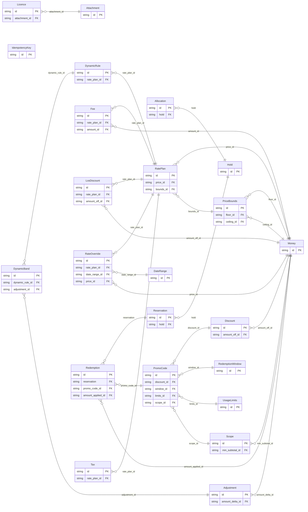

<!-- Code generated by protoc-gen-store. DO NOT EDIT. -->

# `freebusy` — GORM models

Go structs with GORM struct tags — one package per schema.

Generated from Protobuf by protoc-gen-store. Source of truth is the `.proto` files — regenerate rather than editing.

| Models | Enums |
| ---: | ---: |
| 23 | 12 |

## Entity relationships

## Output

- `<schema>/models.go` — one Go package per schema, one struct per table.
- `migrate.go` — a factory `Registry` (with a preloaded `Default`) that migrates every model in one call; emitted when the `go_module` opt is set. Call `Default.EnsureSchemas(db)` before `Default.Migrate(db)` so the schema-qualified tables have their Postgres schemas.
- Nullable columns are pointer types; proto enums become string-typed Go enums.
- Attach in main: `Default.EnsureSchemas(db)` then `Default.Migrate(db)`, or wire the structs into a `*gorm.DB` and run AutoMigrate yourself.
- `<schema>/<model>_store.go` — a typed CRUD store per resource (Create, GetByID, List, Count, Update, DeleteByID, plus GetBy/ListBy finders for unique and foreign-key columns); emitted when the `stores` opt is set (which also requires `go_module`). Requires `gorm.io/gorm`.
- `gormx/gormx.go` — the shared runtime every store imports: `ListOptions`, the generic `Store[M]` interface every store satisfies, a `GenericStore[M]` engine that runs CRUD for any model with no per-entity code, and `EnsureSchemas`. Lets one generic engine drive every entity.
- `telemetry/telemetry.go` — the first-party telemetry adapter: `New(o)` wraps an SDK handle as the `gormx.Telemetry` the stores observe through (`WithTelemetry(telemetry.New(o))`), and `Plugin(o)` is the SQL-level gorm plugin. Emitted with the `telemetry` opt; requires `github.com/the-protobuf-project/telemetry/telemetry-go`.
- `Registry.Instrument(db, o)` in `migrate.go` — installs the generated telemetry gorm plugin so every query emits a span (and metric) through the SDK handle.

## Schema `allocation`

### `Hold` → `holds`

A Hold is a temporary, expiring claim on one or more bookable resources for a window, taken before payment or confirmation so two callers cannot be sold the same thing. Native, with no RFC behind it, and the comment says why (the same trade protobuf.shared.project.v1 records upstream). RFC 5545 section 3.2.12's PARTSTAT=TENTATIVE can express that a claim is provisional, and RFC 5546's iTIP can carry the request that created it, but neither specifies a lapse time, and an expiring claim is the one thing a commercial booking engine cannot do without. The resources held are RFC 9073 VRESOURCEs and the window is measured against their RFC 7953 availability; only the clock is ours. Holds are allocated, not requested: CreateHold names candidate resources and a quantity, and the server decides which concrete resources are taken. That keeps "which bay did I get" a server decision made under a lock, rather than a client guess that races.

| Column | Type | Null |
| --- | --- | --- |
| `id` | `CHAR(26)` | not null |
| `name` | `VARCHAR(255)` | not null |
| `window` | `TSTZRANGE` | not null |
| `quantity` | `INTEGER` | nullable |
| `expire_time` | `TIMESTAMPTZ` | nullable |
| `state` | `HoldState` | nullable |
| `idempotency_key` | `VARCHAR(255)` | nullable |
| `create_time` | `TIMESTAMPTZ` | not null |
| `update_time` | `TIMESTAMPTZ` | not null |
| `etag` | `VARCHAR(255)` | nullable |
| `organizational_unit_id` | `CHAR(26)` | not null |
| `resources` | `VARCHAR(255)[]` | nullable |
| `candidate_resources` | `VARCHAR(255)[]` | nullable |

### `Allocation` → `resource`

An Allocation is one resource taken by one hold for one span: the row the engine counts when it asks what is already claimed. Storage-only. No RPC returns it -- callers see a Hold and its `resources` -- but a Hold cannot answer "who has bay 14 at 10:00" on its own: its window is one value and its resources a list, so an overlap query over holds would have to unpack both on every row. One row per resource, with the span as two indexed instants, makes that query a plain range scan on either backend. The span and `expire_time` are copies of the hold's, written in the same write as the hold. The copy is the point: a claim stops counting the instant `expire_time` passes, with no sweeper write needed, because every read filters on it. It sits under the site and names its hold, rather than nesting under the hold: the engine asks about allocations by resource and time across a whole site, never hold by hold, and a hold with child resources would owe DeleteHold a `force` flag guarding rows no caller can see.

| Column | Type | Null |
| --- | --- | --- |
| `id` | `CHAR(26)` | not null |
| `name` | `VARCHAR(255)` | not null |
| `resource` | `VARCHAR(255)` | not null |
| `start_time` | `TIMESTAMPTZ` | not null |
| `end_time` | `TIMESTAMPTZ` | not null |
| `expire_time` | `TIMESTAMPTZ` | nullable |
| `create_time` | `TIMESTAMPTZ` | not null |
| `hold` | `CHAR(26)` | nullable |
| `organizational_unit_id` | `CHAR(26)` | not null |

### Enums

- `HoldState`: ACTIVE, RELEASED, EXPIRED, CONVERTED

## Schema `pricing`

### `RatePlan` → `rate_plans`

A RatePlan is what a bookable resource costs: a base price, the calendar of overrides that move it, and the fees and taxes layered on top. Native, with no RFC behind it, and this is the one gap the audit could not close. The IETF has never standardised commerce — RFC 8905's `payto:` names a payment *address*, not an amount — so while every statement this engine makes about time comes from a published RFC, every statement it makes about money is ours. `google.type.Money` carries the amounts, which is the closest thing to a standard available and is exempt from the cross-package rule. A resource of its own rather than fields on the thing being priced: the same resource is sold at different rates to different channels and seasons, a rate plan is edited on a cadence entirely unlike the resource's, and a booking must still be explainable under the plan that priced it long after that plan stops being offered. Pricing attaches to a resource by reference, so an RFC 9073 VRESOURCE stays a description of a bookable thing and never grows a price.

| Column | Type | Null |
| --- | --- | --- |
| `id` | `CHAR(26)` | not null |
| `name` | `VARCHAR(255)` | not null |
| `resource` | `VARCHAR(255)` | not null |
| `display_name` | `VARCHAR(255)` | not null |
| `description` | `TEXT` | nullable |
| `pricing_unit` | `PricingUnit` | nullable |
| `state` | `RatePlanState` | nullable |
| `create_time` | `TIMESTAMPTZ` | not null |
| `update_time` | `TIMESTAMPTZ` | not null |
| `etag` | `VARCHAR(255)` | nullable |
| `price_id` | `CHAR(26)` | not null |
| `bounds_id` | `CHAR(26)` | nullable |

### `RateOverride` → `rate_overrides`

A price that replaces a plan's base rate for a span of dates, specific weekdays, or both.

| Column | Type | Null |
| --- | --- | --- |
| `id` | `CHAR(26)` | not null |
| `weekdays` | `` | nullable |
| `rate_plan_id` | `CHAR(26)` | not null |
| `date_range_id` | `CHAR(26)` | nullable |
| `price_id` | `CHAR(26)` | not null |

### `LosDiscount` → `los_discounts`

A discount applied once a stay reaches `min_nights`. Exactly one of `percent_off` or `amount_off` is set.

| Column | Type | Null |
| --- | --- | --- |
| `id` | `CHAR(26)` | not null |
| `min_nights` | `INTEGER` | not null |
| `percent_off` | `INTEGER` | nullable |
| `rate_plan_id` | `CHAR(26)` | not null |
| `amount_off_id` | `CHAR(26)` | nullable |

### `Fee` → `fees`

A charge added on top of the base subtotal. Exactly one of `amount` or `percent` is set.

| Column | Type | Null |
| --- | --- | --- |
| `id` | `CHAR(26)` | not null |
| `code` | `VARCHAR(255)` | not null |
| `display_name` | `VARCHAR(255)` | nullable |
| `percent` | `INTEGER` | nullable |
| `pricing_unit` | `PricingUnit` | nullable |
| `taxable` | `BOOLEAN` | nullable |
| `rate_plan_id` | `CHAR(26)` | not null |
| `amount_id` | `CHAR(26)` | nullable |

### `Tax` → `taxes`

A tax on the taxable base — the subtotal plus every fee marked taxable.

| Column | Type | Null |
| --- | --- | --- |
| `id` | `CHAR(26)` | not null |
| `code` | `VARCHAR(255)` | not null |
| `display_name` | `VARCHAR(255)` | nullable |
| `percent` | `DOUBLE PRECISION` | not null |
| `rate_plan_id` | `CHAR(26)` | not null |

### `DynamicRule` → `dynamic_rules`

A rule that moves price according to something measured at quote time. Bands are evaluated against the trigger's measured value and at most one band matches per rule, because bands of a single rule partition a range. Rules compound across triggers; bands do not compound within one.

| Column | Type | Null |
| --- | --- | --- |
| `id` | `CHAR(26)` | not null |
| `trigger` | `DynamicTrigger` | not null |
| `rate_plan_id` | `CHAR(26)` | not null |

### `PriceBounds` → `price_bounds`

Hard limits on a computed price, applied last — after every override, discount, dynamic rule and fee, and before tax. Applied last on purpose: bounding an intermediate step would let a later rule carry the price back out of range, which is exactly the failure the bounds exist to prevent.

| Column | Type | Null |
| --- | --- | --- |
| `id` | `CHAR(26)` | not null |
| `floor_id` | `CHAR(26)` | nullable |
| `ceiling_id` | `CHAR(26)` | nullable |

### `DateRange` → `date_ranges`

An inclusive-start, exclusive-end span of calendar dates. Declared here rather than reused from freebusy.shared.v1: AIP-215 permits no cross-package message reference, and a shared types package was exactly what produced the foreign-type findings this package is written to avoid. The duplication is the documented cost of that rule.

| Column | Type | Null |
| --- | --- | --- |
| `id` | `CHAR(26)` | not null |
| `start_date` | `DATE` | not null |
| `end_date` | `DATE` | not null |

### `DynamicBand` → `dynamic_bands`

One threshold band of a DynamicRule: the range the measured value must fall in, and what happens to the price when it does.

| Column | Type | Null |
| --- | --- | --- |
| `id` | `CHAR(26)` | not null |
| `min_threshold` | `INTEGER` | not null |
| `max_threshold` | `INTEGER` | nullable |
| `display_name` | `VARCHAR(255)` | nullable |
| `dynamic_rule_id` | `CHAR(26)` | not null |
| `adjustment_id` | `CHAR(26)` | not null |

### `Adjustment` → `adjustments`

A price adjustment expressed as a proportion or a flat amount. Exactly one is set; both may be negative, which is how a discount is written.

| Column | Type | Null |
| --- | --- | --- |
| `id` | `CHAR(26)` | not null |
| `percent_delta` | `INTEGER` | nullable |
| `amount_delta_id` | `CHAR(26)` | nullable |

### Enums

- `PricingUnit`: PER_BOOKING, PER_NIGHT, PER_PERSON
- `RatePlanState`: ACTIVE, ARCHIVED
- `DynamicTrigger`: OCCUPANCY, LEAD_TIME, LENGTH_OF_STAY

## Schema `promocode`

### `PromoCode` → `resource`

A redeemable discount applied to a booking's subtotal. Scoped by a redemption window, usage caps, a minimum subtotal, and an optional set of properties / units it applies to.

| Column | Type | Null |
| --- | --- | --- |
| `id` | `CHAR(26)` | not null |
| `name` | `VARCHAR(255)` | not null |
| `code` | `VARCHAR(255)` | nullable |
| `display_name` | `VARCHAR(255)` | nullable |
| `description` | `TEXT` | nullable |
| `redemption_count` | `BIGINT` | nullable |
| `state` | `PromoCodeState` | nullable |
| `disabled` | `BOOLEAN` | nullable |
| `create_time` | `TIMESTAMPTZ` | not null |
| `update_time` | `TIMESTAMPTZ` | not null |
| `etag` | `VARCHAR(255)` | nullable |
| `code_generation` | `CodeGeneration` | nullable |
| `discount_id` | `CHAR(26)` | not null |
| `window_id` | `CHAR(26)` | nullable |
| `limits_id` | `CHAR(26)` | nullable |
| `scope_id` | `CHAR(26)` | nullable |

### `Redemption` → `redemptions`

Redemption is a single use of a promo code, modeled as a sub-resource of PromoCode rather than an inline list — so it has its own name/lifecycle and is listed with paging (ListRedemptions). The {promo_code} parent segment generates the promo_code_id FK back to the owning code (1:n into promocode.redemptions); amount_applied is the shared google.type.Money in common.moneys. Redemptions are recorded when a booking's payment settles, never created directly.

| Column | Type | Null |
| --- | --- | --- |
| `id` | `CHAR(26)` | not null |
| `name` | `VARCHAR(255)` | not null |
| `customer` | `VARCHAR(255)` | not null |
| `reservation` | `CHAR(26)` | not null |
| `redeemed_time` | `TIMESTAMPTZ` | nullable |
| `promo_code_id` | `CHAR(26)` | not null |
| `amount_applied_id` | `CHAR(26)` | nullable |

### `Discount` → `discounts`

Discount describes how a promo code reduces a subtotal. Nested value object → belongs-to child table promocode.discounts (FK discount_id on promo_codes). Exactly one of percent_off / amount_off is set; the oneof case is the discriminator, so no separate type enum is needed.

| Column | Type | Null |
| --- | --- | --- |
| `id` | `CHAR(26)` | not null |
| `percent_off` | `INTEGER` | nullable |
| `amount_case` | `DiscountAmountCase` | nullable |
| `amount_off_id` | `CHAR(26)` | nullable |

### `RedemptionWindow` → `redemption_windows`

RedemptionWindow bounds when a code can be redeemed; an unset bound is open-ended. Nested value object → belongs-to promocode.redemption_windows.

| Column | Type | Null |
| --- | --- | --- |
| `id` | `CHAR(26)` | not null |
| `start_time` | `TIMESTAMPTZ` | nullable |
| `end_time` | `TIMESTAMPTZ` | nullable |

### `UsageLimits` → `usage_limits`

UsageLimits caps how often a code can be redeemed. Nested value object → belongs-to promocode.usage_limits. The caps are wrapper types so "unset" (unlimited) is distinct from an explicit value, including 0.

| Column | Type | Null |
| --- | --- | --- |
| `id` | `CHAR(26)` | not null |
| `max_redemptions` | `BIGINT` | nullable |
| `per_customer_limit` | `INTEGER` | nullable |

### `Scope` → `scopes`

Scope restricts which bookings a code applies to. Nested value object → belongs-to promocode.scopes. Its repeated resource references and Money normalize one level deeper (array columns / common.moneys).

| Column | Type | Null |
| --- | --- | --- |
| `id` | `CHAR(26)` | not null |
| `min_subtotal_id` | `CHAR(26)` | nullable |
| `applicable_properties` | `VARCHAR(255)[]` | nullable |
| `applicable_units` | `VARCHAR(255)[]` | nullable |

### Enums

- `PromoCodeState`: ACTIVE, DISABLED, EXPIRED
- `CodeGeneration`: MANUAL, AUTO
- `DiscountAmountCase`: PERCENT_OFF, AMOUNT_OFF

## Schema `property`

### `Licence` → `licences`

A regulatory licence or certificate held by a site or one of its bookable resources (e.g. trade licence, fire safety NOC, per-room liquor licence). Native, and it stays native because no RFC covers it: the IETF standardises calendars and directories, not the paperwork a jurisdiction demands to operate. It parents onto an RFC 4519 organizationalUnit and names an RFC 9073 resource, so the only thing freebusy defines here is the licence itself. One resource covers both scopes: `target` says which, and a resource-scoped licence names it in `unit`. `expiry_date` is filterable so renewals due can be listed; the certificate itself rides in `attachment`.

| Column | Type | Null |
| --- | --- | --- |
| `id` | `CHAR(26)` | not null |
| `name` | `VARCHAR(255)` | not null |
| `target` | `LicenceTarget` | nullable |
| `unit` | `VARCHAR(255)` | nullable |
| `type` | `LicenceType` | not null |
| `licence_number` | `VARCHAR(255)` | nullable |
| `issuing_authority` | `VARCHAR(255)` | nullable |
| `issue_date` | `DATE` | nullable |
| `expiry_date` | `DATE` | nullable |
| `notes` | `VARCHAR(255)` | nullable |
| `state` | `LicenceState` | nullable |
| `create_time` | `TIMESTAMPTZ` | not null |
| `update_time` | `TIMESTAMPTZ` | not null |
| `etag` | `VARCHAR(255)` | nullable |
| `organizational_unit_id` | `CHAR(26)` | not null |
| `attachment_id` | `CHAR(26)` | nullable |

### Enums

- `LicenceTarget`: PROPERTY, UNIT
- `LicenceType`: TRADE, FIRE_SAFETY, LIQUOR, FOOD_SAFETY, TOURISM, HEALTH, OTHER
- `LicenceState`: ACTIVE, ARCHIVED

## Schema `reservation`

### `Reservation` → `resource`

A Reservation is a confirmed booking: a hold made permanent. It is the last step of booking, not the first. The caller checks availability, takes a hold, settles whatever its vertical needs settled -- payment, a guest list, a waiver -- and then creates a reservation from the hold. The reservation records the outcome; the engine already holds the resources. Deliberately thin. scheduling.v1's Booking carried price, discount, promo code, refund, guests and occupancy, which made it a hotel booking. None of that is here: money belongs to the payment service and people to the user service, both referenced by name (AIP-215), and anything else a vertical needs to remember rides in `attributes`.

| Column | Type | Null |
| --- | --- | --- |
| `id` | `CHAR(26)` | not null |
| `name` | `VARCHAR(255)` | not null |
| `hold` | `CHAR(26)` | not null |
| `start_time` | `TIMESTAMPTZ` | nullable |
| `end_time` | `TIMESTAMPTZ` | nullable |
| `customer` | `VARCHAR(255)` | nullable |
| `state` | `ReservationState` | nullable |
| `attributes` | `JSONB` | nullable |
| `cancel_reason` | `VARCHAR(255)` | nullable |
| `create_time` | `TIMESTAMPTZ` | not null |
| `update_time` | `TIMESTAMPTZ` | not null |
| `confirm_time` | `TIMESTAMPTZ` | nullable |
| `cancel_time` | `TIMESTAMPTZ` | nullable |
| `etag` | `VARCHAR(255)` | nullable |
| `replaces` | `VARCHAR(255)` | nullable |
| `replacement` | `VARCHAR(255)` | nullable |
| `organizational_unit_id` | `CHAR(26)` | not null |
| `resources` | `VARCHAR(255)[]` | nullable |

### Enums

- `ReservationState`: PENDING, CONFIRMED, CANCELLING, CANCELLED, FAILED, RESCHEDULING, RESCHEDULED

## Schema `shared`

### `IdempotencyKey` → `idempotency_keys`

The record behind every `request_id` field in this API: it remembers what the first call with a given id returned, so a retry replays that response instead of attempting the write twice. Storage only — no service exposes it, and no caller constructs one. It lives in freebusy.shared.v1 because request_id is API-wide (booking, property, promo code, channel, organisation, schedule) and one interceptor records them all; homing it in any single service's package would make every other service import that service to dedupe its own writes. The id is derived, not random: it is a digest of (method, request_id), so the primary key itself is the uniqueness constraint that makes a concurrent duplicate lose the race rather than double-write.

| Column | Type | Null |
| --- | --- | --- |
| `id` | `CHAR(26)` | not null |
| `name` | `VARCHAR(255)` | not null |
| `method` | `VARCHAR(255)` | not null |
| `request_id` | `VARCHAR(255)` | not null |
| `state` | `IdempotencyState` | nullable |
| `response` | `TEXT` | nullable |
| `create_time` | `TIMESTAMPTZ` | not null |
| `update_time` | `TIMESTAMPTZ` | not null |

### `Attachment` → `attachments`

An uploaded file attached to a document- or licence-carrying record (e.g. a guest's IdDocument scan, or a property/unit licence certificate). The bytes are stored inline in `content` today; `uri` is populated once the file is migrated to object storage (S3 or any CDN-fronted host). At most one of the two is authoritative at a time — prefer `uri` when both are set.

| Column | Type | Null |
| --- | --- | --- |
| `id` | `CHAR(26)` | not null |
| `filename` | `VARCHAR(255)` | nullable |
| `mime_type` | `VARCHAR(255)` | nullable |
| `size_bytes` | `BIGINT` | nullable |
| `content` | `BYTEA` | nullable |
| `uri` | `VARCHAR(255)` | nullable |
| `upload_time` | `TIMESTAMPTZ` | nullable |

### Enums

- `IdempotencyState`: IN_FLIGHT, DONE

## Schema `common`

### `Money` → `moneys`

Represents an amount of money with its currency type.

| Column | Type | Null |
| --- | --- | --- |
| `id` | `CHAR(26)` | not null |
| `currency_code` | `VARCHAR(255)` | nullable |
| `units` | `BIGINT` | nullable |
| `nanos` | `INTEGER` | nullable |
