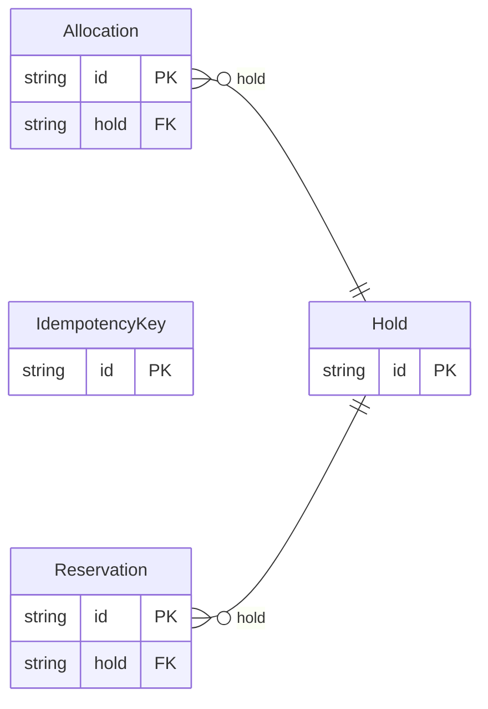

<!-- Code generated by protoc-gen-store. DO NOT EDIT. -->

# `freebusy` — GORM models

Go structs with GORM struct tags — one package per schema.

Generated from Protobuf by protoc-gen-store. Source of truth is the `.proto` files — regenerate rather than editing.

| Models | Enums |
| ---: | ---: |
| 4 | 3 |

## Entity relationships

## Output

- `<schema>/models.go` — one Go package per schema, one struct per table.
- `migrate.go` — a factory `Registry` (with a preloaded `Default`) that migrates every model in one call; emitted when the `go_module` opt is set. Call `Default.EnsureSchemas(db)` before `Default.Migrate(db)` so the schema-qualified tables have their Postgres schemas.
- Nullable columns are pointer types; proto enums become string-typed Go enums.
- Attach in main: `Default.EnsureSchemas(db)` then `Default.Migrate(db)`, or wire the structs into a `*gorm.DB` and run AutoMigrate yourself.
- `<schema>/<model>_store.go` — a typed CRUD store per resource (Create, GetByID, List, Count, Update, DeleteByID, plus GetBy/ListBy finders for unique and foreign-key columns); emitted when the `stores` opt is set (which also requires `go_module`). Requires `gorm.io/gorm`.
- `gormx/gormx.go` — the shared runtime every store imports: `ListOptions`, the generic `Store[M]` interface every store satisfies, a `GenericStore[M]` engine that runs CRUD for any model with no per-entity code, and `EnsureSchemas`. Lets one generic engine drive every entity.
- `telemetry/telemetry.go` — the first-party telemetry adapter: `New(o)` wraps an SDK handle as the `gormx.Telemetry` the stores observe through (`WithTelemetry(telemetry.New(o))`), and `Plugin(o)` is the SQL-level gorm plugin. Emitted with the `telemetry` opt; requires `github.com/the-protobuf-project/telemetry/telemetry-go`.
- `Registry.Instrument(db, o)` in `migrate.go` — installs the generated telemetry gorm plugin so every query emits a span (and metric) through the SDK handle.

## Schema `allocation`

### `Hold` → `holds`

A Hold is a temporary, expiring claim on one or more bookable resources for a window, taken before payment or confirmation so two callers cannot be sold the same thing. Native, with no RFC behind it, and the comment says why (the same trade protobuf.shared.project.v1 records upstream). RFC 5545 section 3.2.12's PARTSTAT=TENTATIVE can express that a claim is provisional, and RFC 5546's iTIP can carry the request that created it, but neither specifies a lapse time, and an expiring claim is the one thing a commercial booking engine cannot do without. The resources held are RFC 9073 VRESOURCEs and the window is measured against their RFC 7953 availability; only the clock is ours. Holds are allocated, not requested: CreateHold names candidate resources and a quantity, and the server decides which concrete resources are taken. That keeps "which bay did I get" a server decision made under a lock, rather than a client guess that races.

| Column | Type | Null |
| --- | --- | --- |
| `id` | `CHAR(26)` | not null |
| `name` | `VARCHAR(255)` | not null |
| `window` | `TSTZRANGE` | not null |
| `quantity` | `INTEGER` | nullable |
| `expire_time` | `TIMESTAMPTZ` | nullable |
| `state` | `HoldState` | nullable |
| `idempotency_key` | `VARCHAR(255)` | nullable |
| `create_time` | `TIMESTAMPTZ` | not null |
| `update_time` | `TIMESTAMPTZ` | not null |
| `etag` | `VARCHAR(255)` | nullable |
| `organizational_unit_id` | `CHAR(26)` | not null |
| `resources` | `VARCHAR(255)[]` | nullable |
| `candidate_resources` | `VARCHAR(255)[]` | nullable |

### `Allocation` → `resource`

An Allocation is one resource taken by one hold for one span: the row the engine counts when it asks what is already claimed. Storage-only. No RPC returns it -- callers see a Hold and its `resources` -- but a Hold cannot answer "who has bay 14 at 10:00" on its own: its window is one value and its resources a list, so an overlap query over holds would have to unpack both on every row. One row per resource, with the span as two indexed instants, makes that query a plain range scan on either backend. The span and `expire_time` are copies of the hold's, written in the same write as the hold. The copy is the point: a claim stops counting the instant `expire_time` passes, with no sweeper write needed, because every read filters on it. It sits under the site and names its hold, rather than nesting under the hold: the engine asks about allocations by resource and time across a whole site, never hold by hold, and a hold with child resources would owe DeleteHold a `force` flag guarding rows no caller can see.

| Column | Type | Null |
| --- | --- | --- |
| `id` | `CHAR(26)` | not null |
| `name` | `VARCHAR(255)` | not null |
| `resource` | `VARCHAR(255)` | not null |
| `start_time` | `TIMESTAMPTZ` | not null |
| `end_time` | `TIMESTAMPTZ` | not null |
| `expire_time` | `TIMESTAMPTZ` | nullable |
| `create_time` | `TIMESTAMPTZ` | not null |
| `hold` | `CHAR(26)` | nullable |
| `organizational_unit_id` | `CHAR(26)` | not null |

### Enums

- `HoldState`: ACTIVE, RELEASED, EXPIRED, CONVERTED

## Schema `reservation`

### `Reservation` → `resource`

A Reservation is a confirmed booking: a hold made permanent. It is the last step of booking, not the first. The caller checks availability, takes a hold, settles whatever its vertical needs settled -- payment, a guest list, a waiver -- and then creates a reservation from the hold. The reservation records the outcome; the engine already holds the resources. Deliberately thin. Price, discount, promo code, refund, guests and occupancy are what would make it a hotel booking, and none of them is here: money belongs to the payment service and people to the user service, both referenced by name (AIP-215), and anything else a vertical needs to remember rides in `attributes`.

| Column | Type | Null |
| --- | --- | --- |
| `id` | `CHAR(26)` | not null |
| `name` | `VARCHAR(255)` | not null |
| `hold` | `CHAR(26)` | not null |
| `start_time` | `TIMESTAMPTZ` | nullable |
| `end_time` | `TIMESTAMPTZ` | nullable |
| `customer` | `VARCHAR(255)` | nullable |
| `state` | `ReservationState` | nullable |
| `attributes` | `JSONB` | nullable |
| `cancel_reason` | `VARCHAR(255)` | nullable |
| `create_time` | `TIMESTAMPTZ` | not null |
| `update_time` | `TIMESTAMPTZ` | not null |
| `confirm_time` | `TIMESTAMPTZ` | nullable |
| `cancel_time` | `TIMESTAMPTZ` | nullable |
| `etag` | `VARCHAR(255)` | nullable |
| `replaces` | `VARCHAR(255)` | nullable |
| `replacement` | `VARCHAR(255)` | nullable |
| `organizational_unit_id` | `CHAR(26)` | not null |
| `resources` | `VARCHAR(255)[]` | nullable |

### Enums

- `ReservationState`: PENDING, CONFIRMED, CANCELLING, CANCELLED, FAILED, RESCHEDULING, RESCHEDULED

## Schema `shared`

### `IdempotencyKey` → `idempotency_keys`

The record behind every `request_id` field in this API: it remembers what the first call with a given id returned, so a retry replays that response instead of attempting the write twice. Storage only — no service exposes it, and no caller constructs one. It lives in freebusy.shared.v1 because request_id is an API-wide convention any RPC may opt into, and one interceptor records them all; homing it in any single service's package would make every other service import that service to dedupe its own writes. No RPC declares request_id today -- holds and reservations carry their own idempotency. The id is derived, not random: it is a digest of (method, request_id), so the primary key itself is the uniqueness constraint that makes a concurrent duplicate lose the race rather than double-write.

| Column | Type | Null |
| --- | --- | --- |
| `id` | `CHAR(26)` | not null |
| `name` | `VARCHAR(255)` | not null |
| `method` | `VARCHAR(255)` | not null |
| `request_id` | `VARCHAR(255)` | not null |
| `state` | `IdempotencyState` | nullable |
| `response` | `TEXT` | nullable |
| `create_time` | `TIMESTAMPTZ` | not null |
| `update_time` | `TIMESTAMPTZ` | not null |

### Enums

- `IdempotencyState`: IN_FLIGHT, DONE
