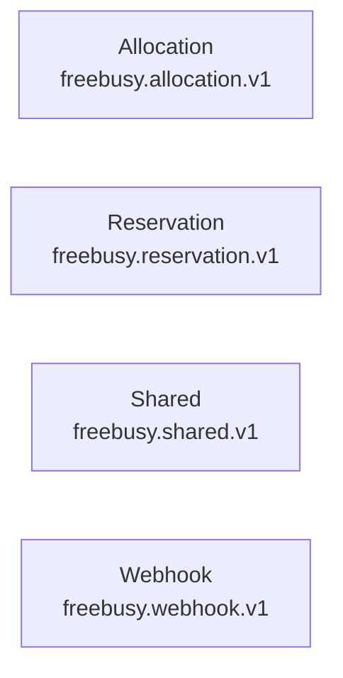

<!-- Copyright 2026 Srikanth K. -->
<!-- SPDX-License-Identifier: Apache-2.0 -->

# Freebusy Protobuf APIs

> [!IMPORTANT]
> Auto-generated by `protoc-gen-openapi` 1.2.0 (mode=markdown). Do not edit manually.

Every protobuf package documented here. Each row links to that package's reference.

## Packages

| Module | Package | Services | Messages | Enums | Flows | Reference |
| --- | --- | --- | --- | --- | --- | --- |
| Allocation | `freebusy.allocation.v1` | 2 | 23 | 4 | 1 | [README](freebusy/allocation/README.md) |
| Reservation | `freebusy.reservation.v1` | 1 | 8 | 2 | 3 | [README](freebusy/reservation/README.md) |
| Shared | `freebusy.shared.v1` | 0 | 4 | 6 | 0 | [README](freebusy/shared/README.md) |
| Webhook | `freebusy.webhook.v1` | 1 | 16 | 3 | 1 | [README](freebusy/webhook/README.md) |
| **Total** | _4 packages_ | 4 | 51 | 15 | 5 | |

## Dependency graph

Import relationships between the packages above. Packages outside this set are omitted.

---

© 2026 Srikanth K | Apache 2.0 License
