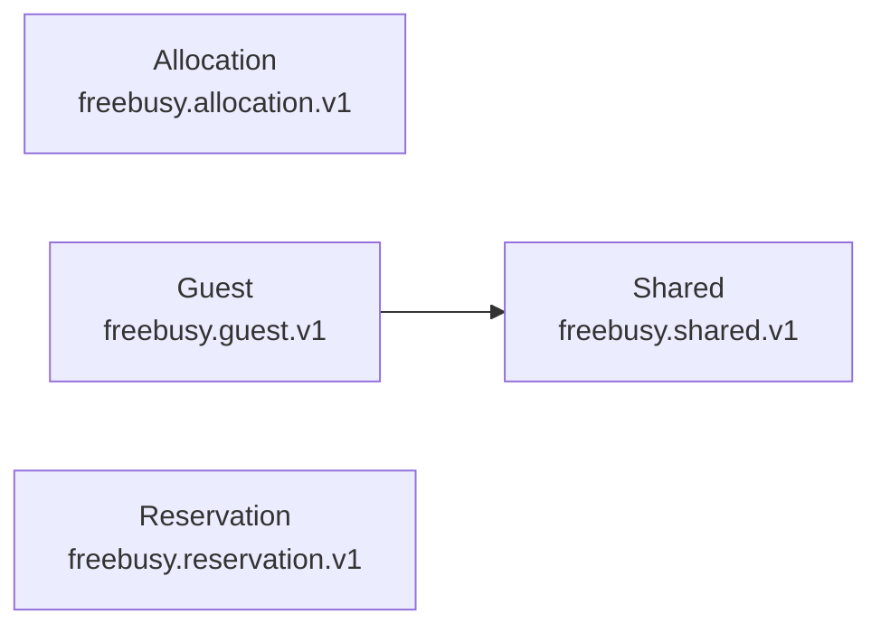

# Freebusy Protobuf APIs

> [!IMPORTANT]
> Auto-generated by `protodoc`. Do not edit manually.

Every protobuf module under `protobuf/`. Each row links to that module's generated reference.

## Modules

| Module | Package | Services | Messages | Enums | Reference |
| --- | --- | --- | --- | --- | --- |
| Allocation | `freebusy.allocation.v1` | 2 | 20 | 3 | [README](freebusy/allocation/README.md) |
| Guest | `freebusy.guest.v1` | 0 | 4 | 5 | [README](freebusy/guest/README.md) |
| Reservation | `freebusy.reservation.v1` | 1 | 7 | 1 | [README](freebusy/reservation/README.md) |
| Shared | `freebusy.shared.v1` | 0 | 6 | 5 | [README](freebusy/shared/README.md) |
| **Total** | _4 modules_ | 3 | 37 | 14 | |

## Dependency graph

Local (`freebusy.*`) import relationships between modules. External deps (`google.*`, `mcp.*`) are omitted.

---

© 2026 oh-tarnished | Apache 2.0 License
