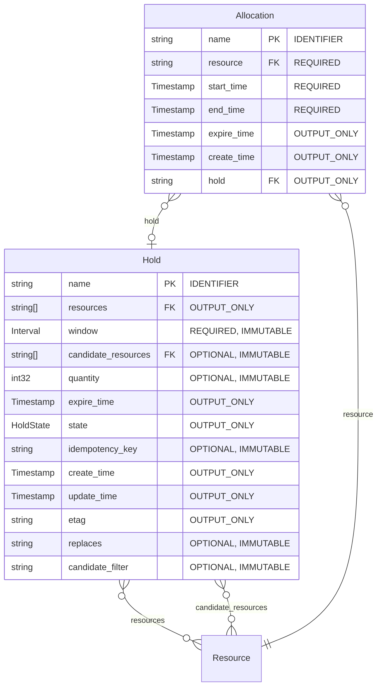
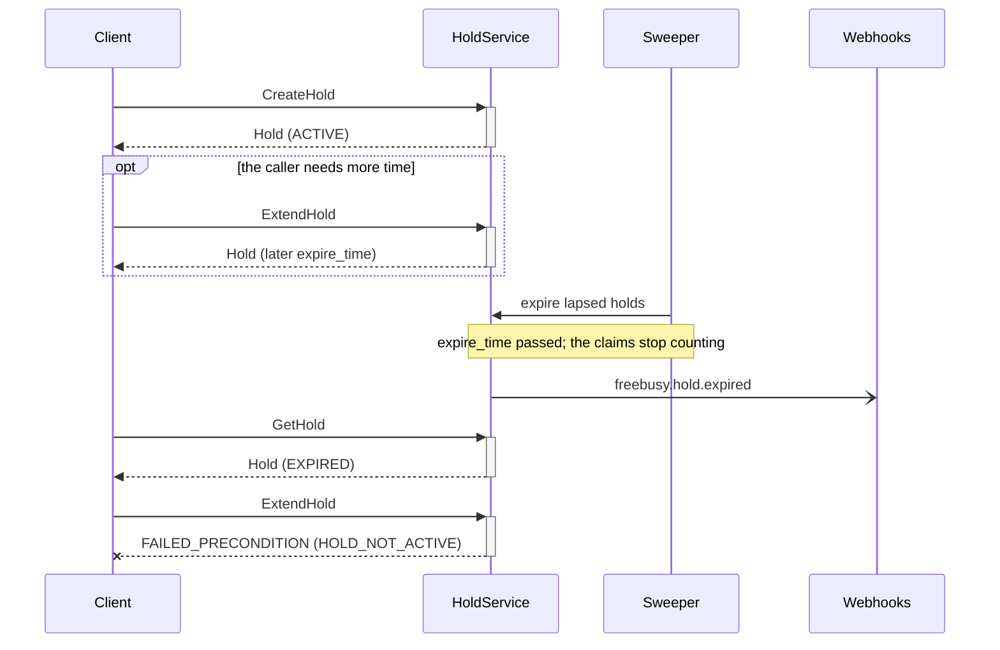
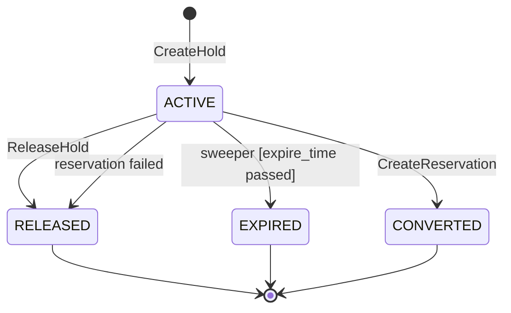

<!-- Copyright 2026 Srikanth K. -->
<!-- SPDX-License-Identifier: Apache-2.0 -->

# Allocation API

**Package:** `freebusy.allocation.v1`

> [!IMPORTANT]
> Auto-generated by `protoc-gen-openapi` 1.2.0 (mode=markdown). Do not edit manually.

**Contents:** [Resources](#resources) · [Services](#services) · [Messages](#messages) · [Enums](#enums)

## Resources

| Resource | Type | Pattern |
| --- | --- | --- |
| [`Hold`](#hold) | `freebusy.allocation.v1/Hold` | `holds/{hold}` |
| [`Allocation`](#allocation) | `freebusy.allocation.v1/Allocation` | `allocations/{allocation}` |

## Services

### AllocationService

AllocationService is the read-only half of the engine: it answers how much is
free, and never changes anything. HoldService is the half that takes.

The counting is done here rather than stored anywhere. No RFC models an
inventory count -- RFC 5545 and RFC 7953 are one-calendar-one-timeline -- so
"5 of 12 free" is produced by asking each RFC 9073 resource's calendar
whether it is free across the window and totalling the answers. RFC 7953's
VAVAILABILITY says when a resource was on offer at all; bookings on its
calendar say what has since been taken; the difference is availability.

Every operation is a custom method (AIP-136): they compute rather than fetch,
so they take neither the standard-method names nor their shapes.

| Method | Request | Response | HTTP | Description |
| --- | --- | --- | --- | --- |
| `ComputeAvailability` | [`ComputeAvailabilityRequest`](#computeavailabilityrequest) | [`ComputeAvailabilityResponse`](#computeavailabilityresponse) | `POST /v1/resources:computeAvailability` | Computes availability across resources, bucketed by slot or day. |
| `CheckAvailability` | [`CheckAvailabilityRequest`](#checkavailabilityrequest) | [`CheckAvailabilityResponse`](#checkavailabilityresponse) | `POST /v1/resources:checkAvailability` | Checks one exact window for one exact quantity, with reasons when it fails.  Advisory, not a reservation: the answer can be stale the instant it is returned. CreateHold is what actually secures anything. |
| `BatchComputeAvailability` | [`BatchComputeAvailabilityRequest`](#batchcomputeavailabilityrequest) | [`BatchComputeAvailabilityResponse`](#batchcomputeavailabilityresponse) | `POST /v1/resources:batchCompute` | Runs several availability computations in one round trip.  Each entry is independent and may name different resources, a different window or granularity. Capped at 50 entries, because each one fans out across every candidate resource's calendar. |
| `SearchAvailability` | [`SearchAvailabilityRequest`](#searchavailabilityrequest) | [`SearchAvailabilityResponse`](#searchavailabilityresponse) | `POST /v1/resources:searchAvailability` | Searches every resource for those free across a window.  The search entry point, where ComputeAvailability counts over resources the caller has already chosen. Paginated, since a search may match thousands of resources. |

### HoldService

HoldService takes and releases expiring claims on resources. It is the only
thing in this API that mutates availability.

Two things are deliberately not RPCs: the sweeper that expires lapsed holds
is an internal job, not a call, and conversion to a confirmed booking is
driven by ReservationService, so a hold is never converted by a caller
reaching in here.

There is no UpdateHold. A hold's window and resources are immutable by
construction -- changing either is a different allocation -- so the only
mutations are the two custom methods below.

| Method | Request | Response | HTTP | Description |
| --- | --- | --- | --- | --- |
| `CreateHold` | [`CreateHoldRequest`](#createholdrequest) | [`Hold`](#hold) | `POST /v1/holds` | Takes a hold, allocating concrete resources for the window.  The server chooses which resources are taken from the candidates offered, under a lock, so two callers racing for the last bay cannot both win. Requires an idempotency key: a retry after a timeout returns the original hold rather than taking a second one. |
| `GetHold` | [`GetHoldRequest`](#getholdrequest) | [`Hold`](#hold) | `GET /v1/{name=holds/*}` | Retrieves one hold.  Authoritative on expiry: a hold whose expire_time has passed is reported EXPIRED here even if the sweeper has not yet written that state, so a caller never sees an ACTIVE hold that no longer reserves anything. |
| `ListHolds` | [`ListHoldsRequest`](#listholdsrequest) | [`ListHoldsResponse`](#listholdsresponse) | `GET /v1/holds` | Lists holds. |
| `ExtendHold` | [`ExtendHoldRequest`](#extendholdrequest) | [`Hold`](#hold) | `POST /v1/{name=holds/*}:extend` | Pushes a hold's expiry further out.  Measured from now rather than from the current deadline, so repeated calls cannot accumulate an unbounded reservation. Fails on a hold that is not ACTIVE -- an expired hold is gone, not extendable. |
| `ReleaseHold` | [`ReleaseHoldRequest`](#releaseholdrequest) | [`Hold`](#hold) | `POST /v1/{name=holds/*}:release` | Gives a hold up before it expires, freeing its resources immediately.  Idempotent: releasing an already-released or expired hold succeeds and changes nothing, because the caller's intent is already satisfied. |
| `DeleteHold` | [`DeleteHoldRequest`](#deleteholdrequest) | `google.protobuf.Empty` | `DELETE /v1/{name=holds/*}` | Deletes a hold record.  Housekeeping for terminal holds, not a way to free resources -- use ReleaseHold for that. Deleting an ACTIVE hold is rejected, so inventory is never freed by a path that leaves no audit trail. |

#### Flow: Hold expiry

A hold nobody confirms lapses at `expire_time`; ExtendHold pushes the
deadline out while it is still ACTIVE.

Reads are authoritative on expiry, so a caller never sees an ACTIVE hold
that no longer holds anything, even before the sweeper runs.

## Messages

### Hold

A Hold is a temporary, expiring claim on one or more bookable resources for a
window, taken before payment or confirmation so two callers cannot be sold
the same thing.

Native, with no RFC behind it, and the comment says why (the same trade
protobuf.shared.project.v1 records upstream). RFC 5545 section 3.2.12's
PARTSTAT=TENTATIVE can express that a claim is provisional, and RFC 5546's
iTIP can carry the request that created it, but neither specifies a lapse
time, and an expiring claim is the one thing a commercial booking engine
cannot do without. The resources held are RFC 9073 VRESOURCEs and the window
is measured against their RFC 7953 availability; only the clock is ours.

Holds are allocated, not requested: CreateHold names candidate resources and
a quantity, and the server decides which concrete resources are taken. That
keeps "which bay did I get" a server decision made under a lock, rather than
a client guess that races.

Resource `freebusy.allocation.v1/Hold`, pattern `holds/{hold}`.

| Field | Type | Behavior | Description |
| --- | --- | --- | --- |
| `name` | `string` | `IDENTIFIER` | The hold name. Top-level: a hold takes resources wherever they are, and grouping them by place is the business of whatever is built on top. Format: holds/{hold} |
| `resources` | repeated `string` | `OUTPUT_ONLY` | The concrete resources this hold has taken, one per unit of `quantity`. Chosen by the server from the candidates the request offered. Format: resources/{resource} References `the-protobuf-project.org/Resource`. |
| `window` | `google.type.Interval` | `REQUIRED`, `IMMUTABLE` | The window held. Immutable: moving it is a different allocation, so release this hold and take another.  Stored as text, its two ends in RFC 3339 joined by "/". |
| `candidate_resources` | repeated `string` | `OPTIONAL`, `IMMUTABLE` | Candidate resources the allocator may choose from, supplied on create. Empty offers every resource, narrowed by `candidate_filter`. Immutable: the choice is made once, and re-offering a different set is a different allocation. Format: resources/{resource} References `the-protobuf-project.org/Resource`. |
| `quantity` | `int32` | `OPTIONAL`, `IMMUTABLE` | How many resources to take, supplied on create; defaults to 1. Once the hold is ACTIVE this equals the length of `resources`. |
| `expire_time` | `google.protobuf.Timestamp` | `OUTPUT_ONLY` | When the hold lapses if nothing confirms it. Extend it with ExtendHold; past this instant the hold no longer reserves anything, whether or not the sweeper has yet marked it EXPIRED. |
| `state` | [`HoldState`](#holdstate) | `OUTPUT_ONLY` | Lifecycle state. New holds start ACTIVE. |
| `idempotency_key` | `string` | `OPTIONAL`, `IMMUTABLE` | Caller-supplied key making CreateHold safe to retry. A repeat with the same key returns the original hold rather than taking a second one. |
| `create_time` | `google.protobuf.Timestamp` | `OUTPUT_ONLY` | Creation timestamp. |
| `update_time` | `google.protobuf.Timestamp` | `OUTPUT_ONLY` | Last-modification timestamp. |
| `etag` | `string` | `OUTPUT_ONLY` | Opaque version for optimistic concurrency (AIP-154); echo on update/delete. |
| `replaces` | `string` | `OPTIONAL`, `IMMUTABLE` | The hold of the reservation this hold is taken to replace with RescheduleReservation: that reservation's `hold`, converted. Its claims do not count against this hold, so a new window overlapping the old one -- an extension, a shift by an hour -- can keep the same resources. Until the move completes this hold claims only the time the old one does not; RescheduleReservation hands the rest over in the write that ends the old hold, so no one else can take it in between. Such a hold can only be used to reschedule that reservation. (A hold, though no resource_reference says so: AIP-121 allows no cycle of mutable references, and this one is a hold naming a hold.) Format: holds/{hold} |
| `candidate_filter` | `string` | `OPTIONAL`, `IMMUTABLE` | An AIP-160 filter narrowing the resources the allocator may choose from, supplied on create, alongside `candidate_resources`: the same filter SearchAvailability takes, over each resource's `resource_types`, `attributes` (its STRUCTURED-DATA, e.g. `attributes.view = "river"`) and `display_name`. Empty narrows nothing. Immutable, like the candidates. |

### Allocation

An Allocation is one resource taken by one hold for one span: the row the
engine counts when it asks what is already claimed.

Storage-only. No RPC returns it -- callers see a Hold and its `resources` --
but a Hold cannot answer "who has bay 14 at 10:00" on its own: its window is
one value and its resources a list, so an overlap query over holds would
have to unpack both on every row. One row per resource, with the span as two
indexed instants, makes that query a plain range scan on either backend.

The span and `expire_time` are copies of the hold's, written in the same
write as the hold. The copy is the point: a claim stops counting the instant
`expire_time` passes, with no sweeper write needed, because every read
filters on it.

It is top-level and names its hold, rather than nesting under the hold: the
engine asks about allocations by resource and time, never hold by hold, and
a hold with child resources would owe DeleteHold a `force` flag guarding
rows no caller can see.

Resource `freebusy.allocation.v1/Allocation`, pattern `allocations/{allocation}`.

| Field | Type | Behavior | Description |
| --- | --- | --- | --- |
| `name` | `string` | `IDENTIFIER` | The allocation name. Format: allocations/{allocation} |
| `resource` | `string` | `REQUIRED` | The resource taken. Format: resources/{resource} References `the-protobuf-project.org/Resource`. |
| `start_time` | `google.protobuf.Timestamp` | `REQUIRED` | Start of the span taken, inclusive. A copy of the hold's window start. |
| `end_time` | `google.protobuf.Timestamp` | `REQUIRED` | End of the span taken, exclusive. A copy of the hold's window end. |
| `expire_time` | `google.protobuf.Timestamp` | `OUTPUT_ONLY` | When this claim stops counting. A copy of the hold's expire_time while it is ACTIVE; set to the release instant on release; unset once the hold is CONVERTED, which is the one outcome that keeps the resource taken. Always the server's to write, never a caller's. |
| `create_time` | `google.protobuf.Timestamp` | `OUTPUT_ONLY` | Creation timestamp. |
| `hold` | `string` | `OUTPUT_ONLY` | The hold that took it. Deleting the hold deletes its allocations with it. Format: holds/{hold} References `freebusy.allocation.v1/Hold`. |

### AvailabilityBucket

One slice of an availability answer: how many resources are free across a
span, and which ones.

This is where pooling happens. No RFC counts inventory -- RFC 5545 and 7953
are one-calendar-one-timeline -- so a count is produced by asking each
resource's calendar whether it is free and totalling the answers, rather than
by storing a capacity number anywhere.

| Field | Type | Behavior | Description |
| --- | --- | --- | --- |
| `window` | `google.type.Interval` | - | The span this bucket covers: one slot, or one calendar day in the target time zone, per the request's granularity. |
| `free_count` | `int32` | - | How many candidate resources are free across the whole span. |
| `total_count` | `int32` | - | How many candidates were considered. `free_count` out of this is the "5 of 12 free" a caller renders. |
| `free_resources` | repeated `string` | - | Which resources are free, when the request asked for them. Omitted by default: a car park with 200 bays would otherwise repeat 200 names in every bucket of every day. Format: resources/{resource} References `the-protobuf-project.org/Resource`. |

### UnbookableReason

Why a requested window is not bookable.

| Field | Type | Behavior | Description |
| --- | --- | --- | --- |
| `code` | [`UnbookableReasonCode`](#unbookablereasoncode) | - | What went wrong, as a code a caller can branch on. |
| `message` | `string` | - | Human-readable detail for logs and support, not for parsing. |
| `resource` | `string` | - | The resource this reason is about, when it concerns one in particular. Format: resources/{resource} References `the-protobuf-project.org/Resource`. |

### AvailabilityMatch

One resource that satisfies a search, with the window it is free for.

| Field | Type | Behavior | Description |
| --- | --- | --- | --- |
| `resource` | `string` | - | The free resource. Format: resources/{resource} References `the-protobuf-project.org/Resource`. |
| `window` | `google.type.Interval` | - | The span it is free for, which may be narrower than the searched window. |
| `resource_types` | repeated `string` | - | RESOURCE-TYPE values carried by the resource, RFC 9073 section 6.3, echoed so a caller can group results without re-fetching each resource. |
| `display_name` | `string` | - | The resource's display name, echoed for the same reason. |

### SearchFacet

The counts of one facet of a search: how many matching resources carry
each value of one field.

| Field | Type | Behavior | Description |
| --- | --- | --- | --- |
| `field` | `string` | - | The field counted, as the request named it, e.g. "attributes.view". |
| `buckets` | repeated [`FacetBucket`](#facetbucket) | - | The most frequent values, most frequent first, at most 20. |

### FacetBucket

One value of a facet and how many resources carry it.

| Field | Type | Behavior | Description |
| --- | --- | --- | --- |
| `value` | `string` | - | The value, as text: "river", "22", "true". |
| `count` | `int64` | - | How many matching resources carry it. |

### ComputeAvailabilityRequest

Request message for AllocationService.ComputeAvailability.

| Field | Type | Behavior | Description |
| --- | --- | --- | --- |
| `resources` | repeated `string` | `OPTIONAL` | Restrict the computation to these resources. Empty means every resource `filter` matches. Format: resources/{resource} References `the-protobuf-project.org/Resource`. |
| `window` | `google.type.Interval` | `REQUIRED` | The window to compute over. |
| `granularity` | [`AvailabilityGranularity`](#availabilitygranularity) | `OPTIONAL` | How to slice the window. Defaults by window length. |
| `slot_duration` | `google.protobuf.Duration` | `OPTIONAL` | Slot length for SLOT granularity. Ignored for DAY. |
| `time_zone` | `string` | `OPTIONAL` | IANA time zone the day boundaries are drawn in, e.g. "Asia/Kolkata". Defaults to the zone of the first resource's calendar. Required in effect for DAY granularity, since "a night" has no meaning without one. |
| `include_free_resources` | `bool` | `OPTIONAL` | Populate AvailabilityBucket.free_resources. Off by default: a large pool would otherwise repeat every resource name in every bucket. |
| `filter` | `string` | `OPTIONAL` | An AIP-160 filter over each resource's search record (ResourceDay): its `resource_types`, its STRUCTURED-DATA under `attributes` (any path, e.g. `attributes.view = "river" AND attributes.max_occupancy >= 3`), its `display_name` (a bare word matches it) and `organizational_unit` (the resource's own, as data). Terms are ANDed unless joined with OR. Empty matches every resource. Only matching resources are computed over or counted. |

### ComputeAvailabilityResponse

Response message for AllocationService.ComputeAvailability.

| Field | Type | Behavior | Description |
| --- | --- | --- | --- |
| `buckets` | repeated [`AvailabilityBucket`](#availabilitybucket) | - | One bucket per slot or day, in ascending time order. |
| `total_count` | `int32` | - | How many resources were considered across the whole window. |

### CheckAvailabilityRequest

Request message for AllocationService.CheckAvailability.

| Field | Type | Behavior | Description |
| --- | --- | --- | --- |
| `resources` | repeated `string` | `OPTIONAL` | Restrict the check to these resources. Empty means every resource `filter` matches. Format: resources/{resource} References `the-protobuf-project.org/Resource`. |
| `window` | `google.type.Interval` | `REQUIRED` | The exact window to check. |
| `quantity` | `int32` | `OPTIONAL` | How many resources are needed. Defaults to 1. |
| `filter` | `string` | `OPTIONAL` | An AIP-160 filter over each resource's search record (ResourceDay): its `resource_types`, its STRUCTURED-DATA under `attributes` (any path, e.g. `attributes.view = "river" AND attributes.max_occupancy >= 3`), its `display_name` (a bare word matches it) and `organizational_unit` (the resource's own, as data). Terms are ANDed unless joined with OR. Empty matches every resource. Only matching resources are checked. |

### CheckAvailabilityResponse

Response message for AllocationService.CheckAvailability.

| Field | Type | Behavior | Description |
| --- | --- | --- | --- |
| `bookable` | `bool` | - | Whether `quantity` resources can be held for the window right now. |
| `free_count` | `int32` | - | How many are actually free, which may be fewer than requested. |
| `reasons` | repeated [`UnbookableReason`](#unbookablereason) | - | Why not, when bookable is false. Empty when it is true. |
| `candidate_resources` | repeated `string` | - | Which resources would be taken, in the order the allocator would pick them. Advisory: another caller may take one before a hold is created. Format: resources/{resource} References `the-protobuf-project.org/Resource`. |

### BatchComputeAvailabilityRequest

Request message for AllocationService.BatchComputeAvailability. Each entry is
a full ComputeAvailabilityRequest, so resources, windows and granularities
may differ within one batch.

| Field | Type | Behavior | Description |
| --- | --- | --- | --- |
| `requests` | repeated [`ComputeAvailabilityRequest`](#computeavailabilityrequest) | `REQUIRED` | The computations to run. Capped at 50 to bound the calendar reads a single call can trigger. |

### BatchComputeAvailabilityResponse

Response message for AllocationService.BatchComputeAvailability.

| Field | Type | Behavior | Description |
| --- | --- | --- | --- |
| `responses` | repeated [`ComputeAvailabilityResponse`](#computeavailabilityresponse) | - | One response per request, in the order requested. |

### SearchAvailabilityRequest

Request message for AllocationService.SearchAvailability. Searches every
resource for those free across a window, where ComputeAvailability counts
over resources already chosen.

| Field | Type | Behavior | Description |
| --- | --- | --- | --- |
| `window` | `google.type.Interval` | `REQUIRED` | The window that must be free. |
| `resource_types` | repeated `string` | `OPTIONAL` | Restrict to RESOURCE-TYPE values, RFC 9073 section 6.3, e.g. "room" or "parking-bay": a resource matches when it carries any of them. Empty matches every type. |
| `page_size` | `int32` | `OPTIONAL` | Maximum matches to return. Defaults to 50, capped at 1000. |
| `page_token` | `string` | `OPTIONAL` | Page token from a previous SearchAvailabilityResponse.next_page_token. Every other field must be the same as in the call that returned it. |
| `filter` | `string` | `OPTIONAL` | An AIP-160 filter over each resource's search record (ResourceDay): its `resource_types`, its STRUCTURED-DATA under `attributes` (any path, e.g. `attributes.view = "river" AND attributes.max_occupancy >= 3`), its `display_name` (a bare word matches it) and `organizational_unit` (the resource's own, as data). Terms are ANDed unless joined with OR. Empty matches every resource. |
| `order_by` | `string` | `OPTIONAL` | AIP-132 order of the matches: a comma-separated list of `resource`, `organizational_unit`, `display_name`, `free_fraction` (the share of the window's first UTC day that is free) and `attributes.max_occupancy` (the booking profile's, as a number), each optionally followed by ` desc`, e.g. `free_fraction desc, display_name`. Defaults to `resource`. |
| `facets` | repeated `string` | `OPTIONAL` | Fields to count matching resources by, returned in SearchAvailabilityResponse.facets: `resource_types`, `organizational_unit` or an `attributes.<path>`, e.g. ["resource_types", "attributes.view"]. At most 10. |

### SearchAvailabilityResponse

Response message for AllocationService.SearchAvailability.

| Field | Type | Behavior | Description |
| --- | --- | --- | --- |
| `matches` | repeated [`AvailabilityMatch`](#availabilitymatch) | - | The free resources found. |
| `next_page_token` | `string` | - | Token for the next page, empty when this is the last page. |
| `facets` | repeated [`SearchFacet`](#searchfacet) | - | One entry per field the request named in `facets`, in that order: how many resources matching the filter have that window free in their standing availability, by value. Counts come from the search records and do not subtract live holds, so they can run slightly above what a hold would get; the matches themselves are exact. |

### CreateHoldRequest

Request message for HoldService.CreateHold, AIP-133.

The allocating call, in standard-method clothing: the caller states what it
wants on the Hold -- window, quantity, and which resources it will accept --
and the server picks the concrete resources under a lock. There is
deliberately no separate Allocate method, so there is one place where the
race is handled.

| Field | Type | Behavior | Description |
| --- | --- | --- | --- |
| `hold` | [`Hold`](#hold) | `REQUIRED` | The hold to take. Its window is required; quantity defaults to 1 and candidate_resources empty offers every resource candidate_filter matches. Supply idempotency_key to make a retry safe. |
| `hold_id` | `string` | `OPTIONAL` | Client-assigned id, becoming the last segment of the hold name. The server generates one when empty. |

### GetHoldRequest

Request message for HoldService.GetHold, AIP-131.

| Field | Type | Behavior | Description |
| --- | --- | --- | --- |
| `name` | `string` | `REQUIRED` | Name of the hold to retrieve. Format: holds/{hold} References `freebusy.allocation.v1/Hold`. |

### ListHoldsRequest

Request message for HoldService.ListHolds, AIP-132.

| Field | Type | Behavior | Description |
| --- | --- | --- | --- |
| `page_size` | `int32` | `OPTIONAL` | Maximum holds to return. Defaults to 50, capped at 1000. |
| `page_token` | `string` | `OPTIONAL` | Page token from a previous ListHoldsResponse.next_page_token. |
| `filter` | `string` | `OPTIONAL` | Filter expression, AIP-160, over the hold's own fields, e.g. `state=HOLD_STATE_ACTIVE`. |

### ListHoldsResponse

Response message for HoldService.ListHolds, AIP-132.

| Field | Type | Behavior | Description |
| --- | --- | --- | --- |
| `holds` | repeated [`Hold`](#hold) | - | The holds on this page. |
| `next_page_token` | `string` | - | Token for the next page, empty when this is the last page. |

### ExtendHoldRequest

Request message for HoldService.ExtendHold.

| Field | Type | Behavior | Description |
| --- | --- | --- | --- |
| `name` | `string` | `REQUIRED` | Name of the hold to extend. Format: holds/{hold} References `freebusy.allocation.v1/Hold`. |
| `duration` | `google.protobuf.Duration` | `REQUIRED` | How much further out to push expire_time, measured from now rather than from the current deadline, so repeated extensions cannot accumulate. |
| `etag` | `string` | `OPTIONAL` | Opaque version read from the hold; the extension is rejected if the hold changed since (AIP-154). |

### ReleaseHoldRequest

Request message for HoldService.ReleaseHold.

| Field | Type | Behavior | Description |
| --- | --- | --- | --- |
| `name` | `string` | `REQUIRED` | Name of the hold to release. Format: holds/{hold} References `freebusy.allocation.v1/Hold`. |
| `etag` | `string` | `OPTIONAL` | Opaque version read from the hold; the release is rejected if the hold changed since (AIP-154). |

### DeleteHoldRequest

Request message for HoldService.DeleteHold, AIP-135.

| Field | Type | Behavior | Description |
| --- | --- | --- | --- |
| `name` | `string` | `REQUIRED` | Name of the hold to delete. Format: holds/{hold} References `freebusy.allocation.v1/Hold`. |
| `etag` | `string` | `OPTIONAL` | Opaque version read from the hold; the delete is rejected if the hold changed since (AIP-154). |

### ResourceDay

A ResourceDay is one resource's standing free time on one UTC day: the
availability read model SearchAvailability, ComputeAvailability,
CheckAvailability and CreateHold read their candidates from, instead of
evaluating every resource there is.

Storage-only, and derived: no RPC takes or returns it. It is a projection
of the resources, their calendars, RFC 7953 availability, RFC 5545
events and the claims of converted holds, rewritten in the same transaction
as every write to those (on Hasura, a single write projects in a request of
its own right after it), for every day of a rolling horizon. `free` is
offered time less booked time; live holds are not subtracted, and neither
is a resource's booking policy applied, because both change with the
clock. The engine evaluates every candidate the projection returns before
answering, so an answer never depends on the projection being current; a
stale row can only make a search miss a resource or read one it then
drops.

| Field | Type | Behavior | Description |
| --- | --- | --- | --- |
| `resource` | `string` | - | The resource, "resources/{resource}". Not a resource reference: a projection row must never keep its source from being purged. |
| `organizational_unit` | `string` | - | The resource's own organizational_unit, copied as data for filtering: freebusy does not check or scope by it. |
| `day` | `google.type.Date` | - | The UTC calendar day this row covers. |
| `free` | repeated `google.type.Interval` | - | The resource's free time within the day, [day 00:00Z, next day 00:00Z): offered by its availability, less confirmed events on its calendar and the claims of converted holds. Live holds are not subtracted. |
| `resource_types` | repeated `string` | - | RFC 9073 RESOURCE-TYPE values the resource carries. |
| `attributes` | `google.protobuf.Struct` | - | Every JSON object the resource's RFC 9073 STRUCTURED-DATA carries as inline text, merged in order (a later key wins): freebusy's booking profile and any vertical's own attributes. Searched with AIP-160 paths such as `attributes.view = "river"` or `attributes.charger_kw >= 22`. |
| `calendar` | `string` | - | The resource's calendar, "calendars/{calendar}": what an event or an availability on that calendar re-projects. |
| `display_name` | `string` | - | The resource's display name, matched by a bare word in a filter. |
| `free_fraction` | `double` | - | The share of the day that is free, from 0 to 1, for ordering by how open a resource is. |

## Enums

### HoldState

Lifecycle of a Hold. A hold is the only thing in this API that expires on its
own: RFC 5545 section 3.2.12's PARTSTAT=TENTATIVE says a tentative claim
exists, but no RFC says when it lapses, so the clock is ours.

| Value | Number | Description |
| --- | --- | --- |
| `HOLD_STATE_UNSPECIFIED` | 0 | Default; never persisted. |
| `HOLD_STATE_ACTIVE` | 1 | Live and holding its resources against other callers, until expire_time. |
| `HOLD_STATE_RELEASED` | 2 | Given up before expiry, by ReleaseHold or by the booking it backed failing. The resources are free again. |
| `HOLD_STATE_EXPIRED` | 3 | expire_time passed with no confirmation. Reached by the sweeper, and by any authoritative read that notices the deadline before the sweeper does, so a stale ACTIVE row never hands out a resource twice. |
| `HOLD_STATE_CONVERTED` | 4 | Converted into a confirmed booking. Terminal, and the only outcome that keeps the resources allocated. |

#### HoldState lifecycle

| From | To | Trigger | Condition |
| --- | --- | --- | --- |
| _(start)_ | `ACTIVE` | `HoldService.CreateHold` | - |
| `ACTIVE` | `RELEASED` | `HoldService.ReleaseHold` | - |
| `ACTIVE` | `RELEASED` | reservation failed | - |
| `ACTIVE` | `EXPIRED` | sweeper | expire_time passed |
| `ACTIVE` | `CONVERTED` | `ReservationService.CreateReservation` | - |

### AvailabilityGranularity

The slicing of an availability answer over a window.

| Value | Number | Description |
| --- | --- | --- |
| `AVAILABILITY_GRANULARITY_UNSPECIFIED` | 0 | Default; the server picks DAY for windows longer than 48 hours and SLOT below that. |
| `AVAILABILITY_GRANULARITY_SLOT` | 1 | One bucket per slot of slot_duration, for hourly bookings: meeting rooms, courts, equipment. |
| `AVAILABILITY_GRANULARITY_DAY` | 2 | One bucket per calendar day in the target time zone, for overnight bookings: rooms, daily parking, multi-day rentals. |

### UnbookableReasonCode

Why a window could not be booked. Returned by CheckAvailability so a caller
can say what to change rather than only that it failed.

| Value | Number | Description |
| --- | --- | --- |
| `UNBOOKABLE_REASON_CODE_UNSPECIFIED` | 0 | Default; never returned. |
| `UNBOOKABLE_REASON_CODE_NO_CAPACITY` | 1 | Fewer free resources than the requested quantity. |
| `UNBOOKABLE_REASON_CODE_OUTSIDE_AVAILABILITY` | 2 | The window falls outside every AvailablePeriod of the resource's RFC 7953 availability pattern -- the time was never on offer. |
| `UNBOOKABLE_REASON_CODE_HELD` | 3 | A live hold covers the window. |
| `UNBOOKABLE_REASON_CODE_BOOKED` | 4 | A confirmed booking covers the window. |
| `UNBOOKABLE_REASON_CODE_WINDOW_TOO_SHORT` | 5 | Shorter than the minimum stay or slot the resource accepts. |
| `UNBOOKABLE_REASON_CODE_WINDOW_TOO_LONG` | 6 | Longer than the maximum stay the resource accepts. |
| `UNBOOKABLE_REASON_CODE_LEAD_TIME` | 7 | Inside the resource's notice period, or beyond how far ahead it opens. |
| `UNBOOKABLE_REASON_CODE_RESOURCE_INACTIVE` | 8 | The resource is soft-deleted or otherwise not accepting bookings. |

### ErrorReason

The reasons freebusy returns for availability and holds: the
google.rpc.ErrorInfo reasons (AIP-193) in the freebusy.dev domain. They are
part of the API: clients branch on them, never on a message.
protoc-gen-service renders them as Go constants, sentinels and the tables of
docs/errors.md.

| Value | Number | Description |
| --- | --- | --- |
| `ERROR_REASON_UNSPECIFIED` | 0 | Unset; never returned. |
| `ERROR_REASON_INVALID_TIME_ZONE` | 1 | time_zone is not an IANA zone name. |
| `ERROR_REASON_TOO_MANY_BUCKETS` | 2 | The window would be answered in too many buckets. |
| `ERROR_REASON_INVALID_FILTER` | 3 | filter (or hold.candidate_filter on CreateHold) is not an AIP-160 filter over a resource's search record: a syntax error, or a field it does not have. |
| `ERROR_REASON_FILTER_UNSUPPORTED` | 4 | The filter is valid, but the backend the search records are read on cannot evaluate it: on a Hasura-only deployment (no [database.postgres]), a : on resource_types, since DDN over ndc-postgres has no comparison on array columns. |
| `ERROR_REASON_INVALID_ORDER_BY` | 5 | SearchAvailability's order_by names a field matches cannot be ordered by, or a direction other than asc/desc. |
| `ERROR_REASON_ORDER_BY_UNSUPPORTED` | 6 | SearchAvailability's order_by is valid, but orders by an attribute path (attributes.max_occupancy) that the backend the search records are read on cannot sort by: DDN's order_by, on a Hasura-only deployment, has no JSON path expression. |
| `ERROR_REASON_INVALID_FACET` | 7 | SearchAvailability's facets names a field resources cannot be counted by. |
| `ERROR_REASON_INVALID_PAGE_TOKEN` | 8 | SearchAvailability's page_token is not one it returned. |
| `ERROR_REASON_WINDOW_BEYOND_HORIZON` | 9 | SearchAvailability with order_by or facets for a window outside the search records' horizon (yesterday to [search] horizon_days ahead). |
| `ERROR_REASON_ENGINE_BUSY` | 10 | SearchAvailability, ComputeAvailability, BatchComputeAvailability, CheckAvailability or CreateHold: as many availability evaluations as the server runs at once ([engine] max_evaluations) were running, and none finished within [engine] admission_wait_ms. |
| `ERROR_REASON_CAPACITY_EXHAUSTED` | 11 | CreateHold: fewer resources are free for the whole window than were asked for. |
| `ERROR_REASON_OUTSIDE_AVAILABILITY` | 12 | CreateHold: the window is outside the published availability of every resource asked about (closed then), so nothing is offered at all. |
| `ERROR_REASON_INVALID_HOLD_EXTENSION` | 13 | ExtendHold's duration is zero, negative or above the maximum. |
| `ERROR_REASON_HOLD_NOT_ACTIVE` | 14 | The hold expired, was released, or became a reservation. |
| `ERROR_REASON_HOLD_CONVERTED` | 15 | ReleaseHold on a hold that became a reservation. |
| `ERROR_REASON_HOLD_ACTIVE` | 16 | DeleteHold on a hold that still holds its resources. |
| `ERROR_REASON_REPLACED_HOLD_NOT_BOOKED` | 17 | CreateHold: hold.replaces names a hold that backs no booking still keeping its resources -- it never became a reservation, or that reservation was cancelled or moved. |

---

© 2026 Srikanth K | Apache 2.0 License
