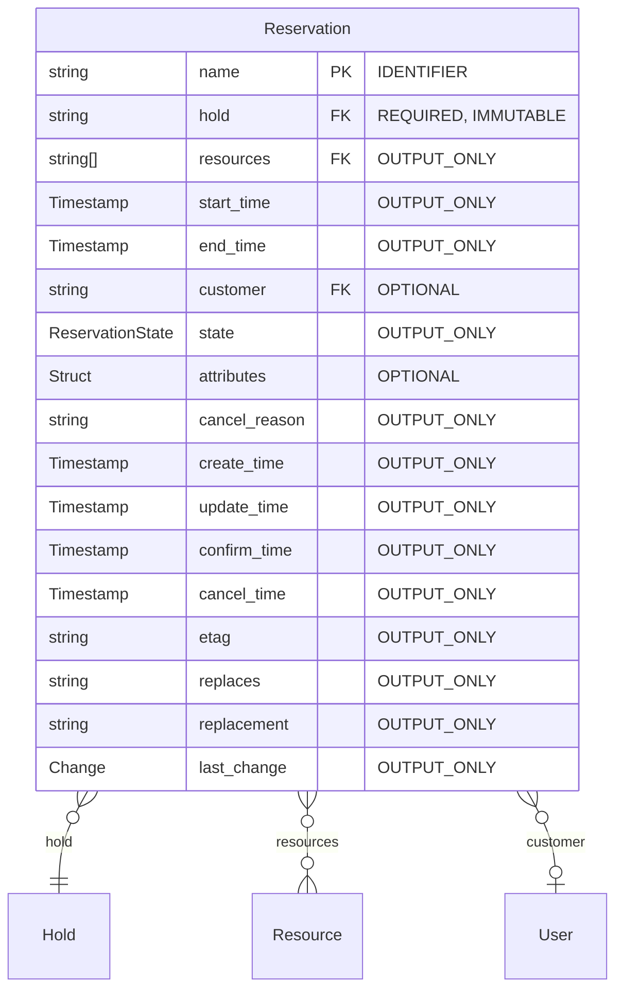
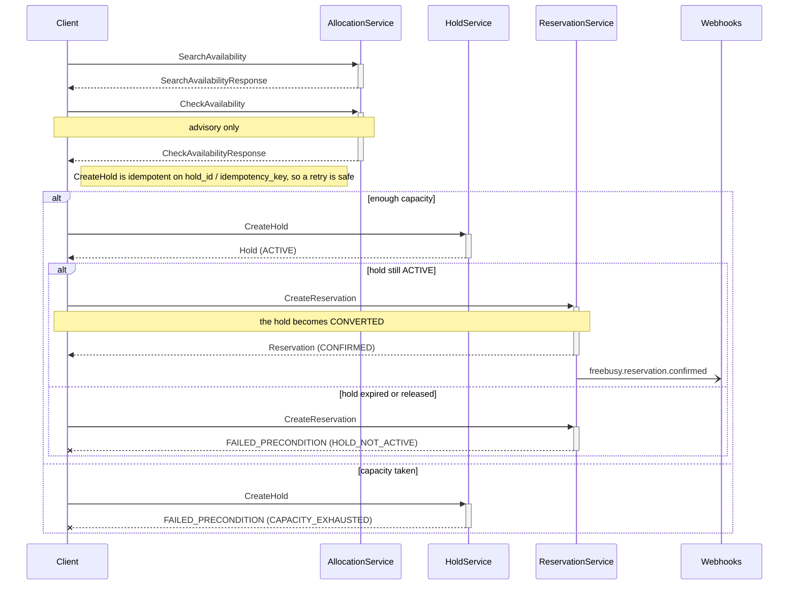
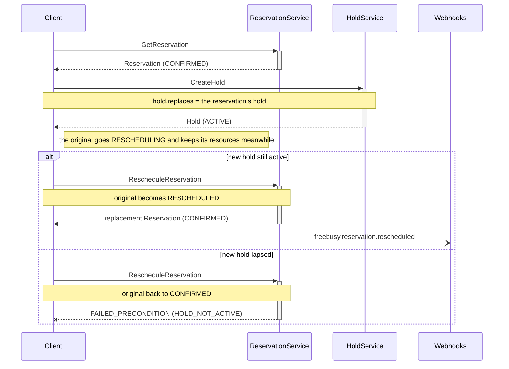
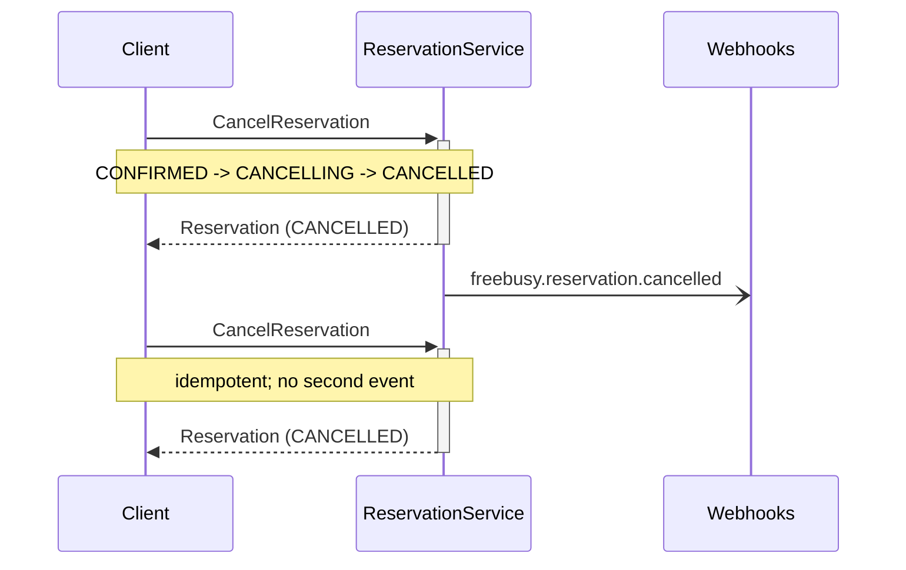
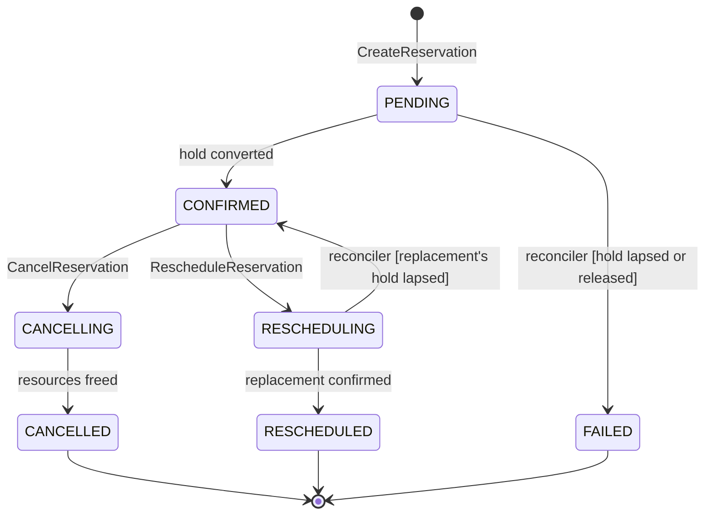

<!-- Copyright 2026 Srikanth K. -->
<!-- SPDX-License-Identifier: Apache-2.0 -->

# Reservation API

**Package:** `freebusy.reservation.v1`

> [!IMPORTANT]
> Auto-generated by `protoc-gen-openapi` 1.2.0 (mode=markdown). Do not edit manually.

**Contents:** [Resources](#resources) · [Flows](#flows) · [Services](#services) · [Messages](#messages) · [Enums](#enums)

## Resources

| Resource | Type | Pattern |
| --- | --- | --- |
| [`Reservation`](#reservation) | `freebusy.reservation.v1/Reservation` | `reservations/{reservation}` |

## Flows

### Flow: Book a resource

Search, check, hold, then confirm. Only the hold secures capacity: search
and check are advisory and can be stale the instant they answer.

## Services

### ReservationService

ReservationService turns holds into confirmed bookings, updates and cancels
them.

It is where HoldService's conversion is driven from: a hold is never
converted by a caller reaching into HoldService, only by a reservation being
made of it. UpdateReservation changes only what the engine does not own --
the customer and the attributes. The window and resources are the hold's,
and changing either is a new hold and a new reservation, which is exactly
what RescheduleReservation does.

| Method | Request | Response | HTTP | Description |
| --- | --- | --- | --- | --- |
| `CreateReservation` | [`CreateReservationRequest`](#createreservationrequest) | [`Reservation`](#reservation) | `POST /v1/reservations` | Makes a reservation from a live hold, converting the hold so its resources stay taken.  Idempotent: a hold backs at most one reservation, so a retry returns the reservation the first call made. Fails with FAILED_PRECONDITION when the hold has lapsed or been released. |
| `GetReservation` | [`GetReservationRequest`](#getreservationrequest) | [`Reservation`](#reservation) | `GET /v1/{name=reservations/*}` | Retrieves one reservation. |
| `ListReservations` | [`ListReservationsRequest`](#listreservationsrequest) | [`ListReservationsResponse`](#listreservationsresponse) | `GET /v1/reservations` | Lists reservations. |
| `UpdateReservation` | [`UpdateReservationRequest`](#updatereservationrequest) | [`Reservation`](#reservation) | `PATCH /v1/{reservation.name=reservations/*}` | Updates a confirmed reservation's customer or attributes, AIP-134.  update_mask is required and may name only `customer` and `attributes`; everything else is the engine's, and is changed by CancelReservation or RescheduleReservation. `reservation.etag`, when set, must match the stored one (AIP-154). Fails with FAILED_PRECONDITION unless the reservation is confirmed. |
| `CancelReservation` | [`CancelReservationRequest`](#cancelreservationrequest) | [`Reservation`](#reservation) | `POST /v1/{name=reservations/*}:cancel` | Cancels a reservation, freeing its resources.  Idempotent: cancelling a cancelled reservation succeeds and changes nothing. |
| `RescheduleReservation` | [`RescheduleReservationRequest`](#reschedulereservationrequest) | [`Reservation`](#reservation) | `POST /v1/{name=reservations/*}:reschedule` | Moves a confirmed reservation onto a new hold, returning the reservation that replaces it.  The replacement is a new reservation made from the new hold, linked both ways (`replaces`, `replacement`); the original ends RESCHEDULED. The original keeps its resources until the replacement is confirmed, so a failure part-way -- the new hold lapsing, a crash -- leaves the customer with their old booking, never with neither. A new hold taken with `replaces` naming the original's hold may overlap the original's window on the same resources -- an extension in place -- and the overlap passes to the replacement in the same write that frees the original. Idempotent: repeating the call with the same hold returns the same replacement. |

#### Flow: Reschedule a reservation

Moves a booking onto a new hold. The original keeps its resources until
the replacement is confirmed, so a failure part-way leaves the old
booking in place.

#### Flow: Cancel a reservation

Cancelling frees the resources; repeating it changes nothing.

## Messages

### Reservation

A Reservation is a confirmed booking: a hold made permanent.

It is the last step of booking, not the first. The caller checks
availability, takes a hold, settles whatever its vertical needs settled --
payment, a guest list, a waiver -- and then creates a reservation from the
hold. The reservation records the outcome; the engine already holds the
resources.

Deliberately thin. Price, discount, promo code, refund, guests and occupancy
are what would tie it to one vertical, and none of them is here: money belongs to the payment service and people to the user
service, both referenced by name (AIP-215), and anything else a vertical
needs to remember rides in `attributes`.

Resource `freebusy.reservation.v1/Reservation`, pattern `reservations/{reservation}`.

| Field | Type | Behavior | Description |
| --- | --- | --- | --- |
| `name` | `string` | `IDENTIFIER` | The reservation name. Its id is the caller's reservation_id, or else the id of the hold it was made from. Format: reservations/{reservation} |
| `hold` | `string` | `REQUIRED`, `IMMUTABLE` | The hold this reservation was made from. Format: holds/{hold} References `freebusy.allocation.v1/Hold`. |
| `resources` | repeated `string` | `OUTPUT_ONLY` | The resources taken, copied from the hold. Format: resources/{resource} References `the-protobuf-project.org/Resource`. |
| `start_time` | `google.protobuf.Timestamp` | `OUTPUT_ONLY` | Start of the reserved window, copied from the hold. |
| `end_time` | `google.protobuf.Timestamp` | `OUTPUT_ONLY` | End of the reserved window, exclusive, copied from the hold. |
| `customer` | `string` | `OPTIONAL` | Who the reservation is for, by name in the user service. freebusy does not keep users: when a resolver for the type is registered (config `reference_services`) a create or update checks the name with that service, and a deleted user leaves the reservation as it is. Format: users/{user} References `users.shokki.engineering/User`. |
| `state` | [`ReservationState`](#reservationstate) | `OUTPUT_ONLY` | Lifecycle state. |
| `attributes` | `google.protobuf.Struct` | `OPTIONAL` | Whatever a vertical needs to keep with the reservation: a party size, a payment reference, a licence plate. Opaque to the engine. |
| `cancel_reason` | `string` | `OUTPUT_ONLY` | Why it was cancelled, in the canceller's words. Set by CancelReservation. |
| `create_time` | `google.protobuf.Timestamp` | `OUTPUT_ONLY` | Creation timestamp. |
| `update_time` | `google.protobuf.Timestamp` | `OUTPUT_ONLY` | Last-modification timestamp. |
| `confirm_time` | `google.protobuf.Timestamp` | `OUTPUT_ONLY` | When it was confirmed. |
| `cancel_time` | `google.protobuf.Timestamp` | `OUTPUT_ONLY` | When it was cancelled. |
| `etag` | `string` | `OUTPUT_ONLY` | Opaque version for optimistic concurrency (AIP-154); echo on cancel. |
| `replaces` | `string` | `OUTPUT_ONLY` | The reservation this one replaced, set when it was made by RescheduleReservation. Format: reservations/{reservation} |
| `replacement` | `string` | `OUTPUT_ONLY` | The reservation replacing this one, set when RescheduleReservation began. Format: reservations/{reservation} |
| `last_change` | [`Reservation.Change`](#reservationchange) | `OUTPUT_ONLY` | What the last write to this reservation changed. A webhook is sent freebusy.reservation.updated exactly when it is CHANGE_DETAILS, and the event of the new state otherwise. |

### CreateReservationRequest

Request message for ReservationService.CreateReservation, AIP-133.

Safe to retry without an idempotency key of its own: a hold can back only
one reservation, so a retry -- with or without reservation_id -- finds the
reservation the first attempt made instead of making a second.

| Field | Type | Behavior | Description |
| --- | --- | --- | --- |
| `reservation` | [`Reservation`](#reservation) | `REQUIRED` | The reservation to make. `hold` is required; `customer` and `attributes` are optional. |
| `reservation_id` | `string` | `OPTIONAL` | Client-assigned id, becoming the last segment of the reservation name. Defaults to the hold's id. A hold backs at most one reservation whatever its id, so naming a hold that already has one returns that reservation. |

### GetReservationRequest

Request message for ReservationService.GetReservation, AIP-131.

| Field | Type | Behavior | Description |
| --- | --- | --- | --- |
| `name` | `string` | `REQUIRED` | Format: reservations/{reservation} References `freebusy.reservation.v1/Reservation`. |

### ListReservationsRequest

Request message for ReservationService.ListReservations, AIP-132.

| Field | Type | Behavior | Description |
| --- | --- | --- | --- |
| `page_size` | `int32` | `OPTIONAL` | Maximum reservations to return. Defaults to 50, capped at 1000. |
| `page_token` | `string` | `OPTIONAL` | Page token from a previous ListReservationsResponse.next_page_token. |
| `filter` | `string` | `OPTIONAL` | Filter expression, AIP-160, e.g. `state = RESERVATION_STATE_CONFIRMED AND start_time >= "2026-11-10T00:00:00Z"`. |
| `order_by` | `string` | `OPTIONAL` | Ordering, AIP-132, e.g. `start_time desc`. |

### ListReservationsResponse

Response message for ReservationService.ListReservations, AIP-132.

| Field | Type | Behavior | Description |
| --- | --- | --- | --- |
| `reservations` | repeated [`Reservation`](#reservation) | - | The reservations on this page. |
| `next_page_token` | `string` | - | Token for the next page, empty when this is the last page. |

### UpdateReservationRequest

Request message for ReservationService.UpdateReservation, AIP-134.

The reservation's own field rules are not applied: a partial update leaves
out `hold`, which a create must send. Instead this message checks
`reservation.name` and `reservation.customer`, and the service checks the
mask.

| Field | Type | Behavior | Description |
| --- | --- | --- | --- |
| `reservation` | [`Reservation`](#reservation) | `REQUIRED` | The reservation, its name identifying which. Only the fields update_mask names are read. `etag`, when set, must match the stored one (AIP-154). |
| `update_mask` | `google.protobuf.FieldMask` | `OPTIONAL` | The fields to change: `customer`, `attributes`, or both; `*` is both. It must be sent -- an update never guesses what was meant from the fields that happen to be set -- and an empty one is rejected with REQUIRED_FIELD. Any other field is rejected with UNKNOWN_MASK_PATH. |

### CancelReservationRequest

Request message for ReservationService.CancelReservation.

| Field | Type | Behavior | Description |
| --- | --- | --- | --- |
| `name` | `string` | `REQUIRED` | Format: reservations/{reservation} References `freebusy.reservation.v1/Reservation`. |
| `reason` | `string` | `OPTIONAL` | Why, in the canceller's words. Recorded, never parsed. |
| `etag` | `string` | `OPTIONAL` | Opaque version read from the reservation; the cancel is rejected if it changed since (AIP-154). |

### RescheduleReservationRequest

Request message for ReservationService.RescheduleReservation.

| Field | Type | Behavior | Description |
| --- | --- | --- | --- |
| `name` | `string` | `REQUIRED` | The confirmed reservation to move. Format: reservations/{reservation} References `freebusy.reservation.v1/Reservation`. |
| `hold` | `string` | `REQUIRED` | A live hold on the new window, taken by the caller with HoldService.CreateHold. Taking it first is what makes the move safe: the new slot is secured before the old one is let go. Format: holds/{hold} References `freebusy.allocation.v1/Hold`. |
| `etag` | `string` | `OPTIONAL` | Opaque version read from the reservation; the move is rejected if it changed since (AIP-154). |

## Enums

### ReservationState

Lifecycle of a Reservation.

Two of these states are in-between states, and they are why a crash never
leaves the books wrong. Confirming takes two writes -- this record and the
hold's conversion -- as does cancelling, and no transaction spans the engine
and this table on every backend. So each transition is written down before it
is carried out: a reservation seen PENDING or CANCELLING says what was being
attempted, and the reconciler finishes it.

| Value | Number | Description |
| --- | --- | --- |
| `RESERVATION_STATE_UNSPECIFIED` | 0 | Default; never persisted. |
| `RESERVATION_STATE_PENDING` | 1 | Recorded, and its hold is being converted. Transient: the call that created it, a retry of that call, or the reconciler moves it on to CONFIRMED or FAILED. |
| `RESERVATION_STATE_CONFIRMED` | 2 | The hold was converted: the resources are taken for the window for good. |
| `RESERVATION_STATE_CANCELLING` | 3 | Cancellation is recorded and the resources are being freed. Transient, like PENDING, and finished the same way. |
| `RESERVATION_STATE_CANCELLED` | 4 | Cancelled; the resources are free again. Terminal. |
| `RESERVATION_STATE_FAILED` | 5 | The hold lapsed or was released before it could be converted, so nothing was taken. Terminal. |
| `RESERVATION_STATE_RESCHEDULING` | 6 | Being replaced by the reservation named in `replacement`. Transient: it keeps its resources until the replacement is confirmed, then becomes RESCHEDULED -- or returns to CONFIRMED if the replacement's hold lapsed. |
| `RESERVATION_STATE_RESCHEDULED` | 7 | Replaced by `replacement`, which now holds the booking; this one's resources are free. Terminal. |

#### ReservationState lifecycle

| From | To | Trigger | Condition |
| --- | --- | --- | --- |
| _(start)_ | `PENDING` | `ReservationService.CreateReservation` | - |
| `PENDING` | `CONFIRMED` | hold converted | - |
| `RESCHEDULING` | `CONFIRMED` | reconciler | replacement's hold lapsed |
| `CONFIRMED` | `CANCELLING` | `ReservationService.CancelReservation` | - |
| `CANCELLING` | `CANCELLED` | resources freed | - |
| `PENDING` | `FAILED` | reconciler | hold lapsed or released |
| `CONFIRMED` | `RESCHEDULING` | `ReservationService.RescheduleReservation` | - |
| `RESCHEDULING` | `RESCHEDULED` | replacement confirmed | - |

### ErrorReason

The reasons freebusy returns for reservations: the google.rpc.ErrorInfo
reasons (AIP-193) in the freebusy.dev domain. They are part of the API:
clients branch on them, never on a message. protoc-gen-service renders them as
Go constants, sentinels and the tables of docs/errors.md.

| Value | Number | Description |
| --- | --- | --- |
| `ERROR_REASON_UNSPECIFIED` | 0 | Unset; never returned. |
| `ERROR_REASON_HOLD_NOT_FOUND` | 1 | The reservation's hold does not exist, or CreateHold's hold.replaces names one that does not. |
| `ERROR_REASON_HOLD_LAPSED` | 3 | The hold lapsed before the reservation was confirmed; the reservation failed. |
| `ERROR_REASON_RESERVATION_ID_TAKEN` | 4 | reservation_id names a reservation made from another hold. |
| `ERROR_REASON_RESERVATION_FAILED` | 5 | CancelReservation on a reservation that failed; it holds nothing. |
| `ERROR_REASON_RESERVATION_MOVED` | 6 | The reservation was rescheduled; its replacement holds the booking. |
| `ERROR_REASON_RESERVATION_NOT_CONFIRMED` | 7 | Only a confirmed reservation can be rescheduled or updated; this one is cancelled, cancelling or failed. |
| `ERROR_REASON_RESCHEDULE_IN_PROGRESS` | 8 | The reservation is being moved, so it cannot be moved elsewhere or updated. |
| `ERROR_REASON_SAME_HOLD` | 9 | Rescheduling onto the hold the reservation was made from changes nothing. |
| `ERROR_REASON_REPLACEMENT_FAILED` | 10 | The new slot could not be booked; the reservation keeps its original one. |
| `ERROR_REASON_HOLD_FOR_RESCHEDULE` | 11 | The hold was taken to replace a booking (hold.replaces), so it can only be used to reschedule the reservation made from that hold. |

### Reservation.Change

What a write to a reservation changed.

| Value | Number | Description |
| --- | --- | --- |
| `CHANGE_UNSPECIFIED` | 0 | Default; never persisted. |
| `CHANGE_STATE` | 1 | Its state: it was created, confirmed, cancelled, rescheduled, or a transition was undone. |
| `CHANGE_DETAILS` | 2 | What is kept with it, through UpdateReservation: its customer or attributes. Its state did not change. |

---

© 2026 Srikanth K | Apache 2.0 License
