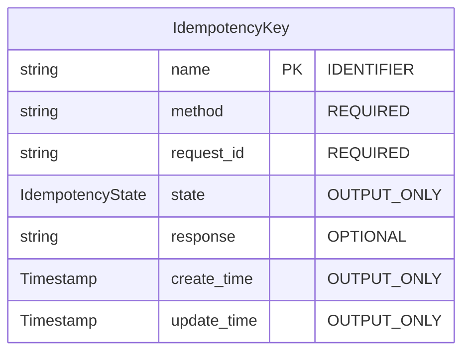

<!-- Copyright 2026 Srikanth K. -->
<!-- SPDX-License-Identifier: Apache-2.0 -->

# Shared API

**Package:** `freebusy.shared.v1`

> [!IMPORTANT]
> Auto-generated by `protoc-gen-openapi` 1.2.0 (mode=markdown). Do not edit manually.

**Contents:** [Resources](#resources) · [Messages](#messages) · [Enums](#enums)

## Resources

| Resource | Type | Pattern |
| --- | --- | --- |
| [`IdempotencyKey`](#idempotencykey) | `freebusy.shared.v1/IdempotencyKey` | `idempotencyKeys/{idempotency_key}` |

## Messages

### IdempotencyKey

The record behind every `request_id` field in this API: it remembers what the
first call with a given id returned, so a retry replays that response instead
of attempting the write twice. Storage only — no service exposes it, and no
caller constructs one. It lives in freebusy.shared.v1 because request_id is
an API-wide convention any RPC may opt into, and one interceptor records them
all; homing it in any single service's package would make every other
service import that service to dedupe its own writes. No RPC declares
request_id today -- holds and reservations carry their own idempotency.

The id is derived, not random: it is a digest of (method, request_id), so the
primary key itself is the uniqueness constraint that makes a concurrent
duplicate lose the race rather than double-write.

Resource `freebusy.shared.v1/IdempotencyKey`, pattern `idempotencyKeys/{idempotency_key}`.

| Field | Type | Behavior | Description |
| --- | --- | --- | --- |
| `name` | `string` | `IDENTIFIER` | The key name. The final segment is a digest of (method, request_id). Format: idempotencyKeys/{idempotency_key} |
| `method` | `string` | `REQUIRED` | Fully-qualified RPC that was called, e.g. "/freebusy.allocation.v1.HoldService/CreateHold". Part of the key: the same request_id replayed against a different method is a different request. |
| `request_id` | `string` | `REQUIRED` | The caller-supplied idempotency key, verbatim from the request's `request_id` field. |
| `state` | [`IdempotencyState`](#idempotencystate) | `OUTPUT_ONLY` | Whether the first call is still running or has settled. REQUIRED, not OUTPUT_ONLY, and AIP-216's state-field-output-only is knowingly not satisfied here. protoc-gen-orm reads OUTPUT_ONLY as "the repository never writes this column": with it set, GORM's Update stops copying State and the GraphQL create input and update patch both omit it, so settle()'s transition to DONE is silently dropped and every replay re-runs the handler. AIP-216 is about a *client* not setting lifecycle; this record has no client -- no service exposes it and the server is the only writer -- so the rule's premise does not hold while its cost is a broken idempotency mechanism. Revisit if orm gains a writable override. |
| `response` | `string` | `OPTIONAL` | What the first call returned: a google.protobuf.Any holding the response message, encoded as protojson. Empty while IN_FLIGHT. Stored as text rather than bytes so it round-trips identically through GORM and through Hasura's GraphQL, and self-describing (the Any carries its @type) so a replay can rebuild the exact response message without knowing which RPC wrote it. |
| `create_time` | `google.protobuf.Timestamp` | `OUTPUT_ONLY` | When the key was claimed. |
| `update_time` | `google.protobuf.Timestamp` | `OUTPUT_ONLY` | When the key settled to DONE. |

### TimeWindow

A half-open time interval [start_time, end_time). Used for query windows and
for a booking's reserved span in both TIME_SLOT and NIGHTLY modes.

| Field | Type | Behavior | Description |
| --- | --- | --- | --- |
| `start_time` | `google.protobuf.Timestamp` | `REQUIRED` | Inclusive start of the interval. |
| `end_time` | `google.protobuf.Timestamp` | `REQUIRED` | Exclusive end of the interval. |

### DateRange

A half-open range of calendar dates [start_date, end_date), evaluated in the
resource's local timezone. The natural query and exception shape for NIGHTLY
resources: end_date is the check-out date and is not itself included.

| Field | Type | Behavior | Description |
| --- | --- | --- | --- |
| `start_date` | `google.type.Date` | `REQUIRED` | Inclusive first date of the range. |
| `end_date` | `google.type.Date` | `REQUIRED` | Exclusive end date of the range. |

### PriceComponent

One line in a price breakdown: a base charge, a fee, a tax, or a discount.
Clients branch on `type` and `code`; the signed `amount` rolls up to the
booking total (charges positive, discounts negative).

| Field | Type | Behavior | Description |
| --- | --- | --- | --- |
| `type` | [`PriceComponent.Type`](#pricecomponenttype) | - | Which kind of line this is. |
| `code` | `string` | - | Stable machine code for the line, e.g. "base", "cleaning_fee", "occupancy_tax", or a promo code. Clients key display and logic off this. |
| `display_name` | `string` | - | Human-readable label suitable for display on an itemized receipt. |
| `amount` | `google.type.Money` | - | Signed amount: positive for charges (base, fees, taxes), negative for discounts. Summing every component yields the booking total. |

## Enums

### OrderDirection

Enums shared across more than one freebusy resource. Resource-specific enums
live alongside their resource (e.g. BookingStatus in the booking package), so
only the genuinely cross-cutting ones are defined here.
Sort direction for list endpoints.

| Value | Number | Description |
| --- | --- | --- |
| `ORDER_DIRECTION_UNSPECIFIED` | 0 | Server default (usually descending by creation time). |
| `ORDER_DIRECTION_ASC` | 1 | Ascending. |
| `ORDER_DIRECTION_DESC` | 2 | Descending. |

### Weekday

Day of the week, numbered to match google.type.DayOfWeek (Monday = 1).

| Value | Number | Description |
| --- | --- | --- |
| `WEEKDAY_UNSPECIFIED` | 0 | Unspecified. |
| `WEEKDAY_MONDAY` | 1 | Monday |
| `WEEKDAY_TUESDAY` | 2 | Tuesday |
| `WEEKDAY_WEDNESDAY` | 3 | Wednesday |
| `WEEKDAY_THURSDAY` | 4 | Thursday |
| `WEEKDAY_FRIDAY` | 5 | Friday |
| `WEEKDAY_SATURDAY` | 6 | Saturday |
| `WEEKDAY_SUNDAY` | 7 | Sunday |

### BookingMode

How a resource is booked, which decides the availability shape it produces.

| Value | Number | Description |
| --- | --- | --- |
| `BOOKING_MODE_UNSPECIFIED` | 0 | Unset; the server treats this as TIME_SLOT. |
| `BOOKING_MODE_TIME_SLOT` | 1 | Duration-based discrete slots (appointments, hourly rentals). |
| `BOOKING_MODE_NIGHTLY` | 2 | Date-range stays over a pool of interchangeable units (lodging). |

### MediaType

Kind of media asset a Media reference points at. Documents (PDFs, house rules,
fact sheets) are just media with type DOCUMENT — they are not a separate type.

| Value | Number | Description |
| --- | --- | --- |
| `MEDIA_TYPE_UNSPECIFIED` | 0 | Unset. |
| `MEDIA_TYPE_IMAGE` | 1 | A photo (e.g. a room or property showcase image). |
| `MEDIA_TYPE_VIDEO` | 2 | A video clip. |
| `MEDIA_TYPE_DOCUMENT` | 3 | A document such as a PDF fact sheet, policy, or house rules. |
| `MEDIA_TYPE_FLOORPLAN` | 4 | A floor plan diagram. |
| `MEDIA_TYPE_VIRTUAL_TOUR` | 5 | A 360°/virtual-tour asset. |

### ErrorReason

The reasons freebusy returns for the resources, calendars, events and
availability freebusy serves, and any call: the
google.rpc.ErrorInfo reasons (AIP-193) in the freebusy.dev domain. They are
part of the API: clients branch on them, never on a message.
protoc-gen-service renders them as Go constants, sentinels and the tables of
docs/errors.md.

| Value | Number | Description |
| --- | --- | --- |
| `ERROR_REASON_UNSPECIFIED` | 0 | Unset; never returned. |
| `ERROR_REASON_CALENDAR_NOT_FOUND` | 10 | The calendar named does not exist. |
| `ERROR_REASON_CALENDAR_DELETED` | 11 | Nothing can be added to a deleted calendar. |
| `ERROR_REASON_CALENDAR_NOT_EMPTY` | 12 | The calendar still has events or availability. |
| `ERROR_REASON_NAME_NOT_UNDER_PARENT` | 13 | BatchGetEvents was asked for an event of another calendar. |
| `ERROR_REASON_NOT_RECURRING` | 14 | ExpandEvent on an event without a recurrence rule, or an override with original_start_range whose series has none. |
| `ERROR_REASON_SERIES_NOT_FOUND` | 15 | CreateEvent or UpdateEvent with original_start_range: no recurring event in the calendar has the override's ical_uid. |
| `ERROR_REASON_NOT_AN_INSTANCE` | 16 | original_start with original_start_range names no instance of the series: its rule and added dates do not produce it, or it is excluded. |
| `ERROR_REASON_RANGE_NOT_SUPPORTED` | 17 | original_start_range (RFC 5545 RANGE=THISANDFUTURE) splits the series at original_start, applying the edit's shift to every later instance; this series cannot be split there -- its rule has BYSETPOS, an ordinal BYDAY or a BYMONTHDAY/BYHOUR the shift would push out of range, or the instance is an added date with more after it. |
| `ERROR_REASON_INVALID_EVENT` | 18 | An event on the calendar cannot be read as time (for example, no start), so the calendar's time cannot be computed. |
| `ERROR_REASON_UNSUPPORTED_RECURRENCE` | 19 | An event recurs by a rule part freebusy does not expand: BYSECOND, BYYEARDAY, BYWEEKNO or RSCALE. |
| `ERROR_REASON_WINDOW_INCOMPLETE` | 20 | A window needs both start_time and end_time. |
| `ERROR_REASON_WINDOW_BACKWARDS` | 21 | window.end_time is not after window.start_time. |
| `ERROR_REASON_WINDOW_TOO_LONG` | 22 | The window is longer than one call answers. |
| `ERROR_REASON_UNIMPLEMENTED` | 23 | The call, or this use of it, is not implemented. |

### IdempotencyState

Lifecycle of a recorded request. A key is claimed IN_FLIGHT before the
handler runs and settles to DONE once its response is recorded; a handler
that fails deletes its key, so the caller may genuinely retry.

| Value | Number | Description |
| --- | --- | --- |
| `IDEMPOTENCY_STATE_UNSPECIFIED` | 0 | Unspecified. |
| `IDEMPOTENCY_STATE_IN_FLIGHT` | 1 | Claimed: a handler is running for this key right now. A second caller arriving here is a concurrent duplicate, not a replay. |
| `IDEMPOTENCY_STATE_DONE` | 2 | Settled: `response` holds what the first call returned. |

### PriceComponent.Type

What a price line represents.

| Value | Number | Description |
| --- | --- | --- |
| `TYPE_UNSPECIFIED` | 0 | Unset. |
| `TYPE_BASE` | 1 | The base charge: nightly/slot subtotal before fees, taxes, and discounts. |
| `TYPE_FEE` | 2 | A fee added on top of the base (e.g. cleaning, service, resort). |
| `TYPE_TAX` | 3 | A tax on the taxable base (e.g. VAT, occupancy/lodging tax). |
| `TYPE_DISCOUNT` | 4 | A discount (promo code, length-of-stay); `amount` is negative. |

---

© 2026 Srikanth K | Apache 2.0 License
