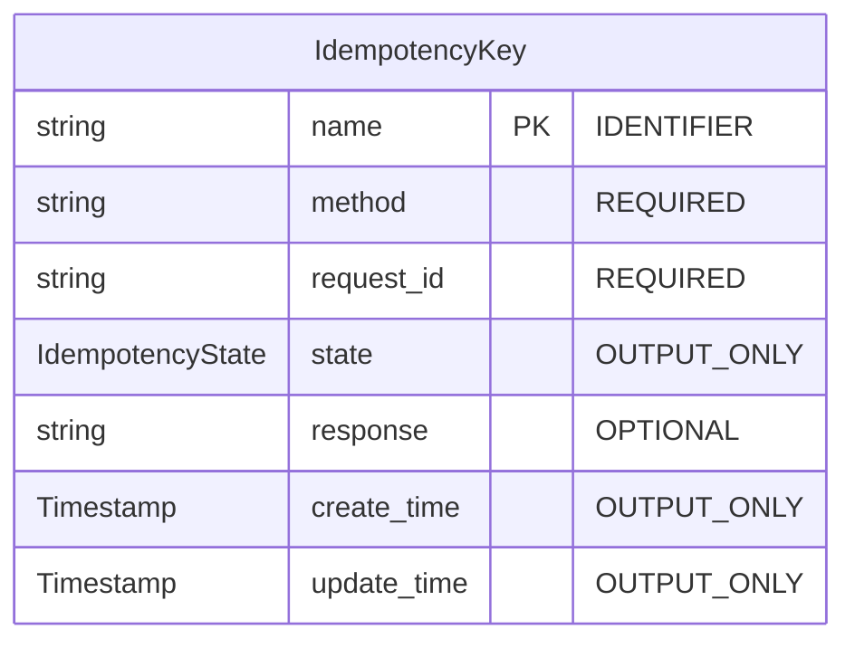

<!-- Copyright 2026 Srikanth K. -->
<!-- SPDX-License-Identifier: Apache-2.0 -->

# Shared API

**Package:** `freebusy.shared.v1`

> [!IMPORTANT]
> Auto-generated by `protoc-gen-openapi` 1.2.0 (mode=markdown). Do not edit manually.

**Contents:** [Resources](#resources) · [Messages](#messages) · [Enums](#enums)

## Resources

| Resource | Type | Pattern |
| --- | --- | --- |
| [`IdempotencyKey`](#idempotencykey) | `freebusy.shared.v1/IdempotencyKey` | `idempotencyKeys/{idempotency_key}` |

## Messages

### IdempotencyKey

The record behind every `request_id` field in this API: it remembers what the
first call with a given id returned, so a retry replays that response instead
of attempting the write twice. Storage only — no service exposes it, and no
caller constructs one. It lives in freebusy.shared.v1 because request_id is
an API-wide convention any RPC may opt into, and one interceptor records them
all; homing it in any single service's package would make every other
service import that service to dedupe its own writes. HoldService.CreateHold
declares it; CreateReservation needs none, since a hold backs at most one
reservation.

The id is derived, not random: it is a digest of (method, request_id), so the
primary key itself is the uniqueness constraint that makes a concurrent
duplicate lose the race rather than double-write.

Resource `freebusy.shared.v1/IdempotencyKey`, pattern `idempotencyKeys/{idempotency_key}`.

| Field | Type | Behavior | Description |
| --- | --- | --- | --- |
| `name` | `string` | `IDENTIFIER` | The key name. The final segment is a digest of (method, request_id). Format: idempotencyKeys/{idempotency_key} |
| `method` | `string` | `REQUIRED` | Fully-qualified RPC that was called, e.g. "/freebusy.allocation.v1.HoldService/CreateHold". Part of the key: the same request_id replayed against a different method is a different request. |
| `request_id` | `string` | `REQUIRED` | The caller-supplied idempotency key, verbatim from the request's `request_id` field. |
| `state` | [`IdempotencyState`](#idempotencystate) | `OUTPUT_ONLY` | Whether the first call is still running or has settled. Output only (AIP-216): only the server writes it, through the store's output-only update path when a call settles. |
| `response` | `string` | `OPTIONAL` | What the first call returned: a google.protobuf.Any holding the response message, encoded as protojson. Empty while IN_FLIGHT. Stored as text rather than bytes so it round-trips identically through GORM and through Hasura's GraphQL, and self-describing (the Any carries its @type) so a replay can rebuild the exact response message without knowing which RPC wrote it. |
| `create_time` | `google.protobuf.Timestamp` | `OUTPUT_ONLY` | When the key was claimed. |
| `update_time` | `google.protobuf.Timestamp` | `OUTPUT_ONLY` | When the key settled to DONE. |

## Enums

### ErrorReason

The reasons freebusy returns for the resources, calendars, events and
availability freebusy serves, and any call: the
google.rpc.ErrorInfo reasons (AIP-193) in the freebusy.shokki.engineering domain. They are
part of the API: clients branch on them, never on a message.
protoc-gen-service renders them as Go constants, sentinels and the tables of
docs/errors.md.

| Value | Number | Description |
| --- | --- | --- |
| `ERROR_REASON_UNSPECIFIED` | 0 | Unset; never returned. |
| `ERROR_REASON_CALENDAR_NOT_FOUND` | 10 | The calendar named does not exist. |
| `ERROR_REASON_CALENDAR_DELETED` | 11 | Nothing can be added to a deleted calendar. |
| `ERROR_REASON_CALENDAR_NOT_EMPTY` | 12 | The calendar still has events or availability. |
| `ERROR_REASON_NAME_NOT_UNDER_PARENT` | 13 | BatchGetEvents was asked for an event of another calendar. |
| `ERROR_REASON_NOT_RECURRING` | 14 | ExpandEvent on an event without a recurrence rule, or an override with original_start_range whose series has none. |
| `ERROR_REASON_SERIES_NOT_FOUND` | 15 | CreateEvent or UpdateEvent with original_start_range: no recurring event in the calendar has the override's ical_uid. |
| `ERROR_REASON_NOT_AN_INSTANCE` | 16 | original_start with original_start_range names no instance of the series: its rule and added dates do not produce it, or it is excluded. |
| `ERROR_REASON_RANGE_NOT_SUPPORTED` | 17 | original_start_range (RFC 5545 RANGE=THISANDFUTURE) splits the series at original_start, applying the edit's shift to every later instance; this series cannot be split there -- its rule has BYSETPOS, an ordinal BYDAY or a BYMONTHDAY/BYHOUR the shift would push out of range, or the instance is an added date with more after it. |
| `ERROR_REASON_INVALID_EVENT` | 18 | An event on the calendar cannot be read as time (for example, no start), so the calendar's time cannot be computed. |
| `ERROR_REASON_UNSUPPORTED_RECURRENCE` | 19 | An event recurs by a rule part freebusy does not expand: BYSECOND, BYYEARDAY, BYWEEKNO or RSCALE. |
| `ERROR_REASON_WINDOW_INCOMPLETE` | 20 | A window needs both start_time and end_time. |
| `ERROR_REASON_WINDOW_BACKWARDS` | 21 | window.end_time is not after window.start_time. |
| `ERROR_REASON_WINDOW_TOO_LONG` | 22 | The window is longer than one call answers. |
| `ERROR_REASON_UNIMPLEMENTED` | 23 | The call, or this use of it, is not implemented. |

### IdempotencyState

Lifecycle of a recorded request. A key is claimed IN_FLIGHT before the
handler runs and settles to DONE once its response is recorded; a handler
that fails deletes its key, so the caller may genuinely retry.

| Value | Number | Description |
| --- | --- | --- |
| `IDEMPOTENCY_STATE_UNSPECIFIED` | 0 | Unspecified. |
| `IDEMPOTENCY_STATE_IN_FLIGHT` | 1 | Claimed: a handler is running for this key right now. A second caller arriving here is a concurrent duplicate, not a replay. |
| `IDEMPOTENCY_STATE_DONE` | 2 | Settled: `response` holds what the first call returned. |

---

© 2026 Srikanth K | Apache 2.0 License
