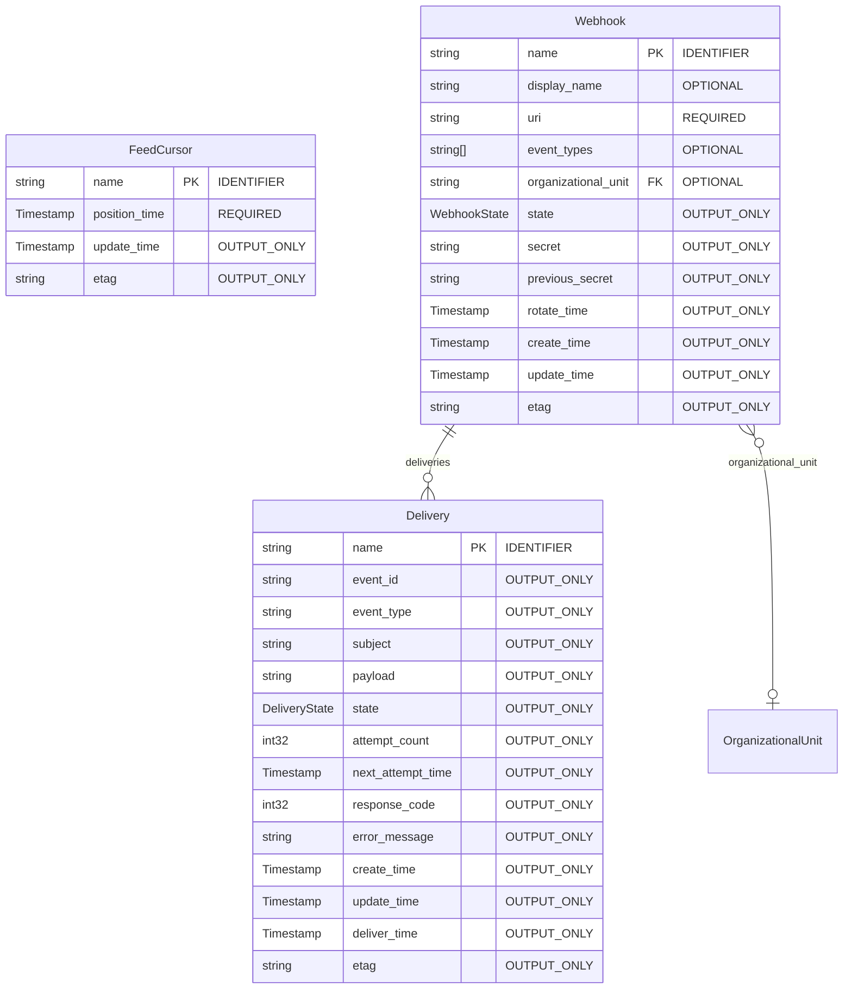
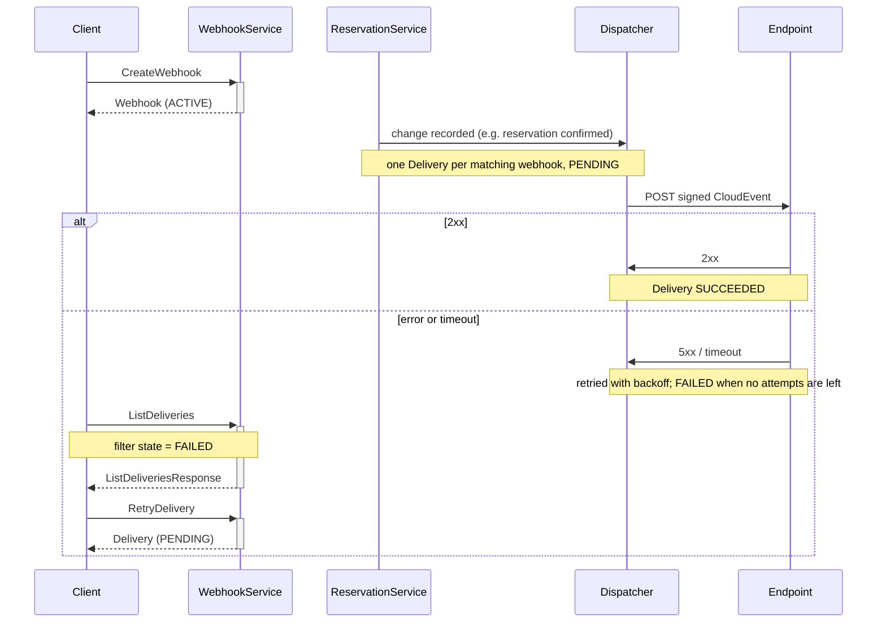
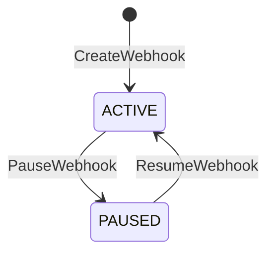
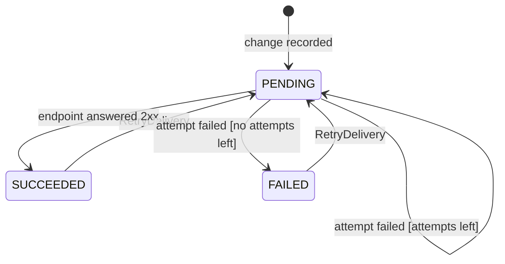

<!-- Copyright 2026 Srikanth K. -->
<!-- SPDX-License-Identifier: Apache-2.0 -->

# Webhook API

**Package:** `freebusy.webhook.v1`

> [!IMPORTANT]
> Auto-generated by `protoc-gen-openapi` 1.2.0 (mode=markdown). Do not edit manually.

**Contents:** [Resources](#resources) · [Services](#services) · [Messages](#messages) · [Enums](#enums)

## Resources

| Resource | Type | Pattern |
| --- | --- | --- |
| [`Delivery`](#delivery) | `freebusy.webhook.v1/Delivery` | `webhooks/{webhook}/deliveries/{delivery}` |
| [`FeedCursor`](#feedcursor) | `freebusy.webhook.v1/FeedCursor` | `feedCursors/{feed_cursor}` |
| [`Webhook`](#webhook) | `freebusy.webhook.v1/Webhook` | `webhooks/{webhook}` |

## Services

### WebhookService

WebhookService subscribes endpoints to changes in holds, reservations and
inventory, and shows what was sent to each.

| Method | Request | Response | HTTP | Description |
| --- | --- | --- | --- | --- |
| `CreateWebhook` | [`CreateWebhookRequest`](#createwebhookrequest) | [`Webhook`](#webhook) | `POST /v1/webhooks` | Creates a webhook. The response carries its signing secret, which no later read returns. |
| `GetWebhook` | [`GetWebhookRequest`](#getwebhookrequest) | [`Webhook`](#webhook) | `GET /v1/{name=webhooks/*}` | Retrieves one webhook, without its secret. |
| `ListWebhooks` | [`ListWebhooksRequest`](#listwebhooksrequest) | [`ListWebhooksResponse`](#listwebhooksresponse) | `GET /v1/webhooks` | Lists webhooks, without their secrets. |
| `UpdateWebhook` | [`UpdateWebhookRequest`](#updatewebhookrequest) | [`Webhook`](#webhook) | `PATCH /v1/{webhook.name=webhooks/*}` | Updates a webhook: its endpoint, event types or site. |
| `PauseWebhook` | [`PauseWebhookRequest`](#pausewebhookrequest) | [`Webhook`](#webhook) | `POST /v1/{name=webhooks/*}:pause` | Stops sending a webhook changes. Changes made while it is paused are not sent; deliveries already pending wait. Idempotent. |
| `ResumeWebhook` | [`ResumeWebhookRequest`](#resumewebhookrequest) | [`Webhook`](#webhook) | `POST /v1/{name=webhooks/*}:resume` | Starts sending a paused webhook changes again, from now on. Idempotent. |
| `DeleteWebhook` | [`DeleteWebhookRequest`](#deletewebhookrequest) | `google.protobuf.Empty` | `DELETE /v1/{name=webhooks/*}` | Deletes a webhook; with force, its deliveries too. |
| `RotateWebhookSecret` | [`RotateWebhookSecretRequest`](#rotatewebhooksecretrequest) | [`Webhook`](#webhook) | `POST /v1/{name=webhooks/*}:rotateSecret` | Replaces a webhook's signing secret, returning the new one. For a day the old secret signs deliveries too -- Standard Webhooks carries several signatures in one header -- so a receiver can switch without missing one. |
| `GetDelivery` | [`GetDeliveryRequest`](#getdeliveryrequest) | [`Delivery`](#delivery) | `GET /v1/{name=webhooks/*/deliveries/*}` | Retrieves one delivery. |
| `ListDeliveries` | [`ListDeliveriesRequest`](#listdeliveriesrequest) | [`ListDeliveriesResponse`](#listdeliveriesresponse) | `GET /v1/{parent=webhooks/*}/deliveries` | Lists a webhook's deliveries. |
| `RetryDelivery` | [`RetryDeliveryRequest`](#retrydeliveryrequest) | [`Delivery`](#delivery) | `POST /v1/{name=webhooks/*/deliveries/*}:retry` | Sends a delivery again, whatever its state: it goes back to PENDING with its attempts reset and is attempted at once. The payload is the one recorded, not the record as it stands now. |

#### Flow: Webhook delivery

Every change a webhook subscribes to is recorded as a Delivery and sent
as a signed CloudEvent (Standard Webhooks). Failed deliveries are retried
with backoff, and can be sent again by hand.

## Messages

### Delivery

One event owed to one webhook, and how sending it went.

The id is derived, not random: a digest of the webhook and the event, so
recording the same change twice -- a rescan, or two servers scanning at once
-- loses the race on the primary key instead of sending the event twice.

Resource `freebusy.webhook.v1/Delivery`, pattern `webhooks/{webhook}/deliveries/{delivery}`.

| Field | Type | Behavior | Description |
| --- | --- | --- | --- |
| `name` | `string` | `IDENTIFIER` | The delivery name. The final segment is a digest of (webhook, event_id). Format: webhooks/{webhook}/deliveries/{delivery} |
| `event_id` | `string` | `OUTPUT_ONLY` | The CloudEvents id, the same for every webhook sent this change: a digest of the record's name and etag. Receivers deduplicate on it. |
| `event_type` | `string` | `OUTPUT_ONLY` | The CloudEvents type, e.g. "freebusy.reservation.confirmed". |
| `subject` | `string` | `OUTPUT_ONLY` | The record that changed. Format: organizationalUnits/{organizational_unit}/reservations/{reservation} or organizationalUnits/{organizational_unit}/holds/{hold} |
| `payload` | `string` | `OUTPUT_ONLY` | The request body sent: a CloudEvents 1.0 JSON document whose data is the record as it stood. |
| `state` | [`DeliveryState`](#deliverystate) | `OUTPUT_ONLY` | Where sending stands. |
| `attempt_count` | `int32` | `OUTPUT_ONLY` | Attempts made so far. |
| `next_attempt_time` | `google.protobuf.Timestamp` | `OUTPUT_ONLY` | When the next attempt is due, while PENDING. |
| `response_code` | `int32` | `OUTPUT_ONLY` | HTTP status of the last attempt; 0 when it got no response. |
| `error_message` | `string` | `OUTPUT_ONLY` | Why the last attempt failed, empty after a success. |
| `create_time` | `google.protobuf.Timestamp` | `OUTPUT_ONLY` | When the change was recorded for this webhook. |
| `update_time` | `google.protobuf.Timestamp` | `OUTPUT_ONLY` | Last-modification timestamp. |
| `deliver_time` | `google.protobuf.Timestamp` | `OUTPUT_ONLY` | When the endpoint accepted it. |
| `etag` | `string` | `OUTPUT_ONLY` | Opaque version for optimistic concurrency (AIP-154). |

### FeedCursor

How far the dispatcher has read one change feed: every record of the feed
last modified before position_time has been recorded for every webhook. Storage
only -- no service exposes it.

Resource `freebusy.webhook.v1/FeedCursor`, pattern `feedCursors/{feed_cursor}`.

| Field | Type | Behavior | Description |
| --- | --- | --- | --- |
| `name` | `string` | `IDENTIFIER` | The cursor name; the final segment names the feed, e.g. "reservations". Format: feedCursors/{feed_cursor} |
| `position_time` | `google.protobuf.Timestamp` | `REQUIRED` | Records modified before this have been recorded. |
| `update_time` | `google.protobuf.Timestamp` | `OUTPUT_ONLY` | Last-modification timestamp. |
| `etag` | `string` | `OUTPUT_ONLY` | Opaque version for optimistic concurrency (AIP-154). |

### Webhook

A Webhook sends an HTTPS endpoint each change to holds, reservations and the
inventory they draw on -- resources, calendars, calendar events and
availability -- as a signed CloudEvent: how a payment service learns a hold
lapsed, or a booking layer that a reservation was confirmed or a court was
closed for maintenance, without polling.

Changes are read from the records themselves, not announced by the writes,
so a change cannot be lost to a crash between a write and its
announcement. The price is coalescing: two transitions of one record in
quick succession may arrive as one event carrying the later state. Every
event carries the whole record, so a receiver acts on what is, not on a
diff.

Resource `freebusy.webhook.v1/Webhook`, pattern `webhooks/{webhook}`.

| Field | Type | Behavior | Description |
| --- | --- | --- | --- |
| `name` | `string` | `IDENTIFIER` | The webhook name. Format: webhooks/{webhook} |
| `display_name` | `string` | `OPTIONAL` | Human-readable name, for the operator's own reference. |
| `uri` | `string` | `REQUIRED` | The endpoint each event is POSTed to. HTTPS, except to a loopback host when the server allows insecure endpoints for development. Required on create; an update that leaves it out keeps the current one. |
| `event_types` | repeated `string` | `OPTIONAL` | The event types sent, e.g. "freebusy.reservation.confirmed" or "freebusy.event.deleted". Empty sends every type. A type is "freebusy.<record>.<what happened>": holds are active, released, expired and converted; reservations pending, confirmed, cancelling, cancelled, failed, rescheduling and rescheduled, and updated exactly when UpdateReservation changed its customer or attributes -- the reservation's last_change is CHANGE_DETAILS (freebusy.reservation.updated); resources, calendars, events and availabilities created, updated and deleted. |
| `organizational_unit` | `string` | `OPTIONAL` | Limits events to one site's holds, reservations and resources. Empty sends every site's. Calendars, events and availabilities belong to no site, so a webhook limited to one is not sent them. Format: organizationalUnits/{organizational_unit} References `the-protobuf-project.org/OrganizationalUnit`. |
| `state` | [`WebhookState`](#webhookstate) | `OUTPUT_ONLY` | Whether changes are sent. Set by PauseWebhook and ResumeWebhook; pausing keeps the webhook and its history. |
| `secret` | `string` | `OUTPUT_ONLY` | The key every delivery is signed with, in the Standard Webhooks form: a "whsec_" prefix and the encoded key. Returned by CreateWebhook and RotateWebhookSecret only; every other read leaves it empty. |
| `previous_secret` | `string` | `OUTPUT_ONLY` | The key the secret replaced, which also signs deliveries for a day after a rotation so a receiver can switch keys without dropping one. Never returned. |
| `rotate_time` | `google.protobuf.Timestamp` | `OUTPUT_ONLY` | When the secret was last rotated. |
| `create_time` | `google.protobuf.Timestamp` | `OUTPUT_ONLY` | Creation timestamp. |
| `update_time` | `google.protobuf.Timestamp` | `OUTPUT_ONLY` | Last-modification timestamp. |
| `etag` | `string` | `OUTPUT_ONLY` | Opaque version for optimistic concurrency (AIP-154). |

### CreateWebhookRequest

Request message for WebhookService.CreateWebhook, AIP-133.

| Field | Type | Behavior | Description |
| --- | --- | --- | --- |
| `webhook` | [`Webhook`](#webhook) | `REQUIRED` | The webhook to create. `uri` is required. |
| `webhook_id` | `string` | `OPTIONAL` | Client-assigned id, becoming the last segment of the webhook name. Server-assigned when empty. |

### GetWebhookRequest

Request message for WebhookService.GetWebhook, AIP-131.

| Field | Type | Behavior | Description |
| --- | --- | --- | --- |
| `name` | `string` | `REQUIRED` | Format: webhooks/{webhook} References `freebusy.webhook.v1/Webhook`. |

### ListWebhooksRequest

Request message for WebhookService.ListWebhooks, AIP-132.

| Field | Type | Behavior | Description |
| --- | --- | --- | --- |
| `page_size` | `int32` | `OPTIONAL` | Maximum webhooks to return. Defaults to 50, capped at 1000. |
| `page_token` | `string` | `OPTIONAL` | Page token from a previous ListWebhooksResponse.next_page_token. |

### ListWebhooksResponse

Response message for WebhookService.ListWebhooks, AIP-132.

| Field | Type | Behavior | Description |
| --- | --- | --- | --- |
| `webhooks` | repeated [`Webhook`](#webhook) | - | The webhooks on this page. |
| `next_page_token` | `string` | - | Token for the next page, empty when this is the last page. |

### UpdateWebhookRequest

Request message for WebhookService.UpdateWebhook, AIP-134.

| Field | Type | Behavior | Description |
| --- | --- | --- | --- |
| `webhook` | [`Webhook`](#webhook) | `REQUIRED` | The webhook, its name identifying which. `etag`, when set, must match. |
| `update_mask` | `google.protobuf.FieldMask` | `OPTIONAL` | Fields to update: display_name, uri, event_types, organizational_unit. Empty updates every one of them. |

### DeleteWebhookRequest

Request message for WebhookService.DeleteWebhook, AIP-135.

| Field | Type | Behavior | Description |
| --- | --- | --- | --- |
| `name` | `string` | `REQUIRED` | Format: webhooks/{webhook} References `freebusy.webhook.v1/Webhook`. |
| `etag` | `string` | `OPTIONAL` | Opaque version read from the webhook; the delete is rejected if it changed since (AIP-154). |
| `force` | `bool` | `OPTIONAL` | Deletes the webhook's deliveries with it. Without it, a webhook that has any is not deleted (AIP-135); pausing it stops new ones. |

### PauseWebhookRequest

Request message for WebhookService.PauseWebhook.

| Field | Type | Behavior | Description |
| --- | --- | --- | --- |
| `name` | `string` | `REQUIRED` | Format: webhooks/{webhook} References `freebusy.webhook.v1/Webhook`. |

### ResumeWebhookRequest

Request message for WebhookService.ResumeWebhook.

| Field | Type | Behavior | Description |
| --- | --- | --- | --- |
| `name` | `string` | `REQUIRED` | Format: webhooks/{webhook} References `freebusy.webhook.v1/Webhook`. |

### RotateWebhookSecretRequest

Request message for WebhookService.RotateWebhookSecret.

| Field | Type | Behavior | Description |
| --- | --- | --- | --- |
| `name` | `string` | `REQUIRED` | Format: webhooks/{webhook} References `freebusy.webhook.v1/Webhook`. |

### GetDeliveryRequest

Request message for WebhookService.GetDelivery, AIP-131.

| Field | Type | Behavior | Description |
| --- | --- | --- | --- |
| `name` | `string` | `REQUIRED` | Format: webhooks/{webhook}/deliveries/{delivery} References `freebusy.webhook.v1/Delivery`. |

### ListDeliveriesRequest

Request message for WebhookService.ListDeliveries, AIP-132.

| Field | Type | Behavior | Description |
| --- | --- | --- | --- |
| `parent` | `string` | `REQUIRED` | Format: webhooks/{webhook} Parent of `freebusy.webhook.v1/Delivery`. |
| `page_size` | `int32` | `OPTIONAL` | Maximum deliveries to return. Defaults to 50, capped at 1000. |
| `page_token` | `string` | `OPTIONAL` | Page token from a previous ListDeliveriesResponse.next_page_token. |
| `filter` | `string` | `OPTIONAL` | Filter expression, AIP-160, e.g. `state = DELIVERY_STATE_FAILED`. |
| `order_by` | `string` | `OPTIONAL` | Ordering, AIP-132, e.g. `create_time desc`. Defaults to newest first. |

### ListDeliveriesResponse

Response message for WebhookService.ListDeliveries, AIP-132.

| Field | Type | Behavior | Description |
| --- | --- | --- | --- |
| `deliveries` | repeated [`Delivery`](#delivery) | - | The deliveries on this page. |
| `next_page_token` | `string` | - | Token for the next page, empty when this is the last page. |

### RetryDeliveryRequest

Request message for WebhookService.RetryDelivery.

| Field | Type | Behavior | Description |
| --- | --- | --- | --- |
| `name` | `string` | `REQUIRED` | Format: webhooks/{webhook}/deliveries/{delivery} References `freebusy.webhook.v1/Delivery`. |

## Enums

### WebhookState

Whether a Webhook is sent changes.

| Value | Number | Description |
| --- | --- | --- |
| `WEBHOOK_STATE_UNSPECIFIED` | 0 | Default; read as ACTIVE. |
| `WEBHOOK_STATE_ACTIVE` | 1 | Changes are delivered. |
| `WEBHOOK_STATE_PAUSED` | 2 | Changes are neither recorded nor delivered for this webhook, and pending deliveries wait. Resuming delivers what was pending, not what changed while paused. |

#### WebhookState lifecycle

| From | To | Trigger | Condition |
| --- | --- | --- | --- |
| _(start)_ | `ACTIVE` | `WebhookService.CreateWebhook` | - |
| `PAUSED` | `ACTIVE` | `WebhookService.ResumeWebhook` | - |
| `ACTIVE` | `PAUSED` | `WebhookService.PauseWebhook` | - |

### DeliveryState

Where one Delivery stands.

| Value | Number | Description |
| --- | --- | --- |
| `DELIVERY_STATE_UNSPECIFIED` | 0 | Default; never persisted. |
| `DELIVERY_STATE_PENDING` | 1 | Not yet accepted by the endpoint; attempted at next_attempt_time. |
| `DELIVERY_STATE_SUCCEEDED` | 2 | The endpoint answered 2xx. |
| `DELIVERY_STATE_FAILED` | 3 | Every attempt failed and no more are scheduled. RetryDelivery sends it again. |

#### DeliveryState lifecycle

| From | To | Trigger | Condition |
| --- | --- | --- | --- |
| _(start)_ | `PENDING` | change recorded | - |
| `PENDING` | `PENDING` | attempt failed | attempts left |
| `FAILED` | `PENDING` | `WebhookService.RetryDelivery` | - |
| `SUCCEEDED` | `PENDING` | `WebhookService.RetryDelivery` | - |
| `PENDING` | `SUCCEEDED` | endpoint answered 2xx | - |
| `PENDING` | `FAILED` | attempt failed | no attempts left |

### ErrorReason

The reasons freebusy returns for webhooks: the google.rpc.ErrorInfo reasons
(AIP-193) in the freebusy.dev domain. They are part of the API: clients branch
on them, never on a message. protoc-gen-service renders them as Go constants,
sentinels and the tables of docs/errors.md.

| Value | Number | Description |
| --- | --- | --- |
| `ERROR_REASON_UNSPECIFIED` | 0 | Unset; never returned. |
| `ERROR_REASON_INVALID_URI` | 1 | uri is not an absolute URL. |
| `ERROR_REASON_URI_HAS_CREDENTIALS` | 2 | uri carries a username or password. |
| `ERROR_REASON_URI_NOT_HTTPS` | 3 | uri is not https. |
| `ERROR_REASON_URI_NOT_PUBLIC` | 4 | uri resolves to a private or loopback address. |
| `ERROR_REASON_UNKNOWN_EVENT_TYPE` | 5 | An entry in event_types is not an event freebusy sends. |
| `ERROR_REASON_WEBHOOK_HAS_DELIVERIES` | 6 | The webhook still has deliveries on record. |

---

© 2026 Srikanth K | Apache 2.0 License
