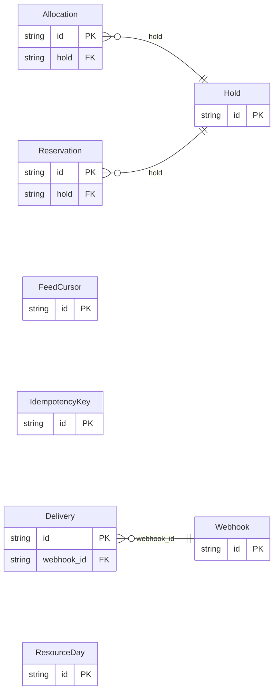

<!-- Copyright 2026 Srikanth K. -->
<!-- SPDX-License-Identifier: Apache-2.0 -->

<!-- Code generated by protoc-gen-store. DO NOT EDIT. -->

# `freebusy/` — Prisma schema

Generated from Protobuf by protoc-gen-store. Source of truth is the `.proto` files — regenerate rather than editing.

| Models | Enums |
| ---: | ---: |
| 8 | 6 |

## Entity relationships

## Subfolders

- [`allocation/`](./allocation/README.md)
- [`reservation/`](./reservation/README.md)
- [`shared/`](./shared/README.md)
- [`webhook/`](./webhook/README.md)
