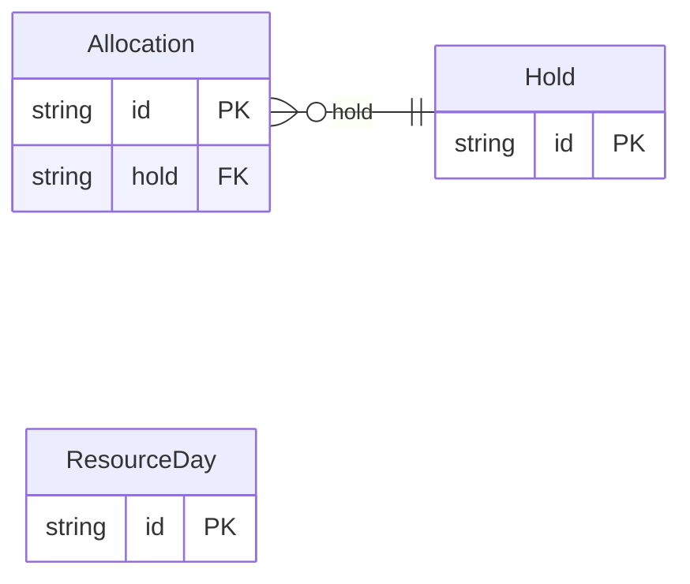

<!-- Copyright 2026 Srikanth K. -->
<!-- SPDX-License-Identifier: Apache-2.0 -->

<!-- Code generated by protoc-gen-store. DO NOT EDIT. -->

# `freebusy/allocation/` — Prisma schema

Generated from Protobuf by protoc-gen-store. Source of truth is the `.proto` files — regenerate rather than editing.

| Models | Enums |
| ---: | ---: |
| 3 | 1 |

## Entity relationships

## Subfolders

- [`allocation/`](./allocation/README.md)
- [`enums/`](./enums/README.md)
- [`resource_day/`](./resource_day/README.md)
