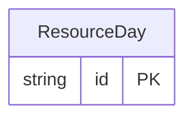

<!-- Copyright 2026 Srikanth K. -->
<!-- SPDX-License-Identifier: Apache-2.0 -->

<!-- Code generated by protoc-gen-store. DO NOT EDIT. -->

# `freebusy/allocation/resource_day/` — Prisma schema

Generated from Protobuf by protoc-gen-store. Source of truth is the `.proto` files — regenerate rather than editing.

| Models | Enums |
| ---: | ---: |
| 1 | 0 |

## Entity relationships

Schema file: [`resource_day.postgres.prisma`](./resource_day.postgres.prisma)

### `ResourceDay` → `resource_days`

A ResourceDay is one resource's standing free time on one UTC day: the availability read model SearchAvailability, ComputeAvailability, CheckAvailability and CreateHold read their candidates from, instead of evaluating every resource an operator has. Storage-only, and derived: no RPC takes or returns it. It is a projection of the resources, their sites, calendars, RFC 7953 availability, RFC 5545 events and the claims of converted holds, rewritten in the same transaction as every write to those (on Hasura, a single write projects in a request of its own right after it), for every day of a rolling horizon. `free` is offered time less booked time; live holds are not subtracted, and neither is a resource's booking policy applied, because both change with the clock. The engine evaluates every candidate the projection returns before answering, so an answer never depends on the projection being current; a stale row can only make a search miss a resource or read one it then drops.

| Column | Type | Null |
| --- | --- | --- |
| `id` | `TEXT` | not null |
| `resource` | `TEXT` | not null |
| `organization` | `TEXT` | not null |
| `organizational_unit` | `TEXT` | not null |
| `day` | `DATE` | not null |
| `free` | `TSTZMULTIRANGE` | not null |
| `resource_types` | `TEXT[]` | not null |
| `attributes` | `JSONB` | not null |
| `calendar` | `TEXT` | not null |
| `display_name` | `TEXT` | not null |
| `free_fraction` | `DOUBLE PRECISION` | not null |
| `row_version` | `BIGINT` | not null |
