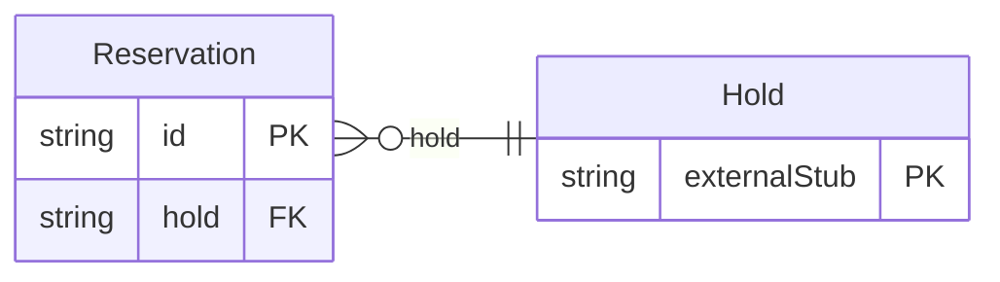

<!-- Code generated by protoc-gen-store. DO NOT EDIT. -->

# `freebusy/reservation/reservation/` — Prisma schema

Generated from Protobuf by protoc-gen-store. Source of truth is the `.proto` files — regenerate rather than editing.

| Models | Enums |
| ---: | ---: |
| 1 | 0 |

## Entity relationships

Schema file: [`reservation.postgres.prisma`](./reservation.postgres.prisma)

### `Reservation` → `resource`

A Reservation is a confirmed booking: a hold made permanent. It is the last step of booking, not the first. The caller checks availability, takes a hold, settles whatever its vertical needs settled -- payment, a guest list, a waiver -- and then creates a reservation from the hold. The reservation records the outcome; the engine already holds the resources. Deliberately thin. Price, discount, promo code, refund, guests and occupancy are what would make it a hotel booking, and none of them is here: money belongs to the payment service and people to the user service, both referenced by name (AIP-215), and anything else a vertical needs to remember rides in `attributes`.

| Column | Type | Null |
| --- | --- | --- |
| `id` | `CHAR(26)` | not null |
| `name` | `VARCHAR(255)` | not null |
| `hold` | `CHAR(26)` | not null |
| `start_time` | `TIMESTAMPTZ` | nullable |
| `end_time` | `TIMESTAMPTZ` | nullable |
| `customer` | `VARCHAR(255)` | nullable |
| `state` | `ReservationState` | nullable |
| `attributes` | `JSONB` | nullable |
| `cancel_reason` | `VARCHAR(255)` | nullable |
| `create_time` | `TIMESTAMPTZ` | not null |
| `update_time` | `TIMESTAMPTZ` | not null |
| `confirm_time` | `TIMESTAMPTZ` | nullable |
| `cancel_time` | `TIMESTAMPTZ` | nullable |
| `etag` | `VARCHAR(255)` | nullable |
| `replaces` | `VARCHAR(255)` | nullable |
| `replacement` | `VARCHAR(255)` | nullable |
| `organizational_unit_id` | `CHAR(26)` | not null |
| `resources` | `VARCHAR(255)[]` | nullable |
