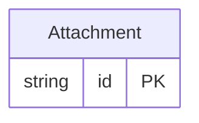

<!-- Code generated by protoc-gen-store. DO NOT EDIT. -->

# `freebusy/shared/types/` — Prisma schema

Generated from Protobuf by protoc-gen-store. Source of truth is the `.proto` files — regenerate rather than editing.

| Models | Enums |
| ---: | ---: |
| 1 | 0 |

## Entity relationships

Schema file: [`types.postgres.prisma`](./types.postgres.prisma)

### `Attachment` → `attachments`

An uploaded file attached to a document- or licence-carrying record (e.g. a guest's IdDocument scan, or a property/unit licence certificate). The bytes are stored inline in `content` today; `uri` is populated once the file is migrated to object storage (S3 or any CDN-fronted host). At most one of the two is authoritative at a time — prefer `uri` when both are set.

| Column | Type | Null |
| --- | --- | --- |
| `id` | `CHAR(26)` | not null |
| `filename` | `VARCHAR(255)` | nullable |
| `mime_type` | `VARCHAR(255)` | nullable |
| `size_bytes` | `BIGINT` | nullable |
| `content` | `BYTEA` | nullable |
| `uri` | `VARCHAR(255)` | nullable |
| `upload_time` | `TIMESTAMPTZ` | nullable |
