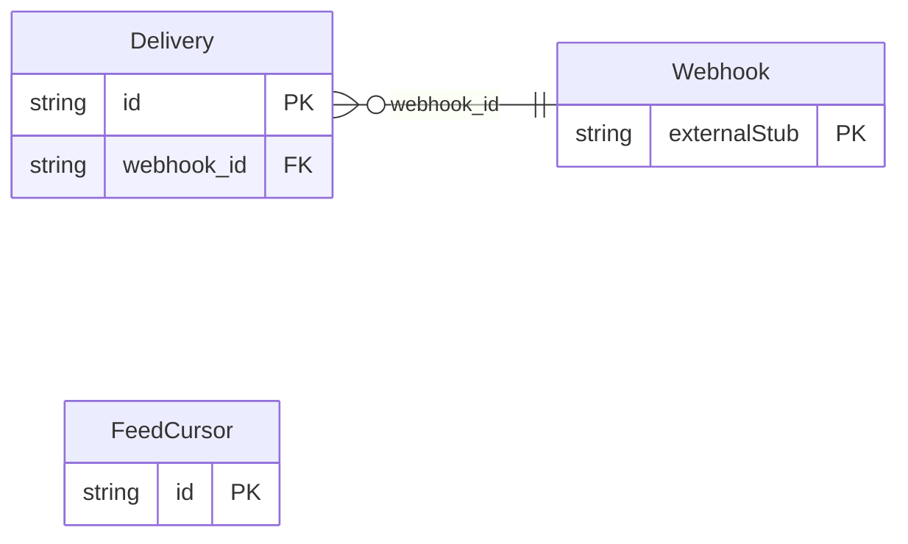

<!-- Copyright 2026 Srikanth K. -->
<!-- SPDX-License-Identifier: Apache-2.0 -->

<!-- Code generated by protoc-gen-store. DO NOT EDIT. -->

# `freebusy/webhook/delivery/` — Prisma schema

Generated from Protobuf by protoc-gen-store. Source of truth is the `.proto` files — regenerate rather than editing.

| Models | Enums |
| ---: | ---: |
| 2 | 0 |

## Entity relationships

Schema file: [`delivery.postgres.prisma`](./delivery.postgres.prisma)

### `Delivery` → `deliveries`

One event owed to one webhook, and how sending it went. The id is derived, not random: a digest of the webhook and the event, so recording the same change twice -- a rescan, or two servers scanning at once -- loses the race on the primary key instead of sending the event twice.

| Column | Type | Null |
| --- | --- | --- |
| `id` | `CHAR(26)` | not null |
| `name` | `VARCHAR(255)` | not null |
| `event_id` | `VARCHAR(255)` | nullable |
| `event_type` | `VARCHAR(255)` | nullable |
| `subject` | `VARCHAR(255)` | nullable |
| `payload` | `VARCHAR(255)` | nullable |
| `state` | `DeliveryState` | nullable |
| `attempt_count` | `INTEGER` | nullable |
| `next_attempt_time` | `TIMESTAMPTZ` | nullable |
| `response_code` | `INTEGER` | nullable |
| `error_message` | `VARCHAR(255)` | nullable |
| `create_time` | `TIMESTAMPTZ` | not null |
| `update_time` | `TIMESTAMPTZ` | not null |
| `deliver_time` | `TIMESTAMPTZ` | nullable |
| `etag` | `VARCHAR(255)` | nullable |
| `webhook_id` | `CHAR(26)` | not null |

### `FeedCursor` → `feed_cursors`

How far the dispatcher has read one change feed: every record of the feed last modified before position_time has been recorded for every webhook. Storage only -- no service exposes it.

| Column | Type | Null |
| --- | --- | --- |
| `id` | `CHAR(26)` | not null |
| `name` | `VARCHAR(255)` | not null |
| `position_time` | `TIMESTAMPTZ` | not null |
| `update_time` | `TIMESTAMPTZ` | not null |
| `etag` | `VARCHAR(255)` | nullable |
