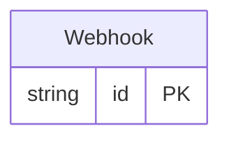

<!-- Copyright 2026 Srikanth K. -->
<!-- SPDX-License-Identifier: Apache-2.0 -->

<!-- Code generated by protoc-gen-store. DO NOT EDIT. -->

# `freebusy/webhook/webhook/` — Prisma schema

Generated from Protobuf by protoc-gen-store. Source of truth is the `.proto` files — regenerate rather than editing.

| Models | Enums |
| ---: | ---: |
| 1 | 0 |

## Entity relationships

Schema file: [`webhook.postgres.prisma`](./webhook.postgres.prisma)

### `Webhook` → `resource`

A Webhook sends an HTTPS endpoint each change to holds, reservations and the inventory they draw on -- resources, calendars, calendar events and availability -- as a signed CloudEvent: how a payment service learns a hold lapsed, or a booking layer that a reservation was confirmed or a court was closed for maintenance, without polling. Changes are read from the records themselves, not announced by the writes, so a change cannot be lost to a crash between a write and its announcement. The price is coalescing: two transitions of one record in quick succession may arrive as one event carrying the later state. Every event carries the whole record, so a receiver acts on what is, not on a diff.

| Column | Type | Null |
| --- | --- | --- |
| `id` | `CHAR(26)` | not null |
| `name` | `VARCHAR(255)` | not null |
| `display_name` | `VARCHAR(255)` | nullable |
| `uri` | `VARCHAR(255)` | not null |
| `event_types` | `VARCHAR(255)[]` | nullable |
| `state` | `WebhookState` | nullable |
| `secret` | `VARCHAR(255)` | nullable |
| `previous_secret` | `VARCHAR(255)` | nullable |
| `rotate_time` | `TIMESTAMPTZ` | nullable |
| `create_time` | `TIMESTAMPTZ` | not null |
| `update_time` | `TIMESTAMPTZ` | not null |
| `etag` | `VARCHAR(255)` | nullable |
