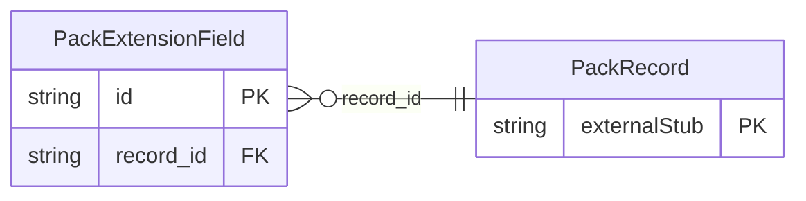

<!-- Code generated by protoc-gen-store. DO NOT EDIT. -->

# `rfc/rfc8428/pack/extension/` — Prisma schema

Generated from Protobuf by protoc-gen-store. Source of truth is the `.proto` files — regenerate rather than editing.

| Models | Enums |
| ---: | ---: |
| 1 | 1 |

## Entity relationships

Schema file: [`extension.postgres.prisma`](./extension.postgres.prisma)

### `PackExtensionField` → `extension_fields`

ExtensionField is one custom SenML Field, RFC 8428 section 4.4 <https://www.rfc-editor.org/rfc/rfc8428.html#section-4.4>. A label and its value, preserved verbatim. Two conventions ride in the label and neither is enforceable here, because both change what a *reader* must do rather than what a writer may send: a label beginning "b" has base semantics and applies to following records the way `base_unit` does (section 12.2 <https://www.rfc-editor.org/rfc/rfc8428.html#section-12.2>), and a label ending "_" is must-understand -- section 4.4 <https://www.rfc-editor.org/rfc/rfc8428.html#section-4.4> says a reader that does not know it MUST raise an error instead of ignoring it. Reference: RFC 8428 "Sensor Measurement Lists (SenML)", section 4.4. https://www.rfc-editor.org/rfc/rfc8428.html#section-4.4

| Column | Type | Null |
| --- | --- | --- |
| `id` | `CHAR(26)` | not null |
| `label` | `VARCHAR(255)` | not null |
| `string_value` | `VARCHAR(255)` | nullable |
| `number_value` | `DOUBLE PRECISION` | nullable |
| `boolean_value` | `BOOLEAN` | nullable |
| `data_value` | `BYTEA` | nullable |
| `value_case` | `PackExtensionFieldValueCase` | nullable |
| `record_id` | `CHAR(26)` | not null |

### Enums

- `PackExtensionFieldValueCase`: STRING_VALUE, NUMBER_VALUE, BOOLEAN_VALUE, DATA_VALUE
