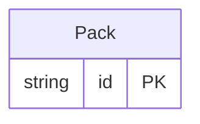

<!-- Code generated by protoc-gen-store. DO NOT EDIT. -->

# `rfc/rfc8428/pack/pack/` — Prisma schema

Generated from Protobuf by protoc-gen-store. Source of truth is the `.proto` files — regenerate rather than editing.

| Models | Enums |
| ---: | ---: |
| 1 | 0 |

## Entity relationships

Schema file: [`pack.postgres.prisma`](./pack.postgres.prisma)

### `Pack` → `resource`

Pack is a SenML Pack: one or more SenML Records in an array, RFC 8428 section 4 <https://www.rfc-editor.org/rfc/rfc8428.html#section-4>. The unit a sensor publishes and a consumer fetches. Section 12.3 <https://www.rfc-editor.org/rfc/rfc8428.html#section-12.3> registers four media types for it -- "application/senml+json", "application/senml+cbor", "application/senml+xml" and "application/senml-exi" -- which is the whole point of the format: one data model, four wire encodings, chosen by how constrained the device and the link are. The four are codecs registered against "the-protobuf-project.org/Pack" in `shared/interchange/v1`, not four schemas. A flat collection, "packs/{pack}". Section 4.7 <https://www.rfc-editor.org/rfc/rfc8428.html#section-4.7> is explicit that SenML carries the minimum dynamic information and that static metadata about the device or sensor is held **out of band**, by CoRE Link Format, so there is no device or sensor resource in this RFC to nest a pack under. Inventing one would assert a containment RFC 8428 <https://www.rfc-editor.org/rfc/rfc8428.html> deliberately declines to define -- the same reasoning that keeps `Resource` flat in rfc9073. What identifies a sensor is instead a *string*: `base_sensor_id` and `sensor_id` concatenated, which section 4.5.1 <https://www.rfc-editor.org/rfc/rfc8428.html#section-4.5.1> requires to be globally unique and constrains to characters usable directly in a URI path. Filter on it with AIP-160 <https://aip.dev/160> rather than looking for a parent in the resource name. Reference: RFC 8428 "Sensor Measurement Lists (SenML)", section 4. https://www.rfc-editor.org/rfc/rfc8428.html#section-4

| Column | Type | Null |
| --- | --- | --- |
| `id` | `CHAR(26)` | not null |
| `name` | `VARCHAR(255)` | not null |
| `uid` | `VARCHAR(255)` | nullable |
| `base_version` | `INTEGER` | nullable |
| `resolved` | `BOOLEAN` | nullable |
| `create_time` | `TIMESTAMPTZ` | not null |
| `update_time` | `TIMESTAMPTZ` | not null |
| `etag` | `VARCHAR(255)` | nullable |
| `delete_time` | `TIMESTAMPTZ` | nullable |
| `expire_time` | `TIMESTAMPTZ` | nullable |
