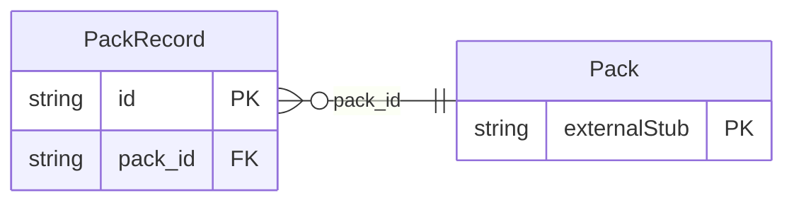

<!-- Code generated by protoc-gen-store. DO NOT EDIT. -->

# `rfc/rfc8428/pack/types/` — Prisma schema

Generated from Protobuf by protoc-gen-store. Source of truth is the `.proto` files — regenerate rather than editing.

| Models | Enums |
| ---: | ---: |
| 1 | 1 |

## Entity relationships

Schema file: [`types.postgres.prisma`](./types.postgres.prisma)

### `PackRecord` → `records`

Record is one SenML Record: a single measurement or configuration instance in time, RFC 8428 section 4 <https://www.rfc-editor.org/rfc/rfc8428.html#section-4>. A record carries two kinds of field. **Base fields** (section 4.1 <https://www.rfc-editor.org/rfc/rfc8428.html#section-4.1>, the `base_` prefix here) apply to this record and to every record after it in the Pack, up to but not including the next record carrying that same base field. **Regular fields** (section 4.2 <https://www.rfc-editor.org/rfc/rfc8428.html#section-4.2>) apply only to the record they appear in. Both kinds may appear in any record. A record is therefore not self-describing: reading one in isolation gives the wrong sensor, the wrong time and possibly the wrong unit, because the base values that complete it live in an earlier sibling. Section 4.6 <https://www.rfc-editor.org/rfc/rfc8428.html#section-4.6> calls a record with the base values already folded in **resolved**, and `Packs.ResolvePack` is that operation. One measurement per record, deliberately: section 4.5.4 <https://www.rfc-editor.org/rfc/rfc8428.html#section-4.5.4> says values measured together -- air pressure and altitude, latitude and longitude -- belong in separate records correlated by their time, not in one record with several values. Reference: RFC 8428 "Sensor Measurement Lists (SenML)", section 4. https://www.rfc-editor.org/rfc/rfc8428.html#section-4

| Column | Type | Null |
| --- | --- | --- |
| `id` | `CHAR(26)` | not null |
| `base_sensor_id` | `VARCHAR(255)` | nullable |
| `base_time_value` | `DOUBLE PRECISION` | nullable |
| `base_unit` | `VARCHAR(255)` | nullable |
| `base_value` | `DOUBLE PRECISION` | nullable |
| `base_sum` | `DOUBLE PRECISION` | nullable |
| `sensor_id` | `VARCHAR(255)` | nullable |
| `unit` | `VARCHAR(255)` | nullable |
| `sum` | `DOUBLE PRECISION` | nullable |
| `time_value` | `DOUBLE PRECISION` | nullable |
| `update_duration` | `INTERVAL` | nullable |
| `number_value` | `DOUBLE PRECISION` | nullable |
| `string_value` | `VARCHAR(255)` | nullable |
| `boolean_value` | `BOOLEAN` | nullable |
| `data_value` | `BYTEA` | nullable |
| `value_case` | `PackRecordValueCase` | nullable |
| `pack_id` | `CHAR(26)` | not null |

### Enums

- `PackRecordValueCase`: NUMBER_VALUE, STRING_VALUE, BOOLEAN_VALUE, DATA_VALUE
