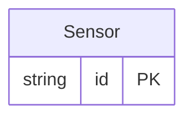

<!-- Copyright 2026 Srikanth K. -->
<!-- SPDX-License-Identifier: Apache-2.0 -->

<!-- Code generated by protoc-gen-store. DO NOT EDIT. -->

# `rfc/rfc8428/sensor/sensor/` — Prisma schema

Generated from Protobuf by protoc-gen-store. Source of truth is the `.proto` files — regenerate rather than editing.

| Models | Enums |
| ---: | ---: |
| 1 | 0 |

## Entity relationships

Schema file: [`sensor.postgres.prisma`](./sensor.postgres.prisma)

### `Sensor` → `resource`

Sensor is the thing a SenML Record names: what is being measured, and where to reach it. **Native: no RFC defines it, and under the rules of this repository that demands a reason rather than a citation.** The reason is that RFC 8428 names this gap and then declines to fill it. Section 4.5.1 <https://www.rfc-editor.org/rfc/rfc8428.html#section-4.5.1> requires the concatenated SenML name to be "a globally unique identifier for the resource" -- so the sensor has identity, in the RFC's own words. Section 4.7 <https://www.rfc-editor.org/rfc/rfc8428.html#section-4.7> then says SenML deliberately carries no static metadata about the device, object or sensor, "for efficiency reasons", and that such metadata "is carried out of band", pointing at the CoRE Link Format (RFC 6690 <https://www.rfc-editor.org/rfc/rfc6690.html>). A pack therefore tells you a reading came from "urn:dev:ow:10e2073a01080063" and nothing whatever about it. This resource is that out-of-band half, and it is **ours**. RFC 8428 defines a *name format* for a sensor, not a sensor. It sits under `rfc8428/` anyway, which is rule 5's one written exception -- see `CLAUDE.md`. The rule keeps a native type out of an `rfc*/` directory so the path cannot lend it authority it has not earned, and that risk is real here: **nothing on this message comes from RFC 8428.** What outweighs it is that the resource is meaningless apart from SenML. Its identity field is a section 4.5.1 <https://www.rfc-editor.org/rfc/rfc8428.html#section-4.5.1> name, its unit is a section 12.1 <https://www.rfc-editor.org/rfc/rfc8428.html#section-12.1> unit, and the gap it fills is one section 4.7 <https://www.rfc-editor.org/rfc/rfc8428.html#section-4.7> names. Filed away from the packs it exists to annotate, it reads as a general-purpose sensor registry, which it is not. This comment is the substitute for the path: the authority is borrowed, and the borrowing is stated rather than implied. The fields below are the CoRE Link Format attributes section 4.7 <https://www.rfc-editor.org/rfc/rfc8428.html#section-4.7> points at, because inventing a different vocabulary for the same job would be worse than borrowing a specified one. Each cites RFC 6690 <https://www.rfc-editor.org/rfc/rfc6690.html>; none of that makes this message RFC 6690's, which defines a link serialisation and not a resource either. Not linked to `Pack` by a resource reference. A record names a sensor with a *string* -- `base_sensor_id` and `sensor_id` concatenated -- and that string is `senml_id` here. Joining the two is a lookup, not a foreign key, because a pack that arrives for an unregistered sensor is ordinary and must not be rejected.

| Column | Type | Null |
| --- | --- | --- |
| `id` | `CHAR(26)` | not null |
| `name` | `VARCHAR(255)` | not null |
| `uid` | `VARCHAR(255)` | nullable |
| `senml_id` | `VARCHAR(255)` | not null |
| `display_name` | `VARCHAR(255)` | nullable |
| `target_uri` | `VARCHAR(255)` | nullable |
| `resource_types` | `VARCHAR(255)[]` | nullable |
| `interface_descriptions` | `VARCHAR(255)[]` | nullable |
| `media_types` | `VARCHAR(255)[]` | nullable |
| `unit` | `VARCHAR(255)` | nullable |
| `update_duration` | `INTERVAL` | nullable |
| `create_time` | `TIMESTAMPTZ` | not null |
| `update_time` | `TIMESTAMPTZ` | not null |
| `etag` | `VARCHAR(255)` | nullable |
| `delete_time` | `TIMESTAMPTZ` | nullable |
| `expire_time` | `TIMESTAMPTZ` | nullable |
