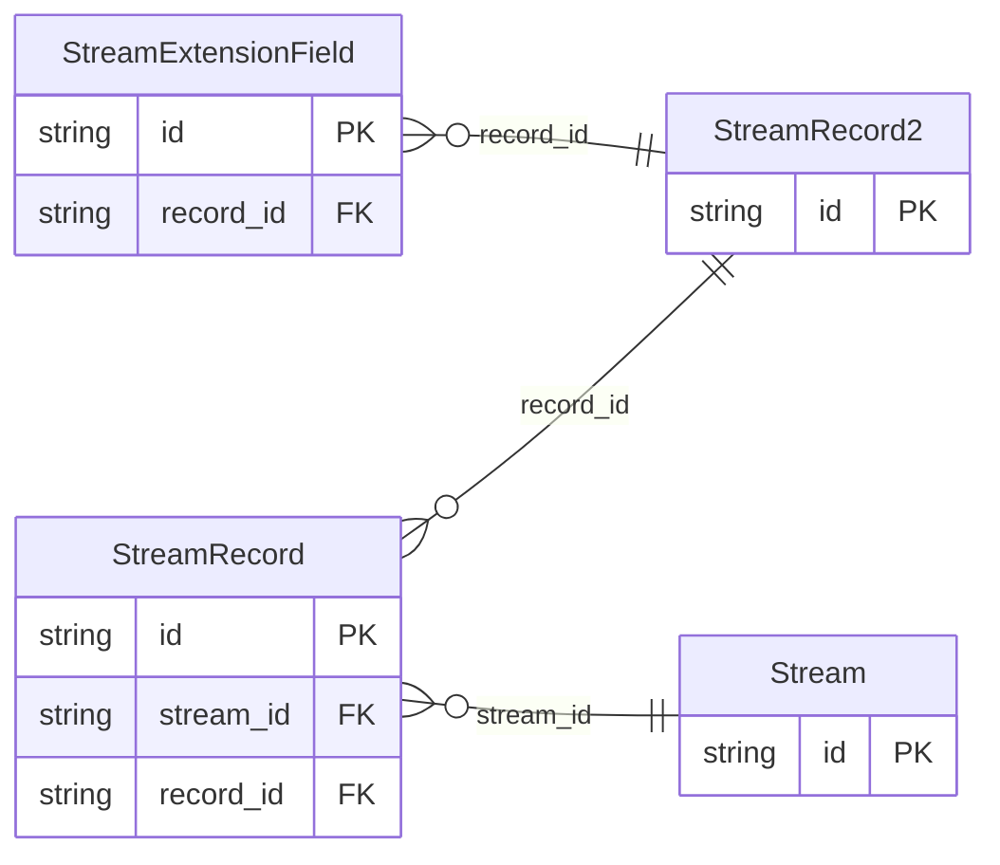

<!-- Copyright 2026 Srikanth K. -->
<!-- SPDX-License-Identifier: Apache-2.0 -->

<!-- Code generated by protoc-gen-store. DO NOT EDIT. -->

# `rfc/rfc8428/stream/` — Prisma schema

Generated from Protobuf by protoc-gen-store. Source of truth is the `.proto` files — regenerate rather than editing.

| Models | Enums |
| ---: | ---: |
| 4 | 2 |

## Entity relationships

## Subfolders

- [`extension/`](./extension/README.md)
- [`stream/`](./stream/README.md)
- [`types/`](./types/README.md)
