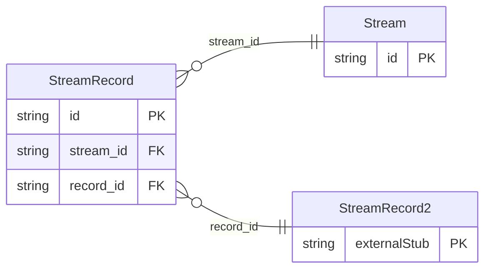

<!-- Code generated by protoc-gen-store. DO NOT EDIT. -->

# `rfc/rfc8428/stream/stream/` — Prisma schema

Generated from Protobuf by protoc-gen-store. Source of truth is the `.proto` files — regenerate rather than editing.

| Models | Enums |
| ---: | ---: |
| 2 | 0 |

## Entity relationships

Schema file: [`stream.postgres.prisma`](./stream.postgres.prisma)

### `Stream` → `resource`

Stream is a Sensor Streaming Measurement List, RFC 8428 section 4.8 <https://www.rfc-editor.org/rfc/rfc8428.html#section-4.8>. The same records a Pack holds, collected over time instead of all at once. Section 4.8 <https://www.rfc-editor.org/rfc/rfc8428.html#section-4.8> registers four media types of its own for this -- "application/sensml+json", "application/sensml+cbor", "application/sensml+xml" and "application/sensml-exi", section 12.3.2 <https://www.rfc-editor.org/rfc/rfc8428.html#section-12.3.2> onward -- and requires a system using SenML this way to say so, because a consumer may read each record as it arrives rather than waiting for the whole thing to close. **A separate resource from Pack, for one reason that is not cosmetic.** Section 4.8 <https://www.rfc-editor.org/rfc/rfc8428.html#section-4.8> resolves a relative time against when *that record* was sent, where a Pack resolves every relative time against when the pack was. A pack is one instant; a stream is one instant per record. Storing a stream as a Pack would collapse those into a single "now" and silently move every reading in it -- section 4.5.3 <https://www.rfc-editor.org/rfc/rfc8428.html#section-4.5.3> puts that error at anything from a millisecond to a dozen minutes. `StreamRecord` is where the per-record instant lives, and it is the whole reason this package exists. Reference: RFC 8428 "Sensor Measurement Lists (SenML)", section 4.8. https://www.rfc-editor.org/rfc/rfc8428.html#section-4.8

| Column | Type | Null |
| --- | --- | --- |
| `id` | `CHAR(26)` | not null |
| `name` | `VARCHAR(255)` | not null |
| `uid` | `VARCHAR(255)` | nullable |
| `base_version` | `INTEGER` | nullable |
| `closed` | `BOOLEAN` | nullable |
| `create_time` | `TIMESTAMPTZ` | not null |
| `update_time` | `TIMESTAMPTZ` | not null |
| `etag` | `VARCHAR(255)` | nullable |
| `delete_time` | `TIMESTAMPTZ` | nullable |
| `expire_time` | `TIMESTAMPTZ` | nullable |

### `StreamRecord` → `records_link`

StreamRecord is one record of a stream together with the instant it was sent, RFC 8428 section 4.8 <https://www.rfc-editor.org/rfc/rfc8428.html#section-4.8>. The pairing exists because section 4.8 <https://www.rfc-editor.org/rfc/rfc8428.html#section-4.8> says a relative time in a stream is read against "the time when the specific Record is sent in the stream". A `Record` alone cannot carry that: its own `time_value` is the offset being interpreted, not the instant to interpret it against. A wrapper rather than a field added to the copied `Record`, so the copy stays byte-identical to `protobuf.rfc8428.pack.v1.Record` and the two cannot drift. The difference between a pack and a stream then lives in exactly one place -- here -- which is where section 4.8 <https://www.rfc-editor.org/rfc/rfc8428.html#section-4.8> puts it too. Reference: RFC 8428 "Sensor Measurement Lists (SenML)", section 4.8. https://www.rfc-editor.org/rfc/rfc8428.html#section-4.8

| Column | Type | Null |
| --- | --- | --- |
| `id` | `CHAR(26)` | not null |
| `reference_time_value` | `DOUBLE PRECISION` | nullable |
| `stream_id` | `CHAR(26)` | not null |
| `record_id` | `CHAR(26)` | not null |
