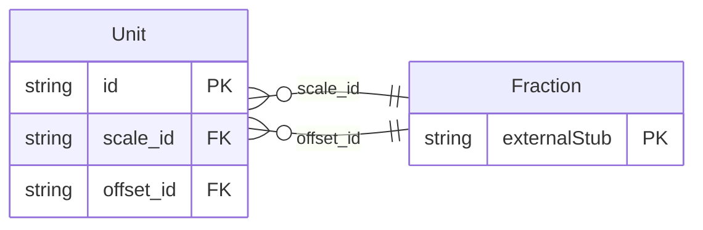

<!-- Code generated by protoc-gen-store. DO NOT EDIT. -->

# `rfc/rfc8428/unit/unit/` — Prisma schema

Generated from Protobuf by protoc-gen-store. Source of truth is the `.proto` files — regenerate rather than editing.

| Models | Enums |
| ---: | ---: |
| 1 | 0 |

## Entity relationships

Schema file: [`unit.postgres.prisma`](./unit.postgres.prisma)

### `Unit` → `resource`

Unit is one entry in the SenML Units registry, RFC 8428 section 12.1 <https://www.rfc-editor.org/rfc/rfc8428.html#section-12.1>, or in the Secondary Units subregistry RFC 8798 section 3 <https://www.rfc-editor.org/rfc/rfc8798.html#section-3> adds to it. One resource for both, because RFC 8798 <https://www.rfc-editor.org/rfc/rfc8798.html> says they are one registry: its section 3 <https://www.rfc-editor.org/rfc/rfc8798.html#section-3> opens "IANA has created a 'Secondary Units' subregistry in the 'Sensor Measurement Lists (SenML)' registry defined in RFC 8428". That sentence is also why this package sits under `rfc8428/` and not `rfc8798/`: rule 6 gives a directory to the **defining** RFC, and 8798 refines a registry 8428 created. A primary entry and a secondary one differ by `senml_unit`. A primary unit stands alone -- "Cel" is degrees Celsius and converts to nothing. A secondary unit names the primary it derives from and carries the two numbers that get you there. **Why this is a resource and not a constant table.** RFC 8798 section 4 <https://www.rfc-editor.org/rfc/rfc8798.html#section-4> asks for it in as many words: the subregistry "is expected to grow at a faster pace" than the primary one, it "is amenable to automatic interpretation, by making use of the scale and offset columns", and implementations SHOULD **not** each poll IANA -- they should receive updated registries "via common repositories". A deployment holding its own copy, addressable and updatable, is that common repository. An enum would be the opposite: frozen at the moment this schema shipped, rejecting every unit registered since. Reference: RFC 8428 "Sensor Measurement Lists (SenML)", section 12.1. https://www.rfc-editor.org/rfc/rfc8428.html#section-12.1

| Column | Type | Null |
| --- | --- | --- |
| `id` | `CHAR(26)` | not null |
| `name` | `VARCHAR(255)` | not null |
| `uid` | `VARCHAR(255)` | nullable |
| `symbol` | `VARCHAR(255)` | not null |
| `description` | `VARCHAR(255)` | nullable |
| `senml_unit` | `VARCHAR(255)` | nullable |
| `reference` | `VARCHAR(255)` | nullable |
| `producing_discouraged` | `BOOLEAN` | nullable |
| `create_time` | `TIMESTAMPTZ` | not null |
| `update_time` | `TIMESTAMPTZ` | not null |
| `etag` | `VARCHAR(255)` | nullable |
| `delete_time` | `TIMESTAMPTZ` | nullable |
| `expire_time` | `TIMESTAMPTZ` | nullable |
| `scale_id` | `CHAR(26)` | nullable |
| `offset_id` | `CHAR(26)` | nullable |
