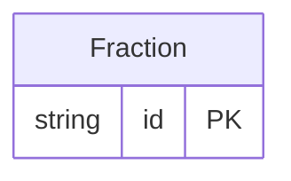

<!-- Copyright 2026 Srikanth K. -->
<!-- SPDX-License-Identifier: Apache-2.0 -->

<!-- Code generated by protoc-gen-store. DO NOT EDIT. -->

# `rfc/type/fraction/` — Prisma schema

Generated from Protobuf by protoc-gen-store. Source of truth is the `.proto` files — regenerate rather than editing.

| Models | Enums |
| ---: | ---: |
| 1 | 0 |

## Entity relationships

Schema file: [`fraction.postgres.prisma`](./fraction.postgres.prisma)

### `Fraction` → `fractions`

Represents a fraction in terms of a numerator divided by a denominator.

| Column | Type | Null |
| --- | --- | --- |
| `id` | `CHAR(26)` | not null |
| `numerator` | `BIGINT` | nullable |
| `denominator` | `BIGINT` | nullable |
